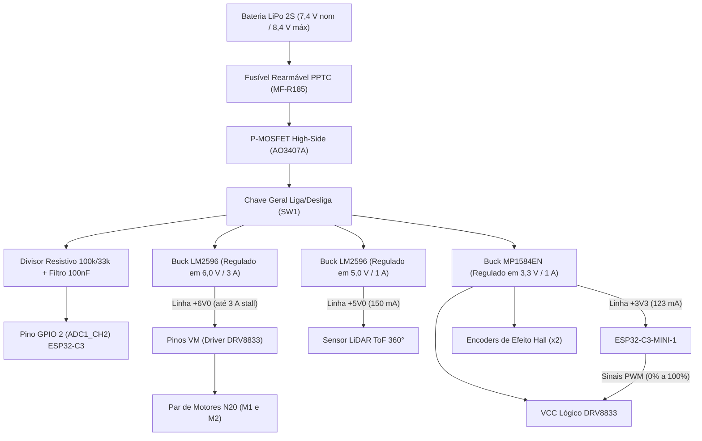

# Análise de Consumo Energético e Arquitetura de Potência

---

## 1. Identificação dos Subsistemas Elétricos

A arquitetura do Micromouse organiza a distribuição de potência e os níveis lógicos a partir da fonte principal de alimentação. O subsistema elétrico divide-se em barramentos de potência e barramentos de regulação chaveada. O perfil de carga foi levantado com base nas especificações dos componentes e nas medições preliminares.

Para o dimensionamento da autonomia contínua, padronizou-se o ciclo de missão unitário em **600 segundos (10 minutos)** de exploração e tomada de tempo, e a missão estendida de homologação em **1.800 segundos (30 minutos)** para cumprir a resolução consecutiva dos 3 labirintos da competição (**RNF-04**).

* **ESP32-C3-MINI-1 (MCU e Telemetria):** Opera sob linha regulada de 3,3 V derivada de conversor Buck de alta frequência (MP1584EN). Consumo médio nominal de **110 mA (0,11 A)** em processamento de controle e transmissões periódicas de rádio.
* **Motores DC GA12-N20 com Redução (Par de Atuadores M1 e M2):** Tensão nominal de catálogo de 6,0 V, alimentados por linha regulada dedicada de +6,0 V gerada por conversor Buck LM2596 de 3 A conectado aos pinos VM do driver DRV8833. Consumo médio dinâmico em piso de corrida estimado em **0,15 A por motor (0,30 A conjunto)**, com picos de travamento (*stall*) de até **~1,5 A por motor (~3,0 A conjunto)**.
* **Driver Ponte H Dupla (DRV8833 - Lógica de Controle):** Alimentação lógica e pinos de sinal PWM a 3,3 V comutados pelos GPIOs do microcontrolador. Apresenta consumo quiescente de **3 mA (0,003 A)**.
* **Encoders Incrementais de Efeito Hall (2 unidades):** Conectados via interrupções de quadratura aos GPIOs do MCU e alimentados pela linha de 3,3 V. Consumo conjunto estimado em **10 mA (0,01 A)**.
* **Sensor LiDAR ToF 360° (Sensoriamento Primário de Pista):** Opera com linha dedicada de alimentação de 5,0 V (+5V0) derivada de conversor Buck LM2596 e interface serial UART. Apresenta consumo nominal médio de **150 mA (0,15 A)** em rotação contínua e varredura óptica.

---

## 2. Cálculo da Energia Consumida por Componente

O cálculo de energia elétrica em regime de corrente contínua adota a relação fundamental:

$$E = V \cdot I \cdot t$$

Onde:
* $E$ = Energia em joules (J)
* $V$ = Tensão de alimentação do subsistema em volts (V)
* $I$ = Corrente média consumida em ampères (A)
* $t$ = Tempo operacional de missão unitária ($t = 600\text{ s} = 10\text{ min}$)

| Componente / Subsistema | Tensão ($V$) | Corrente Média ($I$) | Tempo ($t$) | Energia Consumida ($E$) |
| :--- | :---: | :---: | :---: | :---: |
| ESP32-C3-MINI-1 | 3,3 V | 0,110 A | 600 s | 217,80 J |
| Motores DC N20 (Par M1 + M2) | 6,0 V | 0,300 A | 600 s | 1.080,00 J |
| Driver DRV8833 (Lógica) | 3,3 V | 0,003 A | 600 s | 5,94 J |
| Encoders Incrementais (Par) | 3,3 V | 0,010 A | 600 s | 19,80 J |
| Sensor LiDAR ToF 360° | 5,0 V | 0,150 A | 600 s | 450,00 J |

---

## 3. Estimativa do Consumo Total de Energia

A demanda energética líquida total calculada para um ciclo unitário de 10 minutos de missão ($E_{\text{total}}$) é obtida pela soma das parcelas energéticas de cada componente:

$$E_{\text{total}} = 217,80 + 1080,00 + 5,94 + 19,80 + 450,00 = \mathbf{1.773,54\text{ J}}$$

Convertendo para Watt-hora (Wh) utilizando a equivalência padrão ($1\text{ Wh} = 3600\text{ J}$):

$$E_{\text{Wh}} = \frac{E_{\text{total}}}{3600} = \frac{1773,54}{3600} \approx \mathbf{0,493\text{ Wh}}$$

---

## 4. Escolha e Dimensionamento da Fonte de Alimentação

### 4.1 Margem de Segurança e Eficiência Energética
Para robôs móveis autônomos de labirinto, adota-se uma margem de segurança de **40%**, combinada com um rendimento médio de **85%** ($\eta = 0{,}85$) dos conversores chaveados Buck da placa. Essa folga de projeto sustenta:
1. **Transientes Dinâmicos:** As partidas, frenagens e rotações rápidas dos motores elevam a corrente momentânea muito acima do patamar nominal de regime permanente.
2. **Perdas Térmicas nos Conversores:** O chaveamento e a resistência parasita das bobinas e diodos internos dos reguladores Step-Down degradam parte da potência útil em calor.
3. **Preservação Química da Célula:** Células à base de lítio sofrem danos de capacidade irreversíveis quando descarregadas abaixo de 20% de sua reserva total (profundidade de descarga limite de 80% DoD).

A energia total demandada na fonte para uma corrida unitária de 10 minutos é:

$$E_{\text{necessária}} = \frac{E_{\text{Wh}}}{\eta \cdot (1 - \text{Margem})} = \frac{0,493}{0,85 \cdot (1 - 0,40)} \approx \mathbf{0,967\text{ Wh}}$$

### 4.2 Capacidade Mínima Teórica Requerida
Adotando topologia recarregável **LiPo 2S** com tensão nominal de $V_{\text{nominal}} = 7{,}4\text{ V}$ (8,4 V em plena carga e corte de subtensão operacional em 6,6 V / 3,3 V por célula):

$$\text{Capacidade Teórica (Ah)} = \frac{E_{\text{necessária}}}{V_{\text{nominal}}} = \frac{0,967\text{ Wh}}{7,4\text{ V}} \approx 0,1306\text{ Ah} \implies \mathbf{130\text{ mAh}}$$

### 4.3 Validação de Autonomia para os 3 Labirintos Consecutivos (RNF-04)
O requisito **RNF-04** exige autonomia ininterrupta para completar as 3 configurações de labirinto da competição (4×4, 8×4 e 12×4 células), cada uma com teto regulamentar de 10 minutos (**RNF-03**), totalizando **30 minutos contínuos ($t_{\text{total}} = 1.800\text{ s} = 0{,}5\text{ h}$)** no pior cenário de estresse.

Calculando a potência média drenada da bateria sob rendimento de 85% dos conversores chaveados Buck:
* Potência útil das cargas lógicas e sensores (+5V0 e +3V3): $P_{\text{lógica}} \approx 1{,}19\text{ W} \implies P_{\text{fonte, lógica}} = \frac{1,19}{0,85} \approx 1{,}40\text{ W}$
* Potência útil dos motores sob linha regulada de +6V0 ($I = 0{,}30\text{ A}$ contínuo): $P_{\text{motores}} = 6{,}0\text{ V} \cdot 0{,}30\text{ A} = 1{,}80\text{ W} \implies P_{\text{fonte, motores}} = \frac{1,80}{0,85} \approx 2{,}12\text{ W}$
* **Potência média total drenada da bateria:** $P_{\text{bat\_total}} \approx 1{,}40 + 2{,}12 = \mathbf{3{,}52\text{ W}}$

A corrente média contínua consumida do barramento de 7,4 V nominal é:

$$I_{\text{bat\_médio}} = \frac{P_{\text{bat\_total}}}{V_{\text{nominal}}} = \frac{3{,}52\text{ W}}{7,4\text{ V}} \approx \mathbf{0{,}476\text{ A}} \ (\mathbf{476\text{ mA}})$$

Portanto, a capacidade consumida durante os 30 minutos ininterruptos de missão é:

$$C_{\text{consumida\_30min}} = I_{\text{bat\_médio}} \cdot 0,5\text{ h} = 476\text{ mA} \cdot 0,5\text{ h} = \mathbf{238\text{ mAh}}$$

Aplicando o fator de segurança química de 80% de profundidade máxima de descarga (DoD):

$$C_{\text{mínima\_30min}} = \frac{238\text{ mAh}}{0,80} = \mathbf{297{,}5\text{ mAh}}$$

---

## 5. Homologação do Pack Comercial Selecionado

Com base no dimensionamento de 130 mAh (missão unitária) e na demanda estendida de 297,5 mAh (3 labirintos), homologa-se formalmente o seguinte pack comercial:

* **Fabricante / Modelo:** **Tattu 650mAh 2S1P 75C 7.4V Lipo Battery Pack with XT30 Plug**
* **Topologia:** Polímero de Lítio (LiPo) 2S1P / 2 Células
* **Tensão:** 7,4 V nominal | 8,4 V em plena carga | 6,6 V corte UVLO
* **Capacidade Nominal:** **650 mAh**
* **Taxa de Descarga Contínua (C-Rating):** **75C** ($48{,}75\text{ A}$ contínuos)
* **Taxa de Descarga de Pico (*Burst*):** **150C** ($97{,}5\text{ A}$ pico)
* **Dimensões Físicas:** **57 mm (Comprimento) × 31 mm (Largura) × 12 mm (Altura)**
* **Massa Líquida:** **43 g (±20 g)**
* **Plugue de Potência / Descarga:** **XT-30**
* **Plugue de Carga / Balanceamento:** **JST-XHR-3P**

### Justificativa Técnica da Homologação:
1. **Margem de Autonomia Real:** Com 650 mAh e respeitando a profundidade máxima de descarga recomendada de 80% (DoD), a bateria disponibiliza **520 mAh úteis**. Sob a corrente média de consumo de 476 mA, a autonomia contínua calculada é de **~65,5 minutos** ($\frac{520\text{ mAh}}{476\text{ mA}} \times 60 \approx 65{,}5\text{ min}$), cobrindo com folga de **+118% de margem** o teto regulamentar de 30 minutos dos 3 labirintos consecutivos (**RNF-04**).
2. **Robustez Contra Queda de Tensão (*Voltage Sag*) e Picos de Stall:** A taxa contínua de 75C permite entrega ininterrupta de até 48,75 A. Mesmo no pior cenário com ambos os motores em travamento de bancada/rampa (*stall* de até ~3,0 A no barramento de 6 V), a demanda refletida na bateria fica em torno de 3,5 A a 4,0 A (menos de 9% da taxa 75C), eliminando qualquer risco de *brownout reset* no microcontrolador ESP32-C3.
3. **Alívio Mecânico:** A massa contida de 43 g reduz a inércia rotacional do conjunto móvel e alivia as cargas radiais sobre os mancais e pinhões metálicos da redução dos motores N20.

---

## 6. Arquitetura de Distribuição de Potência

A distribuição elétrica segrega a malha de acionamento de potência dos circuitos lógicos e de sensoriamento óptico através de topologia em estrela:

---

## 7. Módulos e Subdocumentos Especializados

Para garantir modularidade e rastreabilidade com os ensaios de bancada futuros, o detalhamento do subsistema de energia foi dividido nos seguintes documentos especializados:

| Módulo / Subdocumento | Escopo Técnico Principal | Issue de Origem | Status de Validação |
| :--- | :--- | :---: | :---: |
| **[4.2.1 Proteções de Entrada](energia/protecoes-entrada.md)** | Fusível rearmável PPTC (MF-R185) e P-MOSFET High-Side ativo contra polaridade reversa (AO3407A) | #200 | Teórico consolidado / Bancada pendente |
| **[4.2.2 Reguladores Step-Down (Buck)](energia/reguladores-buck.md)** | Dimensionamento analítico dos três conversores (+6V0 LM2596 3A, +5V0 LM2596 1A, +3V3 MP1584EN), térmico e dropout | #199 | Teórico consolidado / Bancada pendente |
| **[4.2.3 Curva de Descarga e SoC da LiPo](energia/curva-descarga-lipo.md)** | Modelo de Shepherd modificado, curva teórica em Python, tabela SoC vs. Tensão e integração com o firmware | #139 | Teórico consolidado / Bancada pendente |
| **[4.2.4 Monitoramento de Tensão (ADC)](energia/monitoramento-tensao.md)** | Divisor resistivo 100k/33k, filtro anti-aliasing RC (fc ≈ 64 Hz, -50 dB em 20 kHz), calibração do ADC e UVLO | #203 | Teórico consolidado / Bancada pendente |

---

## 8. Referências Bibliográficas

1. **TEXAS INSTRUMENTS.** *LM2596 SIMPLE SWITCHER® Power Converter 150-kHz 3-A Step-Down Voltage Regulator*. Datasheet SNVS124D, Rev. Maio 2020. Disponível em: <https://www.ti.com/lit/ds/symlink/lm2596.pdf>.
2. **MONOLITHIC POWER SYSTEMS (MPS).** *MP1584: 3A, 1.5MHz, 28V Step-Down Converter*. Datasheet Rev. 1.0, 2011. Disponível em: <https://www.monolithicpower.com>.
3. **ESPRESSIF SYSTEMS.** *ESP32-C3-MINI-1 Datasheet*. Versão 1.4, 2024. Disponível em: <https://www.espressif.com>.
4. **TEXAS INSTRUMENTS.** *DRV8833 Dual H-Bridge Motor Driver*. Datasheet SLVSAR1E, Rev. Julho 2015. Disponível em: <https://www.ti.com/lit/ds/symlink/drv8833.pdf>.
5. **BOURNS.** *MF-R Series - PTC Resettable Fuses*. Datasheet Rev. 11/2022. Disponível em: <https://www.bourns.com>.
6. **ALPHA & OMEGA SEMICONDUCTOR.** *AO3407A: 30V P-Channel MOSFET*. Datasheet Rev. 4.0, 2020. Disponível em: <http://www.aosmd.com>.
7. **SHEPHERD, C. M.** *Design of Primary and Secondary Cells - Part 2: An equation describing battery discharge*. Journal of The Electrochemical Society, v. 112, n. 7, p. 657-664, 1965.
8. **TREMBLAY, Olivier; DESSAINT, Louis-A.** *Experimental Validation of a Battery Dynamic Model for EV Applications*. World Electric Vehicle Journal, v. 3, n. 2, p. 289-298, 2009.
9. **TATTU.** *Tattu 650mAh 75C 2S1P Lipo Battery Pack with XT30 Plug Specification Sheet*. Gens Ace & Tattu Battery Co., 2023.
10. **MOHAN, Ned; UNDELAND, Tore M.; ROBBINS, William P.** *Power Electronics: Converters, Applications, and Design*. 3. ed. Nova York: John Wiley & Sons, 2003.

---

## Histórico de Versão

| Versão | Data | Descrição | Autor(es) | Revisor(es) |
| :---: | :---: | :--- | :--- | :--- |
| 1.0 | 05/10/2026 | Estruturação inicial do consumo de energia e dimensionamento da bateria LiPo 2S | Bruno Duarte e Paulo Melo | Equipe Micromouse |
| 1.1 | 10/10/2026 | Atualização das especificações dinâmicas da bateria LiPo e modelo Tattu 650mAh | Paulo Melo | Bruno Duarte |
| 1.2 | 12/10/2026 | Dimensionamento dos reguladores Step-Down LM2596 e MP1584EN, cálculo de componentes passivos, análise térmica | Elias Oliveira | Equipe de Hardware |
| 1.3 | 17/10/2026 | Alinhamento da seção de proteções de entrada com o dimensionamento do PPTC (MF-R185) e P-MOSFET (AO3407A) | Paulo Melo | Equipe de Energia |
| 1.4 | 18/10/2026 | Inclusão do conversor Buck dedicado de 6 V para motores (3 A stall), autonomia para 65,5 min e consolidação | Elias Oliveira | Bruno Duarte |
| 1.5 | 18/10/2026 | Mapeamento da curva de descarga da LiPo 2S (Equação de Shepherd) e tabela SoC para o firmware (#139) | Elias Oliveira | Bruno Duarte |
| 2.0 | 20/10/2026 | Reestruturação e seccionamento modular do documento em subdocumentos especializados no diretório `energia/` | Elias Oliveira | Equipe de Energia |