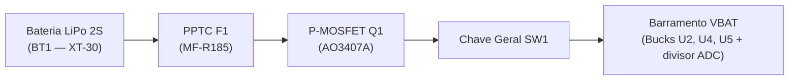

# Chave Geral On/Off (SW1) e Conectores de Potência

---

## 1. Objetivo

Especificar a chave geral liga/desliga (`SW1`) e os elementos do caminho de potência entre a bateria e a placa — conector **XT-30** (`BT1`) e chicote de fios de $0{,}50\text{ mm}^2$ — e registrar a verificação de continuidade da chave em bancada.

A chave fica logo após o estágio de proteção de entrada (ver [4.2.1 Proteções de Entrada](protecoes-entrada.md)) e alimenta todo o barramento `VBAT`:

---

## 2. Corrente que o Caminho de Potência Precisa Suportar

Toda a corrente do robô passa pela chave, pelo conector e pelo chicote. Os valores abaixo vêm de [4.2.1 Proteções de Entrada](protecoes-entrada.md) (seção 2):

| Regime | Corrente no barramento 2S ($I_{\text{BAT}}$) |
| :--- | :---: |
| Nominal (cruzeiro) | $0{,}42\text{ A a }0{,}60\text{ A}$ |
| Pico dinâmico (arrancadas) | $1{,}40\text{ A a }1{,}75\text{ A}$ |
| *Stall* duplo dos motores | $1{,}80\text{ A a }2{,}30\text{ A}$ |
| Limite do PPTC $F1$ ($I_{\text{hold}}$) | $1{,}85\text{ A}$ (desarme $> 3{,}5\text{ A}$) |

Como o PPTC corta acima de $\approx 3{,}5\text{ A}$, **o caminho de potência não precisa conduzir mais que $3{,}5\text{ A}$**, nem por poucos segundos.

---

## 3. Especificação dos Componentes

| Item | Componente | Corrente nominal (catálogo) | Corrente máxima do robô | Margem |
| :--- | :--- | :---: | :---: | :---: |
| **`SW1`** Chave geral | Mini Rocker **KCD1** SPST ON/OFF, 2 terminais | $6\text{ A}$ (250 VAC) / $10\text{ A}$ (125 VAC) | $3{,}5\text{ A}$ (limitado pelo PPTC) | $> 1{,}7\times$ |
| **`BT1`** Conector da bateria | **AMASS XT-30** (polarizado, amarelo) | $15\text{ A}$ contínuos / $30\text{ A}$ pico | $3{,}5\text{ A}$ | $> 4\times$ |
| Chicote de potência | Fio flexível $0{,}50\text{ mm}^2$ (≈ 20 AWG), vermelho (`+`) e preto (`−`) | $\approx 5\text{ A}$ em fiação interna curta | $3{,}5\text{ A}$ | $> 1{,}4\times$ |

> **Nota:** a chave opera em corrente contínua de baixa tensão ($\le 8{,}4\text{ V}$), bem abaixo da tensão de catálogo. Conferir os valores na etiqueta/datasheet do lote comprado (item 3 do [orçamento](../../06-orcamento.md)).

**Montagem do chicote:**

* Solda dos fios nos terminais da chave e do XT-30, com **tubo termo-retrátil** cobrindo cada terminal.
* Fio vermelho no `+` e preto no `−`, respeitando o chanfro de polaridade do XT-30.
* Comprimento mínimo possível, para reduzir queda de tensão e peso.

---

## 4. Verificação em Bancada — Continuidade da Chave

### 4.1 Instrumento e método

* **Instrumento:** multímetro digital **Hikari HM-1002B**, escala de resistência ($200\ \Omega$) / continuidade.
* **Método:** pontas do multímetro nos dois terminais da chave, medindo com a chave **ligada** e depois **desligada**. O resultado esperado é resistência praticamente nula quando ligada e circuito aberto quando desligada.

### 4.2 Resultados

| Posição da chave | Leitura no multímetro | Interpretação | Resultado |
| :--- | :---: | :--- | :---: |
| **Ligada (ON)** | `002` ($\approx 0{,}2\ \Omega$) | Contato fechado; valor inclui a resistência das pontas de prova | ✅ Aprovado |
| **Desligada (OFF)** | `1` (fora de escala) | Circuito aberto, sem fuga entre terminais | ✅ Aprovado |

{ width="360" }

{ width="360" }

**Figura 1.** Teste de continuidade da chave geral `SW1`. À esquerda, chave ligada (leitura `002`, contato fechado); à direita, chave desligada (leitura `1`, circuito aberto).

### 4.3 Estimativa de queda de tensão e aquecimento

A leitura de $\approx 0{,}2\ \Omega$ é dominada pelas pontas de prova; a resistência de contato real de uma chave KCD1 é tipicamente $\le 50\text{ m}\Omega$. Com esse valor:

$$\Delta V_{SW1} = I \cdot R_{\text{contato}} = 0{,}60\text{ A} \cdot 0{,}05\ \Omega = 0{,}03\text{ V} \quad \text{(regime nominal)}$$

$$P_{SW1} = I^2 \cdot R_{\text{contato}} = (1{,}85\text{ A})^2 \cdot 0{,}05\ \Omega \approx 0{,}17\text{ W} \quad \text{(no limite do PPTC)}$$

A queda é desprezível frente à margem dos reguladores Buck e a dissipação é baixa demais para causar aquecimento relevante.

---

## 5. Pendências

- [ ] Teste sob corrente na fonte de bancada ($1{,}85\text{ A}$ por 10 min): medir a queda de tensão na chave e a temperatura do corpo.
- [ ] Foto do chicote XT-30 → `SW1` → placa montado com termo-retrátil.

---

## 6. Referências Bibliográficas

1. **AMASS.** *XT30U Connector Specification*. Changzhou Amass Electronics Co., Ltd. Disponível em: <https://www.china-amass.com>.
2. **BOURNS.** *MF-R Series - PTC Resettable Fuses*. Datasheet Rev. 11/2022. Disponível em: <https://www.bourns.com>.
3. Ficha técnica da chave Mini Rocker **KCD1** SPST 2 terminais (fornecedor da compra — item 3 do [orçamento](../../06-orcamento.md)).

---

## Histórico de Versão

| Versão | Data | Descrição | Autor(es) | Revisor(es) |
| :---: | :---: | :--- | :--- | :--- |
| 1.0 | 25/10/2026 | Especificação da chave geral `SW1`, do conector XT-30 e do chicote de potência, com teste de continuidade da chave em bancada (#204) | Daniel Rodrigues Nascimento | Equipe de Energia |
