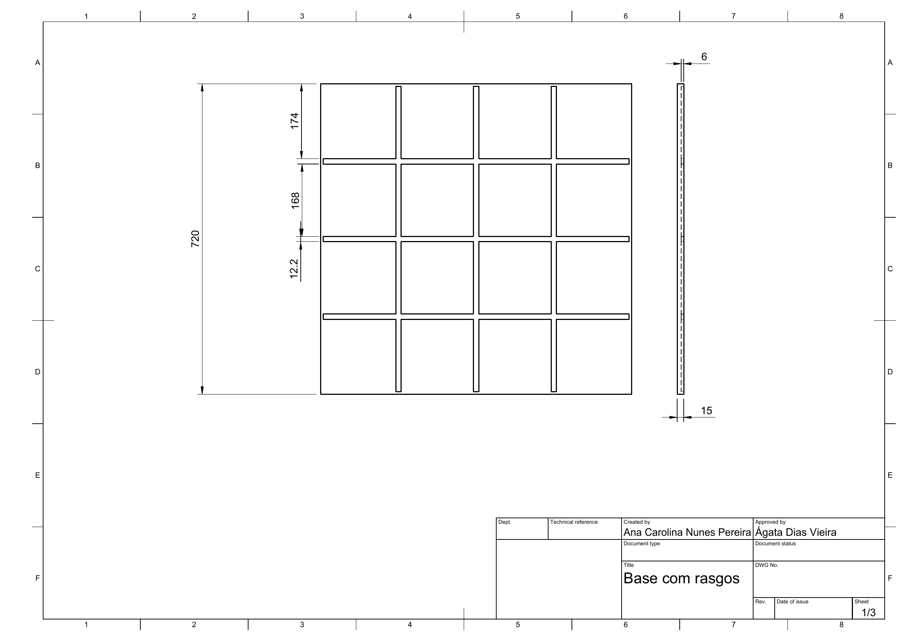
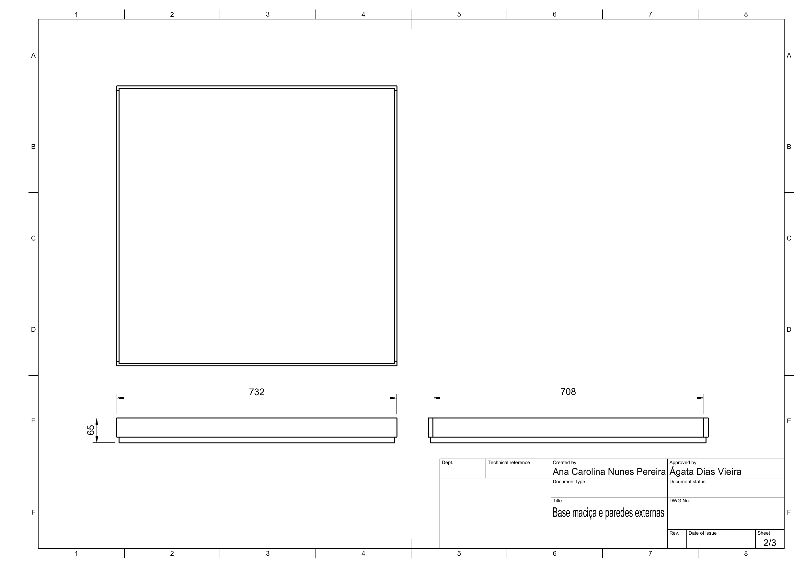
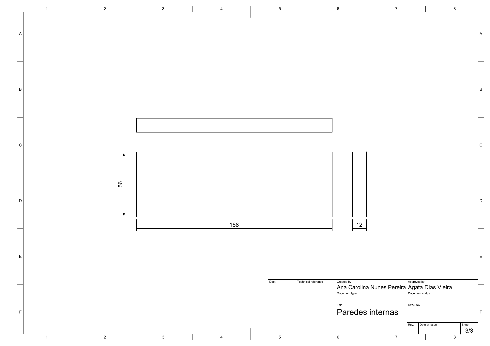
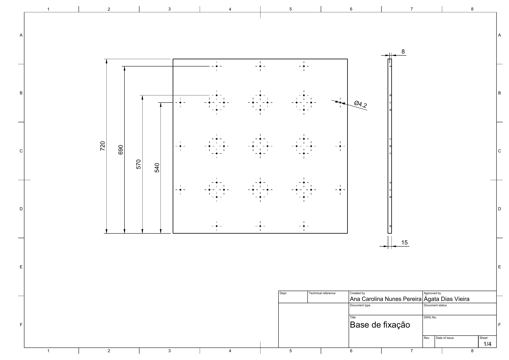
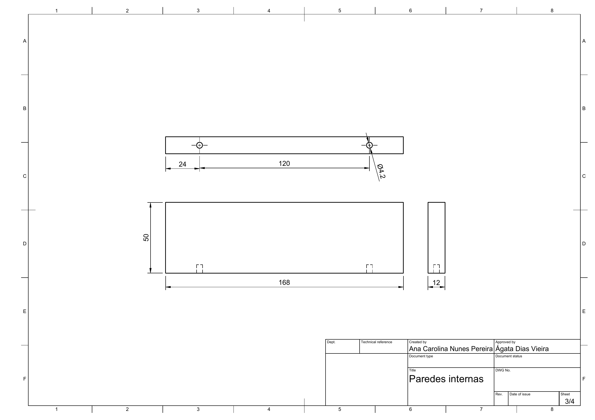
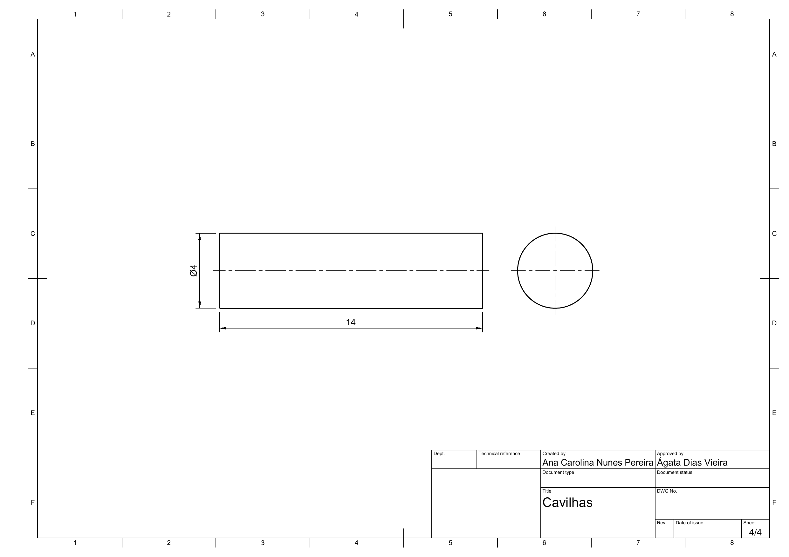

# Documentação do Labirinto Micromouse Modular

## 1. Objetivo

Este documento descreve o projeto do labirinto modular para testes do Micromouse, com base quadrada, paredes removíveis e dois sistemas alternativos de montagem.

A equipe apresenta dois modelos que usam a mesma geometria geral. A diferença está no método de fixação das paredes, e a escolha final de dará pelo preço de produção.

- **Modelo 1:** paredes encaixadas em rasgos na base.
- **Modelo 2:** paredes fixadas por cavilhas de madeira em furos na base.

## 2. Especificações gerais

| Característica | Especificação |
|---|---:|
| Formato da base | Quadrado |
| Comprimento da base | 720 mm |
| Largura da base | 720 mm |
| Área da base | 720 × 720 mm |
| Número de células | 16 |
| Organização da grade | 4 × 4 células |
| Passo nominal entre células | 180 mm |
| Espessura nominal das paredes | 12 mm |
| Altura das paredes acima da base | 50 mm |

**Importante:** o passo da grade, o comprimento das paredes e a posição das junções devem ser tratados conforme a geometria definida para este projeto. O comprimento especificado para as paredes internas é de **168 mm**, pois devido às espessuras das paredes, os encontros entre elas não pode exceder 180mm.

## 3. Base do labirinto

### 3.1 Dimensões externas

A base deve ter formato quadrado, com dimensões de:

- Comprimento: 720 mm
- Largura: 720 mm

A espessura da base varia de acordo com o modelo de montagem.

| Modelo | Espessura nominal da base |
|---|---:|
| Modelo 1 — rasgos | 12 mm |
| Modelo 2 — cavilhas | 15 mm |

## 4. Paredes internas

### 4.1 Dimensões das peças

Cada parede interna deve ter as seguintes dimensões nominais:

| Dimensão | Medida |
|---|---:|
| Comprimento | 168 mm |
| Espessura | 12 mm |
| Altura acima da base | 50 mm |

Dimensão nominal da parede: **168 × 12 × 50 mm**.

O comprimento de 168 mm corresponde à especificação definida para o projeto a partir do passo nominal de 180 mm e da espessura nominal de 12 mm.

Essa dimensão deve ser mantida nos dois modelos de montagem.

### 4.2 Quantidade de paredes

A quantidade prevista no planejamento atual é de 24 peças internas, para que possamos trabalhar com diferentes configurações de caminhos. 

### 4.3 Material previsto

Madeira (Compensado)

## 5. Paredes externas

As paredes externas delimitam o perímetro do labirinto.

Para uma base de 720 × 720 mm, uma disposição preliminar é:

| Peça | Quantidade | Comprimento | Altura | Espessura |
|---|---:|---:|---:|---:|
| Paredes externas longas | 2 | 732 mm | 50 mm | 12 mm |
| Paredes externas curtas | 2 | 708 mm | 50 mm | 12 mm |

O comprimento de 732mm foi definido pensando que as paredes externas serão fixadas por fora da base, de forma que não reduza o tamanho fixo das células de 180mm. Já o comprimento de 708 mm para as paredes curtas considera que elas ficam posicionadas entre as duas paredes longas, descontando uma espessura de 12 mm em cada extremidade.

**Conferência obrigatória:** essa disposição é preliminar. O comprimento final das paredes externas deve ser confirmado pelo desenho das junções dos cantos, de modo que o conjunto montado respeite as dimensões externas de 720 × 720 mm.

## 6. Modelo 1 — paredes encaixadas em rasgos

### 6.1 Descrição

Neste modelo, as paredes são posicionadas em rasgos usinados diretamente na base.

O encaixe permite montar e desmontar o labirinto sem depender de cavilhas para manter cada parede em posição.

### 6.2 Dimensões preliminares dos rasgos

| Característica | Medida inicial |
|---|---:|
| Largura nominal do rasgo | 12,4 mm |
| Profundidade do rasgo | 6 mm |
| Espessura nominal da base | 12 mm |
| Altura exposta da parede | 50 mm |
| Inserção nominal da parede | 6 mm |

A largura de 12,4 mm é uma medida inicial de prototipagem para uma parede nominal de 12 mm. Ela deve ser ajustada conforme a espessura real do material e a folga necessária para o encaixe.

### 6.3 Altura total da peça de parede

Considerando 50 mm de altura exposta e 6 mm de inserção na base, a altura total preliminar da peça será de:

**56 mm.**

Assim, a peça de parede destinada ao Modelo 1 terá, preliminarmente, dimensões totais de:

**168 × 12 × 56 mm.**

A parte que ficará acima da base terá 50 mm de altura depois da montagem.

### 6.4 Fabricação

1. Cortar a base com dimensões de 720 × 720 mm.
2. Marcar as posições dos rasgos de acordo com o desenho da grade.
3. Usinar os rasgos com largura e profundidade preliminares especificadas.
4. Cortar as paredes internas no comprimento nominal de 168 mm.
5. Preparar as paredes externas conforme o desenho do perímetro.
6. Montar um protótipo e verificar o encaixe.
7. Ajustar a largura dos rasgos caso as paredes fiquem excessivamente apertadas ou soltas.
8. Conferir o alinhamento e a perpendicularidade das paredes.

### 6.5 Observações

A posição dos rasgos deve ser definida a partir do desenho técnico completo. É necessário verificar as regiões de cruzamento, encontros e cantos para evitar sobreposição de peças.

Não se deve determinar a posição dos rasgos apenas pela contagem de células: o desenho de fabricação precisa indicar os eixos e as coordenadas de cada rasgo.

## 7. Modelo 2 — paredes fixadas por cavilhas

### 7.1 Descrição

Neste modelo, as paredes são posicionadas sobre uma base de 15 mm de espessura e fixadas por cavilhas de madeira encaixadas em furos.

O sistema permite remover e reposicionar as paredes, desde que as cavilhas e os furos tenham ajuste adequado.

### 7.2 Dimensões preliminares

| Componente | Dimensão inicial |
|---|---:|
| Base | 720 × 720 × 15 mm |
| Parede interna | 168 × 12 × 50 mm |
| Diâmetro nominal da cavilha | 4 mm |
| Comprimento nominal da cavilha | 14 mm |
| Diâmetro inicial dos furos | 4,2 mm |
| Profundidade inicial dos furos na base | 8 mm |
| Cavilhas por parede | 2 |

As medidas dos furos e das cavilhas são preliminares e devem ser verificadas com o material real antes da fabricação definitiva.

### 7.3 Posicionamento das cavilhas

Cada parede interna deve utilizar duas cavilhas como fixação inicial prevista.

Os furos correspondentes devem ser posicionados de forma simétrica em relação ao centro da parede, mantendo distância suficiente das extremidades para evitar rachaduras ou quebra do material.

### 7.4 Quantidade preliminar de cavilhas

Considerando 24 paredes internas e quatro paredes externas:

| Aplicação | Paredes | Cavilhas por parede | Total |
|---|---:|---:|---:|
| Paredes internas | 24 | 2 | 48 |
| Paredes externas | 4 | 2 | 8 |
| **Total preliminar** | **28** | — | **56** |

Recomenda-se adquirir cavilhas adicionais para testes e reposição.

A quantidade final deve ser ajustada ao número definitivo de paredes e ao método de fixação das paredes externas.

### 7.5 Fabricação e montagem

1. Cortar a base com dimensões de 720 × 720 × 15 mm.
2. Preparar o desenho de posicionamento de todas as paredes.
3. Marcar os pontos dos furos na base.
4. Perfurar os furos com as dimensões preliminares especificadas.
5. Fazer os furos correspondentes nas paredes.
6. Cortar e preparar as cavilhas.
7. Montar uma parede de teste para verificar o ajuste.
8. Conferir se a parede fica vertical e firme.
9. Montar o restante do labirinto.
10. Verificar se as paredes podem ser removidas sem danificar a base ou as peças.

## 8. Comparação dos modelos

| Critério | Modelo 1 — rasgos | Modelo 2 — cavilhas |
|---|---|---|
| Fixação | Encaixe em rasgos | Cavilhas em furos |
| Base | 12 mm de espessura | 15 mm de espessura |
| Usinagem principal | Rasgos | Furos |
| Desmontagem | Retirada das paredes dos rasgos | Retirada das paredes e cavilhas conforme o ajuste |
| Ajustes necessários | Largura e profundidade dos rasgos | Diâmetro, posição e profundidade dos furos |
| Verificação inicial | Encaixe e folga | Alinhamento e firmeza das cavilhas |

## 9. Tolerâncias e prototipagem

As dimensões indicadas são nominais ou preliminares conforme identificado em cada seção. A fabricação deve considerar as variações reais do material e da ferramenta de corte.

## 10. Desenhos técnicos

Para liberar o projeto para fabricação, os desenhos necessários são:

- **Desenho da base:** contorno de 720 × 720 mm, espessura e sistema de fixação.
- **Desenho da grade:** linhas de referência para as 16 células, com passo nominal de 180 mm.
- **Desenho das paredes internas:** peça de 168 × 12 × 50 mm para a versão compatível com a base, com detalhamento da parte de fixação.
- **Desenho das paredes externas:** dimensões e junções dos quatro lados.
- **Desenho do Modelo 1:** posições, larguras e profundidades dos rasgos.
- **Desenho do Modelo 2:** posições, diâmetros e profundidades dos furos, incluindo o detalhe das cavilhas.

### 10.1 Modelo 1 — rasgos

**Figura 1 – Modelo 1: base com rasgos (folha 1/3)**

**Figura 2 – Modelo 1: desenho técnico (folha 2/3)**

**Figura 3 – Modelo 1: desenho técnico (folha 3/3)**

### 10.2 Modelo 2 — cavilhas

**Figura 4 – Modelo 2: base de fixação (folha 1/4)**

**Figura 5 – Modelo 2: desenho técnico (folha 2/4)**

**Figura 6 – Modelo 2: desenho técnico (folha 3/4)**

**Figura 7 – Modelo 2: desenho técnico (folha 4/4)**

### 10.3 Arquivos CAD e PDF

Os arquivos de projeto ficam em [`mec/`](https://github.com/fcte-pi1/2026_2_PI1_Grupo01_Hilmer/tree/documentacao/mec):

| Arquivo | Descrição |
|---|---|
| [`micromouse_modelo1_rasgos.step`](https://github.com/fcte-pi1/2026_2_PI1_Grupo01_Hilmer/blob/documentacao/mec/micromouse_modelo1_rasgos.step) | CAD — Modelo 1 (rasgos) |
| [`micromouse_modelo1_rasgos-desenho-v1.pdf`](https://github.com/fcte-pi1/2026_2_PI1_Grupo01_Hilmer/blob/documentacao/mec/micromouse_modelo1_rasgos-desenho-v1.pdf) | Desenho técnico — Modelo 1 |
| [`micromouse_modelo2_cavilhas-desenho-v1.pdf`](https://github.com/fcte-pi1/2026_2_PI1_Grupo01_Hilmer/blob/documentacao/mec/micromouse_modelo2_cavilhas-desenho-v1.pdf) | Desenho técnico — Modelo 2 |

> **Nota:** o CAD do Modelo 2 (`.step`) ainda não foi incluído no repositório; apenas o desenho em PDF está disponível.

## 11. Lista preliminar de materiais

### Modelo 1

- 1 tábua de compensado que possibilite a fabricação da base 720 × 720 × 12 mm;
- 1 tábua de compensado para fabricação de todas as paredes;
- Material adequado para usinagem dos rasgos.

### Modelo 2

- 1 tábua de compensado que possibilite a fabricação da base 720 × 720 × 15 mm;
- 1 tábua de compensado para fabricação de todas as paredes;
- Cavilhas de madeira de 4 mm de diâmetro e 14 mm de comprimento, em quantidade preliminar de 56 unidades, mais reserva.

Especificações antigas de uma base retangular, de outra quantidade de células ou de outro comprimento de parede não devem ser usadas para fabricar esta versão.

As dimensões preliminares de rasgos, furos e cavilhas precisam ser validadas com um protótipo antes da fabricação definitiva.
