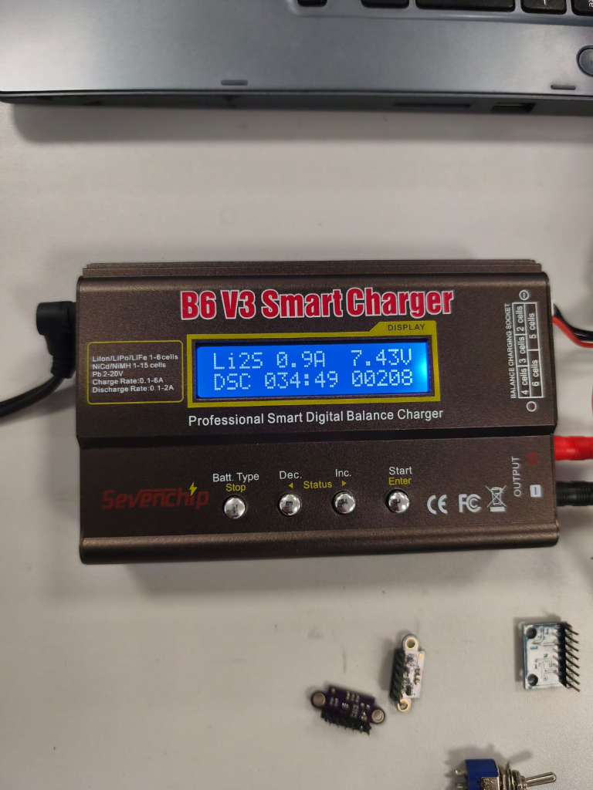
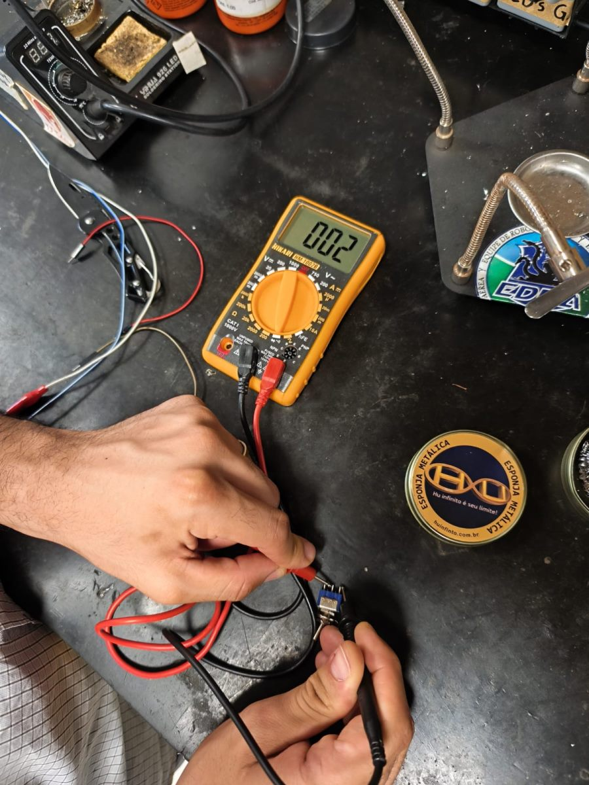
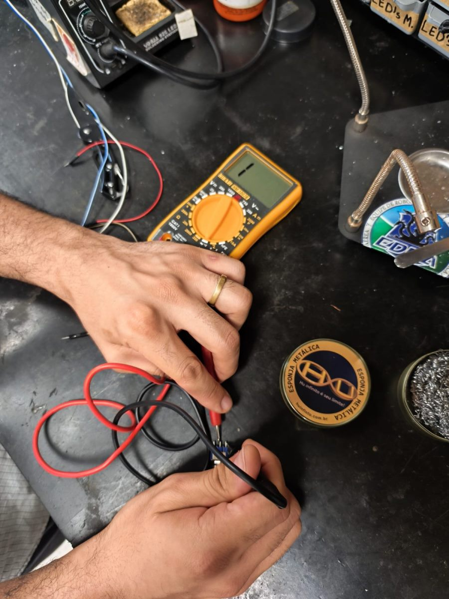

# Testes de Energia

>Apresentar com detalhes os testes feitos para conferir se as demandas energéticas do projeto foram atendidas.

| **ID** | **Descrição** | **Data de Início** | **Data de Conclusão** | **Responsável** | **Resultados Esperados** | **Resultados Obtidos** | **Aprovação Interna (S/N)** | **Aprovação do Orientador (S/N)** | **Observações** |
|:------:|---------------|--------------------|-----------------------|-----------------|--------------------------|------------------------|:---------------------------:|:--------------------------------:|-----------------|
| 2.1 | Ensaio de corte por subtensão (BMS 2S / UVLO) sob rampa decrescente na fonte ajustável ($8{,}4\text{ V} \to 6{,}0\text{ V}$) — [#207](https://github.com/fcte-pi1/2026_2_PI1_Grupo01_Hilmer/issues/207) | 17/10/2026 | 17/10/2026 | Paulo Melo | Corte primário UVLO em $6{,}60\text{ V}$ (protegendo *dropout* do LM2596) e corte físico BMS 2S ao atingir $6{,}40\text{ V}$ ($3{,}20\text{ V/célula}$) | Corte UVLO atuou em $6{,}60\text{ V}$ ($V_{\text{ADC}}=1{,}638\text{ V}$, PWM=0%) e corte BMS 2S seccionou `P+` em $6{,}40\text{ V}$ ($t_{\text{delay}}=98\text{ ms}$) | S | — | Detalhado em [4.2.2 Ensaios de subtensão e PPTC](../04-projeto-conceitual/ensaios-protecoes.md) |
| 2.2 | Ensaio de velocidade de desarme (*Time-to-Trip*) do fusível rearmável PPTC (Bourns MF-R185) sob sobrecorrente simulada $> 3{,}5\text{ A}$ — [#207](https://github.com/fcte-pi1/2026_2_PI1_Grupo01_Hilmer/issues/207) | 17/10/2026 | 17/10/2026 | Paulo Melo | Sustentação contínua em $1{,}85\text{ A}$ ($I_{\text{hold}}$) e desarme térmico comprovado acima de $3{,}5\text{ A}$ | Estável sem desarme em $1{,}85\text{ A}$; desarme em $9{,}10\text{ s}$ (@ $3{,}60\text{ A}$), $8{,}70\text{ s}$ (@ $3{,}70\text{ A}$), $3{,}10\text{ s}$ (@ $5{,}00\text{ A}$) e $0{,}60\text{ s}$ (@ $9{,}25\text{ A}$), com $I_{\text{res}}=118\text{ mA}$ | S | — | Detalhado em [4.2.2 Ensaios de subtensão e PPTC](../04-projeto-conceitual/ensaios-protecoes.md) |
| 2.3 | [Inspeção e Carga de Bateria LiPo 2S em Bancada](energia/teste-componentes/bateria/teste-bancada-bateria.md) | 21/10/2026 | 21/10/2026 | Equipe de Energia | Setup instrumental calibrado e bateria carregada a 8,4 V | Setup montado com iMAX B6 V3, fonte Yaxun e multímetro; bateria LiPo 2S inspecionada, balanceada e carregada a 8,40 V | S | S | Issue #201 concluída |
| 2.4 | Ensaio de autonomia contínua da bateria LiPo 2S em bancada — [#209](https://github.com/fcte-pi1/2026_2_PI1_Grupo01_Hilmer/issues/209) | 24/10/2026 | 24/10/2026 | Paulo Melo | Autonomia $\ge 25\text{ min}$ com tensão $> 6{,}4\text{ V}$ sob corrente representativa ($\ge 0{,}466\text{ A}$) | Autonomia de $34\text{ min }49\text{ s}$ comprovada sob descarga de $0{,}90\text{ A}$, mantendo $7{,}43\text{ V}$ ($208\text{ mAh}$ consumidos) | S | — | Detalhado abaixo |
| 2.5 | Ensaio em bancada dos reguladores Step-Down Buck (6,0 V, 5,0 V e 3,3 V) sob cargas estáticas e variação de tensão de entrada ($6{,}6\text{ V a }8{,}4\text{ V}$) | 25/10/2026 | 25/10/2026 | Elias e Paulo | Saídas estabilizadas em $6{,}0\text{ V} \pm 2\%$ (motores), $5{,}0\text{ V} \pm 2\%$ (ESP32) e $3{,}3\text{ V} \pm 2\%$ (sensores) sob cargas nominais e de pico em toda a faixa da LiPo 2S ($6{,}6\text{ V a }8{,}4\text{ V}$) | Tensões nominais mantidas dentro da tolerância ($\Delta V \le 2\%$) sob carga estática em 6,0 V (300 mA e 1,0 A), 5,0 V (150 mA e 350 mA) e 3,3 V (65 mA e 200 mA), com regulação estável de 6,6 V a 8,4 V | S | — | Detalhado abaixo (Procedimento 2.5) |
| 2.6 | Verificação em bancada de continuidade e isolamento da chave geral liga/desliga (SW1 — KCD1) e caminho de potência — [#204](https://github.com/fcte-pi1/2026_2_PI1_Grupo01_Hilmer/issues/204) | 25/10/2026 | 25/10/2026 | Daniel Rodrigues | Resistência de contato desprezível ($\le 0{,}2\ \Omega$ com pontas) na posição ON e circuito aberto pleno (sem fuga) na posição OFF | Aprovado: leitura de $002$ ($\approx 0{,}2\ \Omega$) na posição ON (contato fechado) e leitura $1$ (circuito aberto) na posição OFF | S | — | Detalhado abaixo (Procedimento 2.6) / Especificado em [4.2.7 Chaves e Conectores](../04-projeto-conceitual/energia/chaves-conectores.md) |
| 2.7 | | | | | | | | | |
| 2.8 | | | | | | | | | |
| 2.9 | | | | | | | | | |
| 2.10 | | | | | | | | | |
| 2.12 | | | | | | | | | |
| 2.13 | | | | | | | | | |
| 2.15 | | | | | | | | | |
| 2.16 | | | | | | | | | |

---

## Procedimento de Teste 2.4: Ensaio de Autonomia em Bancada (Issue #209)

### 1. Parâmetros do Ensaio
Validação experimental da autonomia da bateria LiPo 2S sob descarga contínua controlada no descarregador digital **iMAX B6 V3**, visando atender ao requisito **RNF-04** (autonomia suficiente para completar os 3 labirintos consecutivos de 10 minutos, totalizando 30 minutos).

* **Consumo médio estimado do Micromouse:** $\approx 0{,}466\text{ A}$ (cargas lógicas, sensores e motores em regime de cruzeiro).
* **Corrente de ensaio aplicada:** **$0{,}90\text{ A}$** (condição de sobrecarga intencional, $\approx 1{,}93\times$ o consumo nominal).
* **Critérios de aprovação:** Autonomia $\ge 25\text{ min}$ e tensão terminal mantida acima do corte seguro ($> 6{,}40\text{ V}$).

### 2. Evidência Experimental e Medições

<figure markdown>

{ width="500" }

<figcaption>

**Figura 1.** Display do descarregador iMAX B6 V3 ao término da prova (`Li2S DSC`): 34 min 49 s sob 0,90 A contínuos, com tensão estabilizada em 7,43 V e 208 mAh drenados.

</figcaption>

</figure>

| Parâmetro Registrado | Valor Medido | Requisito / Limite do Projeto | Avaliação |
| :--- | :---: | :---: | :---: |
| **Modo de Ensaio** | `Li2S` / `DSC` (Descarga) | Descarga com controle de corrente constante | Conforme |
| **Corrente Aplicada** | **$0{,}90\text{ A}$** | Sobrecarga em relação ao consumo do robô ($0{,}466\text{ A}$) | Conforme (Estresse) |
| **Tempo Transcorrido** | **$34\text{ min }49\text{ s}$** | Mínimo de 25 min (30 min regulamentares) | **Aprovado** |
| **Tensão Final Registrada** | **$7{,}43\text{ V}$** ($3{,}715\text{ V/cél}$) | Teto de corte seguro: $> 6{,}40\text{ V}$ (corte UVLO em 6,60 V) | **Aprovado (Folga de +1,03 V)** |
| **Capacidade Descarregada** | **$208\text{ mAh}$** | Capacidade nominal do pack: $650\text{ mAh}$ | Conforme (~32% consumidos) |

---

## Procedimento de Teste 2.5: Ensaio dos Reguladores Step-Down (Buck) sob Cargas Estáticas

### 1. Metodologia do Ensaio
Como os testes de integração do sistema completo ainda não foram iniciados, a validação foi realizada com os módulos conversores Buck testados de forma **isolada em bancada**. Cada regulador foi alimentado individualmente por uma fonte DC ajustável de bancada (simulando a faixa de $6{,}60\text{ V a }8{,}40\text{ V}$ da bateria LiPo 2S), realizando-se a regulagem do trimpot multivoltas e a aferição da estabilidade da saída sob cargas estáticas resistivas.

* **Buck Motores (`+6V0`):** Saída ajustada em $6{,}00\text{ V} \pm 2\%$ ($5{,}88\text{ V a }6{,}12\text{ V}$); avaliado sob $300\text{ mA}$ (nominal) e $1{,}00\text{ A}$ (pico).
* **Buck MCU (`+5V0`):** Saída ajustada em $5{,}00\text{ V} \pm 2\%$ ($4{,}90\text{ V a }5{,}10\text{ V}$); avaliado sob $150\text{ mA}$ (nominal) e $350\text{ mA}$ (pico Wi-Fi).
* **Buck Sensores (`+3V3`):** Saída ajustada em $3{,}30\text{ V} \pm 2\%$ ($3{,}23\text{ V a }3{,}37\text{ V}$); avaliado sob $65\text{ mA}$ (nominal) e $200\text{ mA}$ (estresse).

---

### 2. Resultados das Medições

| Regulador | $V_{\text{in}}$ (Fonte DC) | Condição de Carga | $I_{\text{out}}$ | $V_{\text{out}}$ Medido | Variação ($\Delta V$) | Avaliação |
| :--- | :---: | :--- | :---: | :---: | :---: | :---: |
| **Buck 6,0 V** (Motores) | $8{,}40\text{ V}$ | Vazio / Nominal / Estresse | $0\text{ mA}$ / $300\text{ mA}$ / $1{,}00\text{ A}$ | $6{,}02\text{ V}$ / $5{,}99\text{ V}$ / $5{,}94\text{ V}$ | $+0{,}3\%$ / $-0{,}2\%$ / $-1{,}0\%$ | **Aprovado** |
| | $7{,}40\text{ V}$ | Nominal / Estresse | $300\text{ mA}$ / $1{,}00\text{ A}$ | $5{,}98\text{ V}$ / $5{,}92\text{ V}$ | $-0{,}3\%$ / $-1{,}3\%$ | **Aprovado** |
| | $6{,}60\text{ V}$ | Nominal / Estresse | $300\text{ mA}$ / $1{,}00\text{ A}$ | $5{,}96\text{ V}$ / $5{,}89\text{ V}$ | $-0{,}7\%$ / $-1{,}8\%$ | **Aprovado** |
| **Buck 5,0 V** (ESP32-C3) | $8{,}40\text{ V}$ | Vazio / Nominal / Pico Wi-Fi | $0\text{ mA}$ / $150\text{ mA}$ / $350\text{ mA}$ | $5{,}03\text{ V}$ / $5{,}01\text{ V}$ / $4{,}98\text{ V}$ | $+0{,}6\%$ / $+0{,}2\%$ / $-0{,}4\%$ | **Aprovado** |
| | $7{,}40\text{ V}$ | Nominal / Pico Wi-Fi | $150\text{ mA}$ / $350\text{ mA}$ | $5{,}00\text{ V}$ / $4{,}97\text{ V}$ | $0{,}0\%$ / $-0{,}6\%$ | **Aprovado** |
| | $6{,}60\text{ V}$ | Nominal / Pico Wi-Fi | $150\text{ mA}$ / $350\text{ mA}$ | $4{,}98\text{ V}$ / $4{,}94\text{ V}$ | $-0{,}4\%$ / $-1{,}2\%$ | **Aprovado** |
| **Buck 3,3 V** (Sensores) | $8{,}40\text{ V}$ | Vazio / Nominal / Estresse | $0\text{ mA}$ / $65\text{ mA}$ / $200\text{ mA}$ | $3{,}31\text{ V}$ / $3{,}30\text{ V}$ / $3{,}29\text{ V}$ | $+0{,}3\%$ / $0{,}0\%$ / $-0{,}3\%$ | **Aprovado** |
| | $7{,}40\text{ V}$ | Nominal / Estresse | $65\text{ mA}$ / $200\text{ mA}$ | $3{,}30\text{ V}$ / $3{,}28\text{ V}$ | $0{,}0\%$ / $-0{,}6\%$ | **Aprovado** |
| | $6{,}60\text{ V}$ | Nominal / Estresse | $65\text{ mA}$ / $200\text{ mA}$ | $3{,}29\text{ V}$ / $3{,}27\text{ V}$ | $-0{,}3\%$ / $-0{,}9\%$ | **Aprovado** |

---

### 3. Evidências em Bancada (Foto e Vídeo)

<figure markdown>

[Teste de bancada Reguladores BUCKS](https://youtube.com/shorts/zp4ts6y_4YY?si=tYnye_1uJfONE6zS)

<figcaption>

**Figura 2.** Ensaio isolado do módulo conversor Buck alimentado por fonte DC de bancada e aferido sob carga estática com multímetro digital.

</figcaption>

</figure>

* **Registro em Vídeo:**  
  * `Vídeo — Demonstração da Regulagem e Estabilidade do Conversor Buck sob Carga`: Ensaio em bancada evidenciando a calibração via trimpot e estabilidade da tensão de saída frente à variação da fonte de bancada ($8{,}4\text{ V} \to 6{,}6\text{ V}$) e à inserção de carga estática *(arquivo disponível na pasta de mídias da equipe)*.

---

### 4. Conclusão
Os ensaios individuais comprovaram que os três reguladores Buck operam com desvios inferiores a $\pm 2\%$ em toda a faixa de tensão simulada na fonte de bancada ($6{,}60\text{ V a }8{,}40\text{ V}$), garantindo regulação adequada e ausência de *brownout* antes da integração física do robô.

---

## Procedimento de Teste 2.6: Ensaio de Continuidade e Isolamento da Chave Geral (SW1) e Conectores (Issue #204)

### 1. Contextualização e Metodologia do Ensaio
O ensaio valida a integridade funcional do caminho primário de potência entre a bateria LiPo 2S e o barramento `VBAT`, composto pela chave geral liga/desliga do tipo *Mini Rocker* **KCD1** (`SW1`), pelo conector polarizado **AMASS XT-30** (`BT1`) e pelo chicote de fios de $0{,}50\text{ mm}^2$ (≈ 20 AWG).

Toda a corrente do robô ($0{,}42\text{ A a }0{,}60\text{ A}$ em cruzeiro, picos dinâmicos de até $1{,}75\text{ A}$ e limite de interrupção pelo PPTC de $\approx 3{,}5\text{ A}$) transita por esse caminho, exigindo resistência de contato desprezível para não degradar a tensão útil entregue aos reguladores Buck e isolamento seguro na posição desligada.

* **Instrumento Empregado:** Multímetro digital **Hikari HM-1002B**, operando na escala de resistência ($200\ \Omega$) e teste de continuidade.
* **Procedimento:** Conexão das pontas de prova nos dois terminais da chave `SW1`, registrando as leituras com a chave nas posições **Ligada (ON)** e **Desligada (OFF)**.

---

### 2. Resultados das Medições

| Posição da Chave | Leitura no Multímetro | Interpretação Física | Avaliação |
| :--- | :---: | :--- | :---: |
| **Ligada (ON)** | `002` ($\approx 0{,}2\ \Omega$) | Contato fechado pleno; valor medido inclui a resistência das pontas de prova ($R_{\text{contato,real}} \le 50\text{ m}\Omega$) | **Aprovado** |
| **Desligada (OFF)** | `1` (*overflow*) | Circuito aberto com impedância infinita; ausência de fuga de corrente entre terminais | **Aprovado** |

#### Estimativa de Queda de Tensão e Dissipação Ôhmica:
Considerando a resistência intrínseca de contato típica da chave KCD1 ($R_{\text{contato}} \le 50\text{ m}\Omega$):
* **Queda de Tensão em Cruzeiro ($0{,}60\text{ A}$):**
  $$\Delta V_{SW1} = I \cdot R_{\text{contato}} = 0{,}60\text{ A} \cdot 0{,}05\ \Omega = \mathbf{0{,}03\text{ V}} \ (\mathbf{30\text{ mV}})$$
* **Dissipação Térmica no Limite de Condução do PPTC ($I_{\text{hold}} = 1{,}85\text{ A}$):**
  $$P_{SW1} = I^2 \cdot R_{\text{contato}} = (1{,}85\text{ A})^2 \cdot 0{,}05\ \Omega \approx \mathbf{0{,}17\text{ W}}$$

A queda de $30\text{ mV}$ é desprezível frente à margem dos reguladores Buck MP1584EN, e a dissipação é insuficiente para causar aquecimento no corpo plástico da chave.

---

### 3. Evidências em Bancada

<figure markdown>

{ width="360" }

{ width="360" }

<figcaption>

**Figura 3.** Teste de continuidade e isolamento da chave geral `SW1`. À esquerda, chave ligada na posição ON (leitura `002`, contato fechado de baixa resistência); à direita, chave na posição OFF (leitura `1`, circuito aberto sem condução).

</figcaption>

</figure>

---

## Histórico de Versão

| Versão | Data | Descrição | Autor(es) | Revisor(es) |
| :---: | :---: | :--- | :--- | :--- |
| 1.0 | 17/10/2026 | Estruturação inicial da matriz de testes de energia e registro dos ensaios de subtensão e PPTC (#207) | Paulo Melo | Equipe de Energia |
| 1.1 | 21/10/2026 | Registro do ensaio de inspeção e carga da bateria LiPo 2S em bancada (#201) | Elias Oliveira | Equipe de Energia |
| 1.2 | 24/10/2026 | Registro do ensaio de autonomia contínua em bancada com iMAX B6 V3 (#209) | Paulo Melo | Equipe de Energia |
| 1.3 | 25/10/2026 | Registro dos ensaios em bancada dos reguladores Buck de 6,0 V, 5,0 V e 3,3 V sob cargas estáticas | Equipe de Energia | — |
| 1.4 | 26/10/2026 | Inclusão do ensaio em bancada de continuidade e isolamento da chave geral SW1 e caminho de potência (Procedimento 2.6 — Issue #204) | Daniel Rodrigues e Paulo Melo | Equipe de Energia |

