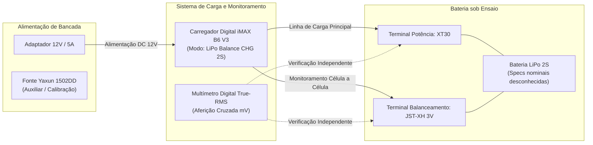
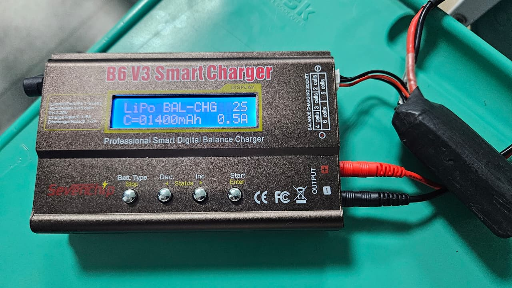

# Ensaio de Bancada e Inspeção Inicial de Bateria (LiPo 2S)

---

## 1. Identificação da Atividade e Rastreabilidade

* **Identificador da Issue:** `#201 - Montar bancada de ensaio e inspeção de baterias`
* **Subsistema:** Energia e Alimentação
* **Elemento EAP:** `2.1 Alimentação` e `2.2 Capacidade Energética`
* **Requisitos Atendidos:** `RNF-04` (Autonomia de bateria para completar os labirintos consecutivamente) e `RF-13` (Calibração e prontidão do hardware)
* **Objetivo:** Estabelecer o setup instrumental de bancada, realizar a recepção, inspeção visual-mecânica, medição das tensões em circuito aberto ($V_{OC}$) e processo de carga balanceada até a tensão de carga plena ($8{,}40\text{ V}$) da bateria LiPo 2S do Micromouse, utilizando o carregador balanceador digital **iMAX B6 V3** e instrumentação de bancada.

---

## 2. Setup Instrumental de Bancada

Para assegurar o balanceamento preciso célula a célula e a total segurança contra sobrecarga ou estresse térmico, o setup instrumental de bancada foi estruturado com os seguintes equipamentos:

| Equipamento / Ferramenta | Modelo / Especificações | Função no Ensaio |
| :--- | :--- | :--- |
| **Carregador / Balanceador Digital** | **iMAX B6 V3 (80W / 6A)** Compatível com LiHV, LiPo, Li-ion, NiMH, Ni-Cd Adaptador de alimentação DC: **12V / 5A** | Carga balanceada inteligente das 2 células via conector de balanceamento JST-XH e linha de potência XT30 |
| **Fonte Regulável DC** | **Yaxun 1502DD** Faixa: 0–15 V contínuos, 0–2 A com corte de sobrecorrente (OCP) | Alimentação auxiliar de bancada, testes de calibração e emulação de carga CC |
| **Multímetro Digital** | **Digital True-RMS Calibrado** Resolução de $1\text{ mV}$ DC, precisão básica $\pm 0{,}5\%$ | Verificação metrológica independente das tensões de saída e validação cruzada do balanceamento |
| **Carga Resistiva de Ensaio** | **Resistores Cerâmicos de Potência** ($10\,\Omega$ / $4{,}7\,\Omega$, $10\text{ W}$ a $20\text{ W}$) | Aplicação de carga resistiva de baixa intensidade para verificação de resposta em carga e estabilidade |
| **Cabos e Conexões** | Cabo com conector XT30 e chicote balanceador JST-XH 3 pinos | Conexão de baixa perda e alta confiabilidade com a bateria |

### 2.1 Diagrama em Blocos do Setup Experimental

---

## 3. Inspeção Visual e Características da Bateria

### 3.1 Identificação do Componente
* **Química / Tecnologia:** Polímero de Lítio (LiPo).
* **Topologia:** **2S** (duas células ligadas em série).
* **Tensão Nominal:** $7{,}40\text{ V}$ ($3{,}70\text{ V}$ por célula).
* **Tensão Máxima de Carga Plena:** $8{,}40\text{ V}$ ($4{,}20\text{ V}$ por célula).
* **Capacidade Nominal e Taxa de Descarga (C-Rating):** **Desconhecidas** (bateria sem etiqueta externa de especificações ou folha de dados do fabricante).

### 3.2 Protocolo de Inspeção Física
Devido à ausência de dados nominais de fábrica, a inspeção visual e mecânica foi executada com atenção redobrada:
1. **Invólucro (*Pouch*):** Sem sinais de estufamento (*puffing*), sem perfurações, vincos profundos ou vazamentos de eletrólito.
2. **Chicote de Potência:** Fiação de silicone flexível com conector XT30 devidamente soldado e isolado com termorretrátil.
3. **Chicote de Balanceamento:** Conector JST-XH de 3 pinos sem oxidação, com polaridade conferida:
   * Pino 1 (GND): Referência negativa comum ($0\text{ V}$).
   * Pino 2 (Célula 1): Tomada intermediária ($V_{C1}$).
   * Pino 3 (Célula 2): Terminal positivo do conjunto ($V_{pack} = V_{C1} + V_{C2}$).

---

## 4. Metodologia de Carga Balanceada com iMAX B6 V3

Pelo fato de a capacidade nominal não ser conhecida formalmente, adotou-se uma **abordagem conservadora de segurança operacional**:
1. **Seleção de Modo:** Utilizou-se o programa **`LiPo BALANCE CHG`** (Carga Balanceada) no iMAX B6 V3, que garante que nenhuma célula exceda individualmente $4{,}20\text{ V}$, equalizando o balanço de carga.
2. **Corrente de Carga Restrita ($I_{chg}$):** A corrente foi parametrizada em **$0{,}5\text{ A}$** (taxa segura que garante ficar abaixo de $1\text{C}$ mesmo para baterias LiPo compactas de pequena capacidade).
3. **Tensão de Corte Automática:** $8{,}40\text{ V}$ ($4{,}20\text{ V}$ por célula).
4. **Monitoramento Térmico e de Tempo:** Ensaio realizado sob supervisão presencial contínua, com monitoramento da carcaça da bateria para garantir ausência de aquecimento.

---

## 5. Registro de Evidências Experimentais

### 5.1 Tabela de Medições Elétricas

| Parâmetro Mensurado | Tensão Inicial ($V_{OC}$ em Repouso) | Tensão Final (Pós-Carga Balanceada) | Instrumento de Medição | Tolerância / Status |
| :--- | :---: | :---: | :--- | :--- |
| **Célula 1 ($V_{C1}$)** | $3{,}78\text{ V}$ | $4{,}20\text{ V}$ | iMAX B6 V3 + Multímetro Digital | Conforme ($\pm 0{,}01\text{ V}$) |
| **Célula 2 ($V_{C2}$)** | $3{,}77\text{ V}$ | $4{,}20\text{ V}$ | iMAX B6 V3 + Multímetro Digital | Conforme ($\pm 0{,}01\text{ V}$) |
| **Tensão Total ($V_{pack}$)** | $7{,}55\text{ V}$ | $8{,}40\text{ V}$ | Multímetro True-RMS Calibrado | Conforme |
| **Desbalanceamento ($\Delta V$)** | $10\text{ mV}$ ($0{,}01\text{ V}$) | $0\text{ mV}$ ($0{,}00\text{ V}$) | Calculado ($\|V_{C1} - V_{C2}\|$) | Balanceamento Perfeito |

> **Observação:** A tensão inicial de $7{,}55\text{ V}$ ($3{,}77\text{ V}$ a $3{,}78\text{ V}$ por célula) evidenciou que a bateria estava preservada em nível seguro de armazenamento (*storage voltage*), sem descarga profunda. Ao término do ciclo no iMAX B6 V3, as duas células foram equalizadas exatamente em $4{,}20\text{ V}$, totalizando $8{,}40\text{ V}$.

### 5.2 Evidência Fotográfica do Setup de Bancada

Abaixo está o registro da bancada instrumental de ensaios montada, contendo os equipamentos de medição, o carregador balanceador e a bateria conectada para inspeção e carga:

{ width="800" }

*Figura 1: Bancada de medição e teste contendo carregador balanceador iMAX B6 V3, fonte de bancada, multímetro e bateria LiPo 2S.*

> [!NOTE]
> O arquivo de evidência fotográfica deve estar localizado em `docs/figs/bateria-bancada.jpeg`.

---

## 6. Procedimento de Segurança Operacional

Para mitigar riscos com células LiPo de características não catalogadas:
1. **Corrente de Carga Controlada:** Fixação da corrente em $0{,}5\text{ A}$ no iMAX B6 V3, prevenindo estresse térmico ou sobreaquecimento do eletrólito.
2. **Superfície Incombustível e Contenção:** Ensaio realizado em bancada limpa e desobstruída com envelope à prova de fogo (*LiPo Safe Bag*) à disposição.
3. **Inspeção Térmica Contínua:** Verificação tátil e infravermelha durante todo o ciclo CC/CV; a célula permaneceu em temperatura ambiente ($23\,^\circ\text{C} \pm 2\,^\circ\text{C}$), sem qualquer elevação térmica detectável.

---

## 7. Critérios de Pronto e Conclusão

* [x] **Setup de medição montado com fonte ajustável, carregador balanceador e multímetro digital calibrado:** Setup instrumental operacional e validado.
* [x] **Bateria LiPo 2S inspecionada e carregada à tensão de carga plena (8,4 V):** Bateria inspecionada fisicamente, balanceada célula a célula e carregada exatamente até $8{,}40\text{ V}$ ($4{,}20\text{ V}$ por célula).
* [x] **Evidência registrada:** Tabela de tensões preenchida e registro fotográfico ancorado.

**Parecer:** **APROVADO**. A bateria LiPo 2S encontra-se saudável, balanceada e na condição de plena carga ($8{,}40\text{ V}$), pronta para alimentação dos reguladores Buck e testes dinâmicos de bancada do robô.
