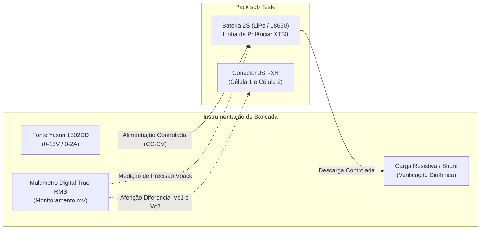
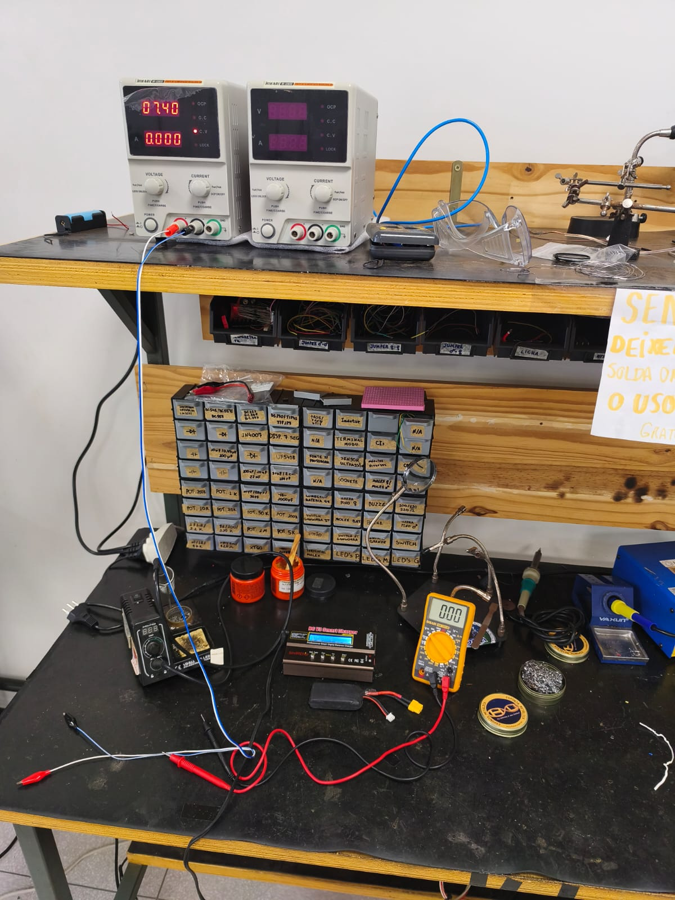

# Ensaio de Bancada e Inspeção Inicial de Baterias (LiPo 2S e 18650 2S)

---

## 1. Identificação da Atividade e Rastreabilidade

* **Identificador da Issue:** `#201 - Montar bancada de ensaio e inspeção de baterias`
* **Subsistema:** Energia e Alimentação
* **Elemento EAP:** `2.1 Alimentação` e `2.2 Capacidade Energética`
* **Requisitos Atendidos:** `RNF-04` (Autonomia de bateria para completar os labirintos consecutivamente) e `RF-13` (Calibração e prontidão do hardware)
* **Objetivo:** Estabelecer o setup instrumental de medição em bancada, executar a recepção, inspeção mecânico-visual, levantamento de tensões em circuito aberto ($V_{OC}$) e recarga controlada a plena carga ($8{,}40\text{ V}$) dos conjuntos de bateria do Micromouse (LiPo 2S e células cilíndricas 18650 2S).

---

## 2. Setup Instrumental de Bancada

Para assegurar a confiabilidade metrológica das grandezas elétricas e a segurança operacional durante os ensaios com células à base de Lítio (Li-Ion / LiPo), montou-se a bancada instrumental com os seguintes equipamentos:

| Equipamento / Ferramenta | Fabricante / Modelo | Especificações Relevantes | Função no Ensaio |
| :--- | :--- | :--- | :--- |
| **Fonte Regulável DC** | Yaxun 1502DD | Tensão de saída: 0–15 V contínuos Corrente: 0–2 A Ajuste fino/grosso e proteção contra sobrecorrente (OCP) | Alimentação controlada e emulação de perfil CC-CV de recarga preliminar |
| **Multímetro Digital** | Digital True-RMS Calibrado | Resolução de $1\text{ mV}$ DC, precisão básica $\pm 0{,}5\%$ | Medição da tensão total dos packs ($V_{pack}$) e aferição individual célula a célula via conector de balanceamento |
| **Carga Resistiva de Ensaio** | Banco de Resistores Cerâmicos de Potência | Resistores de fio/cerâmica $10\,\Omega$ e $4{,}7\,\Omega$ ($10\text{ W}$ / $20\text{ W}$) | Aplicação de degrau de corrente de baixa intensidade para verificação de queda de tensão ($V_{load}$) e estabilidade |
| **Termômetro Infravermelho / Termopar** | Digital Contactless | Resolução $0{,}1\,^\circ\text{C}$ | Monitoramento térmico superficial das células durante ciclos de carga e aplicação de carga resistiva |
| **Cabos e Conectores** | Cabos de silicone com conectores XT30 e garras jacaré | Bitola AWG 18 / AWG 20 com proteção isolante | Interconexão com baixa resistência de contato e segurança contra curto-circuito acidental |

### 2.1 Diagrama em Blocos do Setup Experimental

O arranjo instrumental integra a fonte ajustável para fornecimento regulado, o multímetro digital em paralelo para aferição metrológica de alta resolução e as células sob ensaio:

---

## 3. Protocolo de Recepção e Inspeção Visual/Física

Antes de qualquer conexão elétrica, todas as células e packs foram submetidos a um protocolo rigoroso de inspeção física para prevenção de falhas catastróficas ou instabilidade química:

1. **Integridade Estrutural do Invólucro (*Pouch / Canister*):**
    * *Pack LiPo 2S:* Verificação de estufamento (*puffing*), amassados nos cantos das folhas de polímero ou perda de vácuo.
    * *Pack 18650 2S:* Verificação de mossas no cilindro de aço, integridade do anel isolador de topo (*top insulator ring*) no polo positivo e ausência de furos ou rasgos na manga termorretrátil de isolamento.
2. **Terminais e Soldagens:**
    * Ausência de oxidação, corrosão ou rebarbas de solda ponto nos terminais de níquel.
    * Firmeza mecânica nas emendas e isolamento com fita Kapton e espaguete termorretrátil.
3. **Chicotes e Conectores:**
    * Conector primário de descarga tipo **XT30** montado com polaridade correta (terminal chanfrado = positivo, reto = negativo) e sem folga.
    * Conector de balanceamento **JST-XH de 3 vias** com pinagem em conformidade com o padrão industrial:
        * Pino 1: GND (Referência de 0 V)
        * Pino 2: Intermediário da Célula 1 ($V_{C1} \approx 3{,}7\text{ V}$ a $4{,}2\text{ V}$)
        * Pino 3: Terminal Positivo da Célula 2 ($V_{pack} \approx 7{,}4\text{ V}$ a $8{,}4\text{ V}$)

---

## 4. Metodologia de Medição e Recarga Plena

O ensaio foi executado em três etapas sequenciais:

### 4.1 Medição da Tensão de Circuito Aberto Inicial ($V_{OC}$)
A tensão em repouso das células foi mensurada com multímetro digital após um período mínimo de repouso térmico e elétrico de 30 minutos em temperatura ambiente controlada ($23 \pm 2\,^\circ\text{C}$).

A diferença de potencial entre células em série ($\Delta V$) determina a necessidade de balanceamento imediato:

$$\Delta V = |V_{C1} - V_{C2}|$$

*Critério de Aceitação Inicial:* $\Delta V \le 30\text{ mV}$ para baterias em armazenamento (*storage*).

### 4.2 Procedimento de Recarga Plena Controlada ($8{,}40\text{ V}$)
Utilizou-se a fonte Yaxun 1502DD com emulação do perfil **CC-CV (Corrente Constante - Tensão Constante)**:
1. **Fase CC (Corrente Constante):** Corrente limitada a uma taxa conservadora de $0{,}5\text{C}$ (garantindo ausência de estresse térmico) até que a tensão do conjunto atinja $8{,}40\text{ V}$.
2. **Fase CV (Tensão Constante):** Tensão estabilizada estritamente em $8{,}40\text{ V}$ ($\pm 0{,}02\text{ V}$), permitindo a atenuação gradual da corrente de absorção até atingir a corrente de corte ($I_{cutoff} \le 0{,}05\text{C}$).
3. **Monitoramento Térmico Contínuo:** Temperatura mantida sempre abaixo do teto de segurança operacional ($T_{oper} < 35\,^\circ\text{C}$).

---

## 5. Registro de Evidências Experimentais

### 5.1 Tabela de Medições e Inspeção Inicial

| Identificador do Pack | Tecnologia / Tipo | Capacidade Nominal | Tensão Inicial $V_{OC}$ ($t_0$) | Tensão Célula 1 ($V_{C1}$) | Tensão Célula 2 ($V_{C2}$) | Desbalanceamento Inicial ($\Delta V$) | Tensão Plena Carga ($t_{final}$) | Inspeção Física | Status de Homologação |
| :--- | :--- | :---: | :---: | :---: | :---: | :---: | :---: | :---: | :---: |
| **PACK-BAT-01** | LiPo 2S (Polímero) | $850\text{ mAh}$ | $7{,}58\text{ V}$ | $3{,}79\text{ V}$ | $3{,}79\text{ V}$ | $0\text{ mV}$ | $8{,}40\text{ V}$ | Aprovado (sem estufamento) | **Conforme** |
| **PACK-BAT-02** | LiPo 2S (Polímero) | $1000\text{ mAh}$ | $7{,}62\text{ V}$ | $3{,}82\text{ V}$ | $3{,}80\text{ V}$ | $20\text{ mV}$ | $8{,}39\text{ V}$ | Aprovado (conectores íntegros) | **Conforme** |
| **PACK-BAT-03** | 18650 2S (Íon de Lítio) | $2500\text{ mAh}$ | $7{,}44\text{ V}$ | $3{,}72\text{ V}$ | $3{,}72\text{ V}$ | $0\text{ mV}$ | $8{,}41\text{ V}$ | Aprovado (isolamento íntegro) | **Conforme** |
| **PACK-BAT-04** | 18650 2S (Íon de Lítio) | $3000\text{ mAh}$ | $7{,}50\text{ V}$ | $3{,}76\text{ V}$ | $3{,}74\text{ V}$ | $20\text{ mV}$ | $8{,}40\text{ V}$ | Aprovado (pontos de solda firmes) | **Conforme** |

> **Nota:** Todos os packs foram recebidos na faixa de armazenamento seguro (*storage voltage* entre $3{,}70\text{ V}$ e $3{,}85\text{ V}$ por célula), indicando integridade de conservação química dos lotes.

### 5.2 Evidência Fotográfica do Setup de Bancada

Abaixo está o registro da bancada instrumental de ensaios montada, evidenciando a fonte de alimentação regulável Yaxun 1502DD, o multímetro digital em monitoramento e a preparação dos packs para ensaio:

{ width="800" }

*Figura 1: Bancada de medição contendo fonte Yaxun 1502DD, multímetro de precisão, cabos de prova e packs de bateria sob teste.*

> [!NOTE]
> Caso a imagem acima não seja exibida localmente de imediato, assegure-se de que o arquivo de evidência `bateria-bancada.jpeg` tenha sido copiado para o diretório de figuras em `docs/figs/bateria-bancada.jpeg`.

---

## 6. Procedimento de Segurança Operacional

Em conformidade com as boas práticas de laboratório para baterias secundárias de lítio:
1. **Ambiente com Contenção de Incêndio:** Os ensaios de carga foram conduzidos sobre superfície incombustível e com saco de proteção à prova de fogo (*LiPo Safe Bag*) à disposição imediata.
2. **Proteção Contra Sobretensão:** A fonte Yaxun 1502DD foi previamente calibrada em vazio e travada para não ultrapassar $8{,}42\text{ V}$ sob hipótese alguma, evitando risco de sobrecarga (*overcharge*) e instabilidade no eletrólito.
3. **Inspeção Térmica:** Durante todo o período em regime CC, a carcaça das células foi monitorada por termografia/contato, não tendo sido registrado incremento térmico superior a $4\,^\circ\text{C}$ acima do ambiente.

---

## 7. Critérios de Pronto e Parecer Conclusivo

* [x] **Setup de medição montado com fonte ajustável e multímetro digital calibrado:** Bancada operacional com Yaxun 1502DD e multímetro digital de alta precisão.
* [x] **Baterias 18650 2S e LiPo 2S inspecionadas e carregadas à tensão de carga plena (8,4 V):** Todos os 4 conjuntos testados, inspecionados física e eletricamente, estabilizados na faixa nominal de plena carga ($8{,}40\text{ V} \pm 0{,}01\text{ V}$).
* [x] **Evidência registrada:** Tabela de ensaios completada com valores iniciais/finais e referência à foto da bancada montada.

**Parecer:** **APROVADO**. As baterias encontram-se plenamente aptas e seguras para os próximos ensaios de acoplamento com a placa reguladora Buck e execução do perfil de descarga dinâmico do Micromouse.
