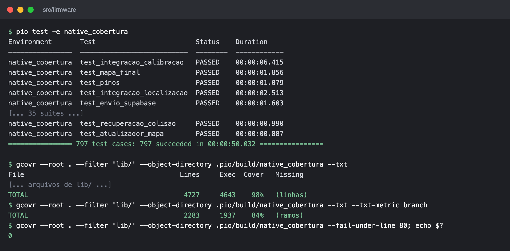
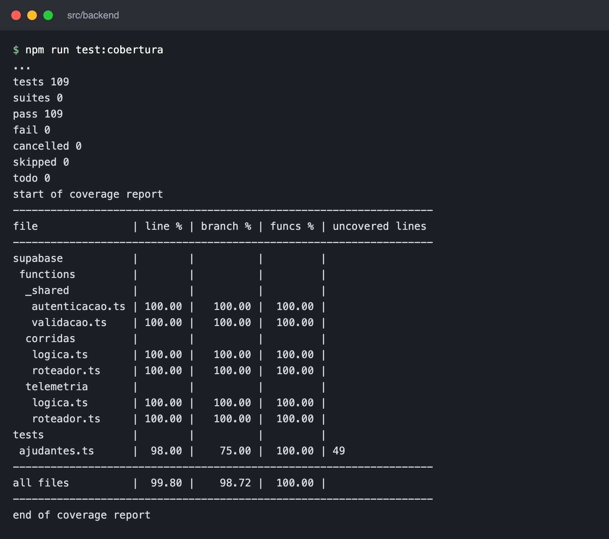
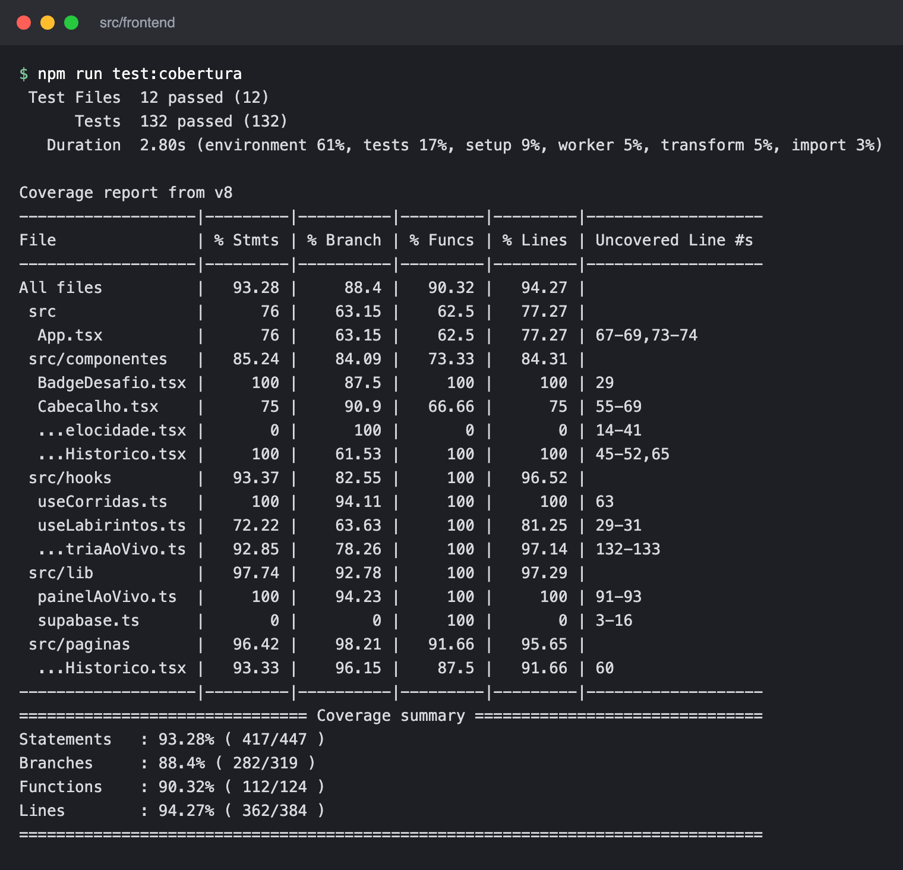

# Testes de Software
## Testes de _software_

Este documento reúne a evidência dos testes de _software_ da ED1: resultado, cobertura de código-fonte e a ligação entre as histórias de usuário (HUs) e os testes. O registro caso a caso de cada tarefa, por sprint, está em [Registro de execução dos testes](software-registro.md).

### Escopo da ED1

A ED1 avalia testes isolados de _software_, com simuladores. Os testes automatizados cobrem as três camadas sem hardware real:

- **Firmware** (C++ no ESP32-C3): PlatformIO e Unity, rodando no computador, com sensores, motores, Wi-Fi e labirinto simulados.
- **Backend** (Supabase): `node:test` sobre as Edge Functions e as funções SQL, com um PostgreSQL de verdade em WebAssembly (PGlite).
- **Frontend** (React): Vitest e Testing Library, com um cliente Supabase simulado.

**Teste unitário** é o de um módulo isolado, com dependências simuladas. **Teste de integração** encadeia módulos reais: as suítes `test_integracao_*` do firmware (o robô simulado anda num labirinto e o firmware só vê o que veria na placa), a Edge Function com as funções SQL no PGlite e as telas e hooks com o Supabase simulado. O teste de sistema (E2E) não faz parte desta entrega, conforme definido com o professor, e fica para a ED2.

### Resultado da execução

Execução de 26/10/2026 sobre o commit `9612a3b` da `main`, por Cláudio Henrique, em macOS.

| Camada | Ferramentas | Comando (em `src/<camada>`) | Testes | Unitários | Integração | Resultado | Cobertura de linhas |
|---|---|---|:-:|:-:|:-:|:-:|:-:|
| Firmware | PlatformIO 6.2.0, Unity, gcovr 8.6 | `pio test -e native_cobertura` | 797 (42 suítes) | 746 | 51 | **797 aprovados, 0 falhas** | **98,2%**; ramos 84,8% |
| Backend | `node:test`, PGlite 0.5.10 | `npm run test:cobertura` | 109 (8 arquivos) | 52 | 57 | **109 aprovados, 0 falhas** | **99,80%**; ramos 98,72% |
| Frontend | Vitest 5.0.5, Testing Library, v8 | `npm run test:cobertura` | 132 (12 arquivos) | 85 | 47 | **132 aprovados, 0 falhas** | **94,27%**; ramos 88,40% |
| **Total** | | | **1 038** | **883** | **155** | **1 038 aprovados, 0 falhas** | todas acima de 80% |

O critério é de pelo menos 80% do código-fonte. No firmware e no backend o CI falha se a cobertura de linhas ficar abaixo disso. A medição inclui:

- **Firmware:** todo o `lib/` que roda no computador (4 727 linhas). Ficam de fora o `main.cpp` e os drivers de hardware (`lib/drivers_esp32`), que só compilam para a placa.
- **Backend:** lógica, roteador e autenticação das Edge Functions. O `index.ts` de cada função (`Deno.serve`) não roda no Node e é conferido pelo `deno check` do CI.
- **Frontend:** todo o `src/`, exceto os testes, `src/test/` e `main.tsx`.

| Outra verificação | Comando | Resultado |
|---|---|---|
| Compilação para a ESP32-C3 | `pio run -e esp32c3` | Sucesso. RAM 26,9% (88 292 de 327 680 bytes), Flash 74,0% (969 906 de 1 310 720 bytes) |
| Tipagem e _build_ do frontend | `npm run build` | Sucesso |
| Tipagem das Edge Functions | `deno check` (CI do backend) | Sucesso |

### Evidência da execução

O CI do GitHub executou as mesmas suítes no mesmo commit, todas com sucesso: [CI Firmware](https://github.com/fcte-pi1/2026_2_PI1_Grupo01_Hilmer/actions/runs/40250337687), [CI Backend](https://github.com/fcte-pi1/2026_2_PI1_Grupo01_Hilmer/actions/runs/40250337647) e [CI Frontend](https://github.com/fcte-pi1/2026_2_PI1_Grupo01_Hilmer/actions/runs/40250337633). As figuras mostram a saída dos comandos, com linhas intermediárias omitidas onde há `[...]`.

<figure markdown>

{ width="800" }

<figcaption>

**Figura.** Firmware: 797 testes aprovados em 42 suítes e cobertura de 98% das linhas e 84% dos ramos de `lib/`, com o mínimo de 80% atendido (código de saída 0).

</figcaption>

</figure>

<figure markdown>

{ width="800" }

<figcaption>

**Figura.** Backend: 109 testes aprovados e cobertura de 99,80% das linhas.

</figcaption>

</figure>

<figure markdown>

{ width="800" }

<figcaption>

**Figura.** Frontend: 132 testes aprovados em 12 arquivos e cobertura de 94,27% das linhas.

</figcaption>

</figure>

### Módulos de teste

Os testes estão agrupados em 13 módulos por assunto. Cada suíte pertence a um só módulo, e a coluna de HUs mostra quais histórias o módulo verifica. As suítes do firmware ficam em `src/firmware/test/`, as do backend em `src/backend/` e as do frontend ao lado do código em `src/frontend/src/`.

| Módulo | Assunto | Camada | Suítes | Unit. | Integ. | Total | HUs |
|:-:|---|---|---|:-:|:-:|:-:|---|
| M1 | Núcleo e simulação | Firmware | `test_nucleo`, `test_simulacao`, `test_labirinto_simulado` | 34 | 0 | 34 | HU-02, HU-03 |
| M2 | Percepção e sensores de distância | Firmware | `test_percepcao`, `test_tof`, `test_lidar`, `test_decodificador_ld06`, `test_pinos`, `test_integracao_tof` | 72 | 8 | 80 | HU-02 |
| M3 | Mapa: estrutura, atualização, JSON e armazenamento | Firmware | `test_mapeamento`, `test_atualizador_mapa`, `test_json_mapa`, `test_armazenamento_mapa`, `test_mapa_final`, `test_integracao_mapa` | 67 | 5 | 72 | HU-03, HU-04 |
| M4 | Navegação, execução dos movimentos e motores | Firmware | `test_resolucao_mapa`, `test_execucao_movimentos`, `test_motores`, `test_protecao_motor`, `test_integracao_execucao` | 100 | 11 | 111 | HU-01 |
| M5 | Odometria, IMU e localização | Firmware | `test_imu`, `test_encoders`, `test_odometria`, `test_localizacao`, `test_deslocamento`, `test_integracao_localizacao` | 155 | 7 | 162 | HU-05 |
| M6 | Rumo, centralização e colisão | Firmware | `test_controle_giroscopio`, `test_controle_movimento`, `test_colisao`, `test_recuperacao_colisao`, `test_integracao_colisao` | 121 | 5 | 126 | HU-11, HU-12, HU-17 |
| M7 | Objetivo e fase da corrida | Firmware | `test_detector_objetivo`, `test_fase_corrida` | 37 | 0 | 37 | HU-07, HU-14 |
| M8 | Boot, calibração e falhas do I²C | Firmware | `test_boot`, `test_calibracao_tof`, `test_rotina_calibracao`, `test_falhas_i2c`, `test_integracao_calibracao`, `test_integracao_falhas_i2c` | 88 | 15 | 103 | HU-13 |
| M9 | Telemetria, buffer e reenvio (robô) | Firmware | `test_telemetria_json`, `test_envio_supabase`, `test_reenvio_telemetria` | 72 | 0 | 72 | HU-08, HU-16 |
| M10 | Edge Function de corridas e banco | Backend | `autenticacao`, `corridas/logica`, `corridas/roteador`, `tests/banco` | 37 | 13 | 50 | HU-09, HU-15 |
| M11 | Edge Function de telemetria, mapa final e consolidação | Backend | `telemetria/logica`, `telemetria/roteador`, `tests/telemetria`, `tests/funcoes` | 15 | 44 | 59 | HU-04, HU-08, HU-09, HU-16 |
| M12 | Dashboard ao vivo | Frontend | `painelAoVivo`, `useReproducaoCorrida`, `formatacao`, `labirinto`, `GradeLabirinto`, `supabaseSimulado`, `App`, `useTelemetriaAoVivo`, `TelaAoVivo` | 79 | 32 | 111 | HU-06, HU-07, HU-08, HU-14 |
| M13 | Histórico de corridas | Frontend | `FiltroLabirinto`, `useCorridas`, `TelaHistorico` | 6 | 15 | 21 | HU-10, HU-15 |
| | **Total** | | | **883** | **155** | **1 038** | |

### Histórias de usuário e protótipos

As HUs e os critérios de aceitação estão em [Requisitos funcionais](../04-projeto-conceitual/software.md#requisitos-funcionais), e os _frames_ de alta fidelidade, no [Protótipo Funcional Navegável](../04-projeto-conceitual/software.md#prototipo-funcional-do-software-navegavel). A interface em React implementa as telas de aguardando largada, corrida em andamento, desafio concluído e histórico, com prints no [registro por sprint](software-registro.md). A tabela liga cada HU ao _frame_ e aos módulos de teste que a verificam.

| HU | Título | Protótipo | Módulos de teste |
|:-:|---|---|---|
| [HU-01](../04-projeto-conceitual/software.md#hu-01) | Percorrer o labirinto de forma autônoma até o objetivo | [`02_Running`](https://www.figma.com/design/90hJ4r7jT0yDMtCwJ0yzy9/Prot%C3%B3tipo-Telemetria-Web?node-id=13-211) | M4 |
| [HU-02](../04-projeto-conceitual/software.md#hu-02) | Reconhecer paredes e piso em cada célula | [`02_Running`](https://www.figma.com/design/90hJ4r7jT0yDMtCwJ0yzy9/Prot%C3%B3tipo-Telemetria-Web?node-id=13-211) | M1, M2 |
| [HU-03](../04-projeto-conceitual/software.md#hu-03) | Construir o mapa quadriculado durante o percurso | [`02_Running`](https://www.figma.com/design/90hJ4r7jT0yDMtCwJ0yzy9/Prot%C3%B3tipo-Telemetria-Web?node-id=13-211) | M1, M3 |
| [HU-04](../04-projeto-conceitual/software.md#hu-04) | Armazenar o mapa do labirinto percorrido | [`03_Completed`](https://www.figma.com/design/90hJ4r7jT0yDMtCwJ0yzy9/Prot%C3%B3tipo-Telemetria-Web?node-id=14-337) | M3, M11 |
| [HU-05](../04-projeto-conceitual/software.md#hu-05) | Estimar a posição do robô por odometria | [`02_Running`](https://www.figma.com/design/90hJ4r7jT0yDMtCwJ0yzy9/Prot%C3%B3tipo-Telemetria-Web?node-id=13-211) | M5 |
| [HU-06](../04-projeto-conceitual/software.md#hu-06) | Visualizar o percurso do robô sobre o mapa | [`01_Idle`](https://www.figma.com/design/90hJ4r7jT0yDMtCwJ0yzy9/Prot%C3%B3tipo-Telemetria-Web?node-id=7-121), [`02_Running`](https://www.figma.com/design/90hJ4r7jT0yDMtCwJ0yzy9/Prot%C3%B3tipo-Telemetria-Web?node-id=13-211), [`03_Completed`](https://www.figma.com/design/90hJ4r7jT0yDMtCwJ0yzy9/Prot%C3%B3tipo-Telemetria-Web?node-id=14-337) | M12 |
| [HU-07](../04-projeto-conceitual/software.md#hu-07) | Detectar e sinalizar a chegada à célula objetivo | [`03_Completed`](https://www.figma.com/design/90hJ4r7jT0yDMtCwJ0yzy9/Prot%C3%B3tipo-Telemetria-Web?node-id=14-337) | M7, M12 |
| [HU-08](../04-projeto-conceitual/software.md#hu-08) | Acompanhar a telemetria do robô em tempo real | [`02_Running`](https://www.figma.com/design/90hJ4r7jT0yDMtCwJ0yzy9/Prot%C3%B3tipo-Telemetria-Web?node-id=13-211) | M9, M11, M12 |
| [HU-09](../04-projeto-conceitual/software.md#hu-09) | Persistir a telemetria das corridas no banco de dados | [`03_Completed`](https://www.figma.com/design/90hJ4r7jT0yDMtCwJ0yzy9/Prot%C3%B3tipo-Telemetria-Web?node-id=14-337), [`04_History_View`](https://www.figma.com/design/90hJ4r7jT0yDMtCwJ0yzy9/Prot%C3%B3tipo-Telemetria-Web?node-id=21-411) | M10, M11 |
| [HU-10](../04-projeto-conceitual/software.md#hu-10) | Consultar o histórico de todas as corridas | [`04_History_View`](https://www.figma.com/design/90hJ4r7jT0yDMtCwJ0yzy9/Prot%C3%B3tipo-Telemetria-Web?node-id=21-411) | M13 |
| [HU-11](../04-projeto-conceitual/software.md#hu-11) | Compensar irregularidades do solo | Sem tela | M6 |
| [HU-12](../04-projeto-conceitual/software.md#hu-12) | Evitar colisões com as paredes | Sem tela | M6 |
| [HU-13](../04-projeto-conceitual/software.md#hu-13) | Autocalibrar os sensores antes da largada | [`01_Idle`](https://www.figma.com/design/90hJ4r7jT0yDMtCwJ0yzy9/Prot%C3%B3tipo-Telemetria-Web?node-id=7-121) | M8 |
| [HU-14](../04-projeto-conceitual/software.md#hu-14) | Supervisionar a corrida pelo dashboard web | [`01_Idle`](https://www.figma.com/design/90hJ4r7jT0yDMtCwJ0yzy9/Prot%C3%B3tipo-Telemetria-Web?node-id=7-121), [`02_Running`](https://www.figma.com/design/90hJ4r7jT0yDMtCwJ0yzy9/Prot%C3%B3tipo-Telemetria-Web?node-id=13-211), [`03_Completed`](https://www.figma.com/design/90hJ4r7jT0yDMtCwJ0yzy9/Prot%C3%B3tipo-Telemetria-Web?node-id=14-337) | M7, M12 |
| [HU-15](../04-projeto-conceitual/software.md#hu-15) | Registrar e filtrar corridas por tipo de labirinto | [`04_History_View_M1`](https://www.figma.com/design/90hJ4r7jT0yDMtCwJ0yzy9/Prot%C3%B3tipo-Telemetria-Web?node-id=21-573), [`04_History_View_M2`](https://www.figma.com/design/90hJ4r7jT0yDMtCwJ0yzy9/Prot%C3%B3tipo-Telemetria-Web?node-id=21-655), [`04_History_View_M3`](https://www.figma.com/design/90hJ4r7jT0yDMtCwJ0yzy9/Prot%C3%B3tipo-Telemetria-Web?node-id=21-737) | M10, M13 |
| [HU-16](../04-projeto-conceitual/software.md#hu-16) | Não perder telemetria em quedas de conexão | [`02_Running`](https://www.figma.com/design/90hJ4r7jT0yDMtCwJ0yzy9/Prot%C3%B3tipo-Telemetria-Web?node-id=13-211) | M9, M11 |
| [HU-17](../04-projeto-conceitual/software.md#hu-17) | Recuperar-se de colisões sem perder o mapa | Sem tela | M6 |

O [roteiro de testes funcionais](../04-projeto-conceitual/software.md#roteiro-de-testes-funcionais) guia os testes de sistema da próxima entrega.

### Escopo da próxima entrega (ED2)

| Issue | Teste | Por que não está na ED1 |
|---|---|---|
| [#175](https://github.com/fcte-pi1/2026_2_PI1_Grupo01_Hilmer/issues/175) | Teste de bancada dos sensores VL53L0X | Exige os sensores reais montados. |
| [#185](https://github.com/fcte-pi1/2026_2_PI1_Grupo01_Hilmer/issues/185) | Teste de corrida completa no labirinto | Exige o robô montado e o labirinto real. |
| [#232](https://github.com/fcte-pi1/2026_2_PI1_Grupo01_Hilmer/issues/232) | Teste ponta a ponta: corrida do ESP32 ao dashboard | É teste de sistema, deixado para a próxima entrega. |
| [#237](https://github.com/fcte-pi1/2026_2_PI1_Grupo01_Hilmer/issues/237) | Medição da latência ponta a ponta | Mede o RNF-05 (até 2 s) com o robô e o dashboard reais. |
| - | Testes de sistema funcionais (E2E) pela interface gráfica | Seguem o roteiro de testes funcionais. |

### Como reproduzir

Com PlatformIO 6.2.0, gcovr 8.6 e Node 22, a partir da raiz do repositório:

```bash
cd src/firmware && pio test -e native_cobertura
cd ../backend && npm ci && npm run test:cobertura
cd ../frontend && npm ci && npm run test:cobertura
```
