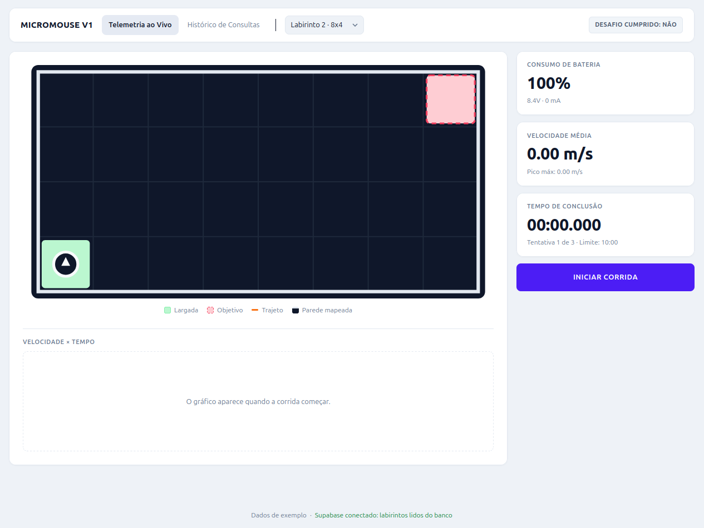
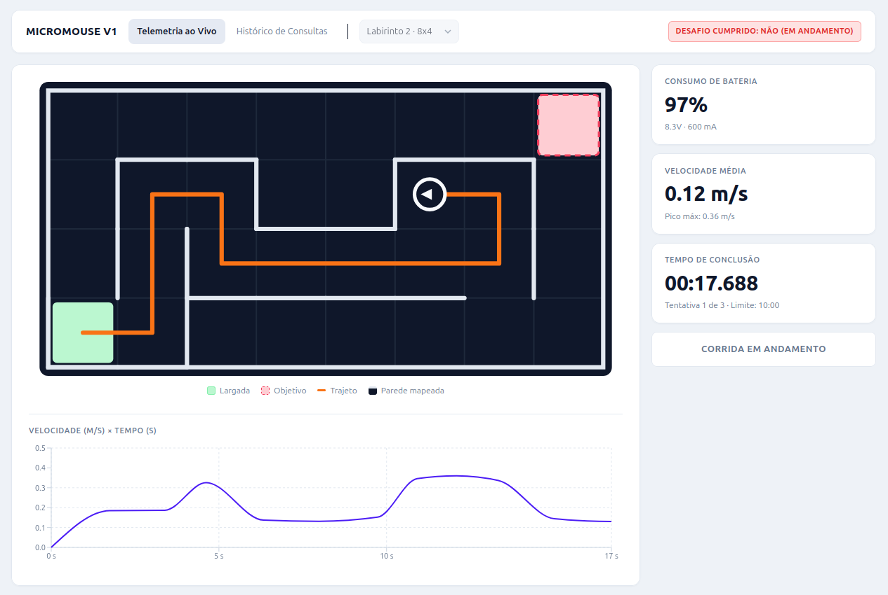
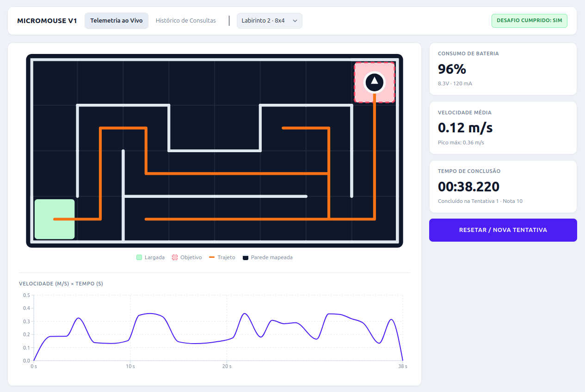
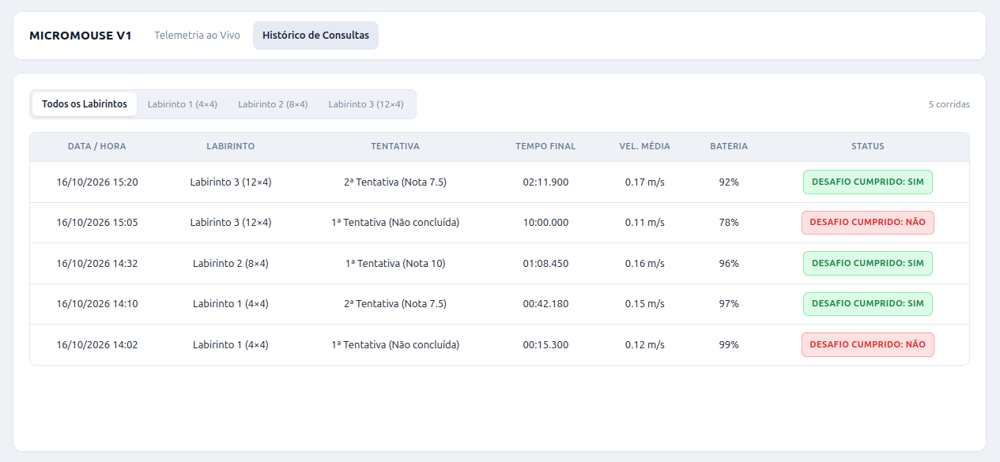

# Testes de Software
## Testes de _software_

> Apresentar com detalhes os testes feitos para conferir se os objetivos do *software* foram atendidos.
>
> - Listar as histórias de usuários e seus respectivos protótipos  implementadas.
> - Associar as histórias de usuários e os casos de testes funcionais implementados.
> - Enviar o print da execução dos suítes de testes automatizados em nível:
>   - Unitário e integração, com cobertura de código-fonte de pelo menos 80%;
>   - Sistema, do tipo funcional (end-to-end E2E).
>
> **Observações:**
>
> 1. Em relação ao *backlog* do produto, será considerado como referência aquele descrito no primeiro ponto de controle, contemplando as correções e *feedbacks* da-os professora(e)s. O ideal seria a real atualização entre o planejado X realizado.
> 2. Os testes mencionados nesta subseção dizem respeito aos testes de *software*. O Roteiro de testes funcionais, entregue no primeiro ponto de controle deve ser corrigido a partir do apontamento da-os professora(e)s. Além disso, ele deve guiar a execução dos testes E2E automatizados. O conjunto de casos de testes funcionais documentados devem estar coerentes com a automação via interface gráfica de entrada de dados.
>
> Exemplos de ferramentas de teste funcionais E2E:
>
> - Selenium
> - Cypress
> - Playwright
>
> Exemplos de ferramentas de testes em nível unitário e integração:
>
> - Jest
> - unittest
> - pytest
> - tox
> - gTest
> - Catch2
## Registro de execução dos testes

### Sprint 2 · Projeto base do firmware

| Item | Valor |
|---|---|
| Tarefa | [#172 Projeto base do firmware](https://github.com/fcte-pi1/2026_2_PI1_Grupo01_Hilmer/issues/172) |
| História de usuário | HU-02 · Reconhecimento de ambiente ([#36](https://github.com/fcte-pi1/2026_2_PI1_Grupo01_Hilmer/issues/36)), RF02 |
| Código testado | `src/firmware` (branch `feat/firmware-base`, PR [#194](https://github.com/fcte-pi1/2026_2_PI1_Grupo01_Hilmer/pull/194)) |
| Data da execução | 04/10/2026 |
| Executado por | Ana Carolina Fialho |
| Documentação do código | [Firmware: implementação](../04-projeto-conceitual/firmware.md) |

**Ambiente de execução**

| Componente | Versão |
|---|---|
| Sistema operacional | macOS (Apple Silicon) |
| PlatformIO Core | 6.2.0 |
| Plataforma de testes no computador | `native` 1.2.1 |
| Framework de testes | Unity 2.6.1 |
| Plataforma da placa | Espressif 32 7.1.3 (ESP32-C3-DevKitM-1, 160 MHz, 320 KB de RAM, 4 MB de Flash) |
| Compilador da placa | `toolchain-riscv32-esp` 8.4.0+2021r2-patch5 |
| Framework da placa | `framework-arduinoespressif32` 4.20017 |

#### Testes unitários (ambiente `native`)

Comando, executado em `src/firmware`:

```bash
pio test -e native
```

| Suíte | Casos | Resultado | Duração |
|---|:-:|:-:|:-:|
| `test_simulacao` | 6 | **6 aprovados** | 0,97 s |
| `test_nucleo` | 4 | **4 aprovados** | 0,78 s |
| **Total** | **10** | **10 aprovados, 0 falhas** | **1,75 s** |

Os tempos são da segunda execução. Na primeira, a suíte `test_simulacao` levou 8,99 s porque o PlatformIO baixou a plataforma `native`, o SCons e o Unity.

| Caso de teste | O que verifica | HU / tarefa | Resultado |
|---|---|---|:-:|
| `test_girar_direita_percorre_as_quatro_direcoes` | Norte → Leste → Sul → Oeste → Norte | HU-03 (base para #176 e #177) | Aprovado |
| `test_girar_esquerda_desfaz_girar_direita` | O giro à esquerda é o inverso do giro à direita | HU-03 (base para #176 e #177) | Aprovado |
| `test_oposta_inverte_a_direcao` | Norte ↔ Sul, Leste ↔ Oeste | HU-03 (base para #176 e #177) | Aprovado |
| `test_direcao_absoluta_converte_lado_do_robo_em_direcao_do_labirinto` | Frente, esquerda e direita convertidas em direção do labirinto | HU-02 e HU-03 (#177) | Aprovado |
| `test_sem_leitura_configurada_a_leitura_falha` | Sem leitura configurada, o LiDAR simulado falha | HU-02 (#172, #174) | Aprovado |
| `test_leitura_fixa_se_repete_a_cada_chamada` | A leitura fixa se repete a cada chamada | HU-02 (#172, #174) | Aprovado |
| `test_fila_entrega_as_leituras_em_ordem_e_depois_volta_para_a_fixa` | Leituras enfileiradas saem em ordem e depois volta a leitura fixa | HU-02 (#172, #174) | Aprovado |
| `test_falha_simulada_retorna_false_e_nao_consome_a_fila` | Falha do sensor não perde leituras da fila | HU-02 (#172) e HU-13 | Aprovado |
| `test_fila_cheia_recusa_novas_leituras` | A fila recusa leituras além da capacidade (16) | HU-02 (#172) | Aprovado |
| `test_pode_ser_usado_pela_interface_ILidar` | O simulado funciona por meio da interface `ILidar` | HU-02 (#172, #173) | Aprovado |

Saída do PlatformIO (resumo):

```text
Processing test_simulacao in native environment
test/test_simulacao/test_lidar_simulado.cpp:85: test_sem_leitura_configurada_a_leitura_falha    [PASSED]
test/test_simulacao/test_lidar_simulado.cpp:86: test_leitura_fixa_se_repete_a_cada_chamada      [PASSED]
test/test_simulacao/test_lidar_simulado.cpp:87: test_fila_entrega_as_leituras_em_ordem_e_depois_volta_para_a_fixa    [PASSED]
test/test_simulacao/test_lidar_simulado.cpp:88: test_falha_simulada_retorna_false_e_nao_consome_a_fila  [PASSED]
test/test_simulacao/test_lidar_simulado.cpp:89: test_fila_cheia_recusa_novas_leituras   [PASSED]
test/test_simulacao/test_lidar_simulado.cpp:90: test_pode_ser_usado_pela_interface_ILidar       [PASSED]
---------------------------------- native:test_simulacao [PASSED] Took 0.97 seconds ----------------------------------

Processing test_nucleo in native environment
test/test_nucleo/test_direcao.cpp:45: test_girar_direita_percorre_as_quatro_direcoes    [PASSED]
test/test_nucleo/test_direcao.cpp:46: test_girar_esquerda_desfaz_girar_direita  [PASSED]
test/test_nucleo/test_direcao.cpp:47: test_oposta_inverte_a_direcao     [PASSED]
test/test_nucleo/test_direcao.cpp:48: test_direcao_absoluta_converte_lado_do_robo_em_direcao_do_labirinto       [PASSED]
----------------------------------- native:test_nucleo [PASSED] Took 0.78 seconds -----------------------------------

Environment    Test            Status    Duration
-------------  --------------  --------  ------------
native         test_simulacao  PASSED    00:00:00.971
native         test_nucleo     PASSED    00:00:00.776
==================================== 10 test cases: 10 succeeded in 00:00:01.747 ====================================
```

A execução filtrada (`pio test -e native -f test_simulacao`) também aprovou os 6 casos da suíte, em 0,89 s.

#### Compilação para a placa (ambiente `esp32c3`)

Comando, executado em `src/firmware`:

```bash
pio run -e esp32c3
```

| Verificação | Resultado |
|---|---|
| Compilação e geração do `firmware.bin` | **Sucesso** |
| Uso de RAM | 4,2% (13 748 de 327 680 bytes) |
| Uso de Flash | 18,9% (247 704 de 1 310 720 bytes) |
| Duração | 143,9 s na primeira execução, incluindo o download da plataforma, do compilador e do Arduino Core |

```text
RAM:   [          ]   4.2% (used 13748 bytes from 327680 bytes)
Flash: [==        ]  18.9% (used 247704 bytes from 1310720 bytes)
Building .pio/build/esp32c3/firmware.bin
Successfully created esp32c3 image.
=========================================== [SUCCESS] Took 143.89 seconds ===========================================
```

#### Verificação de detecção de falhas (teste negativo)

Para confirmar que os testes detectam erros, e não apenas passam, um caso foi alterado de propósito para esperar um resultado errado e depois restaurado.

| Etapa | Ação | Resultado |
|---|---|---|
| 1 | Na linha 21 de `test/test_nucleo/test_direcao.cpp`, o valor esperado de `girarDireita(Norte)` foi trocado de `Leste` para `Sul` | Teste propositalmente incorreto |
| 2 | `pio test -e native -f test_nucleo` | **Falha detectada** na linha 21: `Expected 2 Was 1` |
| 3 | Linha restaurada para `Leste` | Código idêntico ao da execução registrada acima (10 de 10 aprovados) |

```text
test/test_nucleo/test_direcao.cpp:21: test_girar_direita_percorre_as_quatro_direcoes: Expected 2 Was 1  [FAILED]
test/test_nucleo/test_direcao.cpp:46: test_girar_esquerda_desfaz_girar_direita  [PASSED]
test/test_nucleo/test_direcao.cpp:47: test_oposta_inverte_a_direcao     [PASSED]
test/test_nucleo/test_direcao.cpp:48: test_direcao_absoluta_converte_lado_do_robo_em_direcao_do_labirinto       [PASSED]
Program received signal SIGHUP (Hangup: 1)
----------------------------------- native:test_nucleo [ERRORED] Took 1.37 seconds -----------------------------------
================================ 5 test cases: 1 failed, 3 succeeded in 00:00:01.370 ================================
```

**Interpretação da saída:**

- `:21:` indica a linha da verificação que falhou, exatamente a que foi alterada.
- `Expected 2 Was 1`: o Unity compara as direções pelo valor numérico (Norte = 0, Leste = 1, Sul = 2, Oeste = 3). O teste esperava `Sul` (2) e a função devolveu `Leste` (1), que é o resultado correto de um giro à direita a partir do Norte.
- Ao encontrar a primeira verificação que falha, o Unity encerra aquele caso e segue para os próximos; por isso os outros 3 casos continuam aprovados.
- `Program received signal SIGHUP (Hangup: 1)` e o status `ERRORED` não indicam um travamento: o `main` do teste retorna `UNITY_END()`, que é o número de falhas (1). O PlatformIO trata esse código de saída diferente de zero como erro do programa e o conta como mais um item no resumo, daí os "5 test cases" (4 casos + o erro de execução).

#### Pendências desta etapa

- **Cobertura de código:** ainda não medida. O relatório de cobertura (meta de 80%) entra com o CI do firmware ([#223](https://github.com/fcte-pi1/2026_2_PI1_Grupo01_Hilmer/issues/223)).
- **Teste na placa:** o firmware foi compilado, mas ainda não gravado no ESP32-C3. O teste de bancada com o LiDAR real está previsto para 13 e 14/10 ([#175](https://github.com/fcte-pi1/2026_2_PI1_Grupo01_Hilmer/issues/175)), depois de validado o uso dos pinos GPIO20/21, que coincidem com a UART0 do `Serial`.

### Sprint 2 · Classificação parede/livre

| Item | Valor |
| ------ | ------ |
| Tarefa | [#174 Classificação parede/livre](https://github.com/fcte-pi1/2026_2_PI1_Grupo01_Hilmer/issues/174) |
| História de usuário | HU-02 · Reconhecimento de ambiente ([#36](https://github.com/fcte-pi1/2026_2_PI1_Grupo01_Hilmer/issues/36)), RF02 |
| Código testado | `src/firmware` (branch `feat/174-classificador-parede-livre`) |
| Data da execução | 05/10/2026 |
| Executado por | Rafael Lima |
| Documentação do código | [Firmware: implementação](../04-projeto-conceitual/firmware.md) |

**Ambiente de execução**

| Componente | Versão |
| ------ | ------ |
| Sistema operacional | Computador Host (Linux / macOS / Windows) |
| PlatformIO Core | 6.2.0 |
| Plataforma de testes no computador | native 1.2.1 |
| Framework de testes | Unity 2.6.1 |

#### Testes unitários (ambiente native)

Comando executado em src/firmware:

```bash
pio test -e native
```

| Suíte | Casos | Resultado | Duração |
| :--- | :--- | :--- | :--- |
| `test_percepcao` | 6 | **6 aprovados** | 0,80 s |

---

#### Casos de teste

| Caso de teste | O que verifica | HU / tarefa | Resultado |
| :--- | :--- | :--- | :--- |
| `test_classificador_parede_proxima` | Obstáculo próximo (médias < 180 mm) classificado como Parede | HU-02 (#174) | Aprovado |
| `test_classificador_passagem_livre` | Passagem desimpedida (médias > 180 mm) classificada como Livre | HU-02 (#174) | Aprovado |
| `test_classificador_valor_no_limiar` | Limite exato de 180 mm (<= 180 mm Parede, > 180 mm Livre) | HU-02 (#174) | Aprovado |
| `test_classificador_limiar_configuravel` | Alteração e consulta do limiar dinâmico em tempo de execução | HU-02 (#174) | Aprovado |
| `test_classificador_leituras_com_ruido` | Atenuação de picos isolados de ruído via média de amostras | HU-02 (#174) | Aprovado |
| `test_classificador_vetor_vazio` | Vetor de amostras vazio assume Desconhecido por segurança (*fail-safe*) | HU-02 (#174) | Aprovado |

---

#### Saída do PlatformIO

```text
Processing test_percepcao in native environment
test/test_percepcao/test_classificador.cpp: test_classificador_parede_proxima [PASSED]
test/test_percepcao/test_classificador.cpp: test_classificador_passagem_livre [PASSED]
test/test_percepcao/test_classificador.cpp: test_classificador_valor_no_limiar [PASSED]
test/test_percepcao/test_classificador.cpp: test_classificador_limiar_configuravel [PASSED]
test/test_percepcao/test_classificador.cpp: test_classificador_leituras_com_ruido [PASSED]
test/test_percepcao/test_classificador.cpp: test_classificador_vetor_vazio [PASSED]
----------------------------------
native:test_percepcao [PASSED] Took 0.80 seconds
----------------------------------
=================================== 6 test cases: 6 succeeded in 00:00:00.800 ===================================
```

#### Suíte completa com cobertura (o mesmo comando do CI)

```bash
pio test -e native_cobertura
gcovr --root . --filter 'lib/' --object-directory .pio/build/native_cobertura --fail-under-line 80
```

| Verificação | Resultado |
|---|---|
| Testes existentes (núcleo, simulação, percepção, mapa e LiDAR) | **72 aprovados, 0 falhas** |
| Testes novos do simulador | **19 aprovados, 0 falhas** |
| Cobertura das linhas de `lib/` | **98%** (556 de 562), acima da meta de 80% |
| Cobertura de `LabirintoSimulado.cpp` | 99% (115 de 116); a linha fora é o `return` depois do `switch` de `temParede`, que nunca é alcançado e existe para o compilador |

```text
=========== 91 test cases: 91 succeeded in 00:00:04.161 ===========
TOTAL                                        562      556    98%
```

#### Compilação para a placa

```bash
pio run -e esp32c3
```

| Verificação | Resultado |
|---|---|
| Compilação | **Sucesso** |
| Uso de RAM | 4,2% (13 748 de 327 680 bytes) |
| Uso de Flash | 18,9% (247 640 de 1 310 720 bytes) |

O uso de memória não mudou, porque o simulador só é usado nos testes do computador e não entra no firmware da placa.

#### Validação dos labirintos de exemplo

Os três labirintos de `test/test_labirinto_simulado/LabirintosExemplo.h` têm o perímetro fechado e todas as células alcançáveis a partir de (0, 0). Essas duas propriedades são conferidas pelos testes a cada execução (`test_recusa_perimetro_aberto` e `test_todas_as_celulas_dos_exemplos_sao_alcancaveis_da_partida`):

| Labirinto | Formato | Perímetro | Células alcançáveis a partir de (0, 0) |
|---|:-:|:-:|:-:|
| 4×4 | Válido | Fechado | 16 de 16 |
| 8×4 | Válido | Fechado | 32 de 32 (a primeira versão tinha 16 de 32 e foi redesenhada) |
| 12×4 | Válido | Fechado | 48 de 48 |

A tabela de leituras esperadas do 4×4, escrita à mão antes da implementação, bateu com o que o `LabirintoSimulado` calcula nas cinco poses.

---

### Sprint 2 · Armazenamento do mapa em memória

| Item | Valor |
| ------ | ------ |
| Tarefa | [#179 Armazenamento do mapa em memória](https://github.com/fcte-pi1/2026_2_PI1_Grupo01_Hilmer/issues/179) |
| História de usuário | HU-04 · Armazenamento local ([#38](https://github.com/fcte-pi1/2026_2_PI1_Grupo01_Hilmer/issues/38)), RF04 |
| Código testado | `src/firmware` (branch `feat/179-armazenamento-mapa-memoria`) |
| Data da execução | 06/10/2026 |
| Executado por | Marllon Fausto |
| Documentação do código | [README do firmware](https://github.com/fcte-pi1/2026_2_PI1_Grupo01_Hilmer/blob/main/src/firmware/README.md#armazenamento-do-mapa) |

**Ambiente de execução**

| Componente | Versão |
| ------ | ------ |
| Sistema operacional | Linux 7.0 |
| PlatformIO Core | 6.2.0 |
| Plataforma de testes no computador | native 1.2.1 |
| Framework de testes | Unity 2.6.1 |
| Plataforma da placa | espressif32 7.1.3 (ESP32-C3, toolchain riscv32-esp 8.4.0) |

#### Testes unitários (ambiente native)

Comando executado em `src/firmware`:

```bash
pio test -e native -f test_armazenamento_mapa
```

| Suíte | Casos | Resultado | Duração |
| :--- | :--- | :--- | :--- |
| `test_armazenamento_mapa` | 9 | **9 aprovados** | 0,24 s |

A suíte completa (`pio test -e native`) também foi executada: 81 casos, 81 aprovados.

O reinício do estado de navegação é simulado por uma `NavegacaoFalsa`, que recebe o mapa emprestado e guarda a própria posição; destruir e recriar esse objeto equivale a reiniciar a navegação. Além dos casos abaixo, o arquivo de teste confere em tempo de compilação (`static_assert`) que o `ArmazenamentoMapa` não pode ser copiado nem atribuído e que o acesso `const` ao mapa é somente leitura.

#### Casos de teste

| Caso de teste | O que verifica | Critério da #179 | Resultado |
| :--- | :--- | :--- | :--- |
| `test_comeca_sem_corrida_iniciada` | Antes de `iniciarCorrida()` não há corrida e o mapa é 4×4 vazio; depois, a corrida está iniciada | — | Aprovado |
| `test_corrida_12x4_comporta_todas_as_paredes` | Pelo armazenamento, o labirinto 12×4 aceita todas as paredes internas e as devolve pelos dois lados | 1 | Aprovado |
| `test_mapa_preservado_apos_reiniciar_navegacao` | Após destruir e recriar a navegação, o mapa é idêntico (`==`) à cópia feita antes do reinício | 2 | Aprovado |
| `test_mapa_preservado_apos_varios_reinicios` | Em 10 ciclos de registrar e reiniciar, nenhuma parede de ciclos anteriores se perde | 2 | Aprovado |
| `test_navegacao_recriada_enxerga_paredes_anteriores` | A navegação nova encontra as paredes registradas pela anterior | 2 | Aprovado |
| `test_mapa_e_sempre_o_mesmo_objeto` | `mapa()` devolve sempre o mesmo objeto, inclusive após uma nova corrida, então uma referência guardada nunca fica inválida | 2 | Aprovado |
| `test_nova_corrida_zera_o_mapa` | Uma nova corrida volta o mapa ao estado inicial (perímetro `Parede`, interior `Desconhecido`) | 2 | Aprovado |
| `test_nova_corrida_pode_trocar_o_tamanho` | Uma nova corrida pode trocar o labirinto de 4×4 para 12×4 | 1 | Aprovado |
| `test_armazenamento_ocupa_pouca_memoria` | `sizeof(ArmazenamentoMapa)` é de no máximo 256 bytes | 3 | Aprovado |

Para confirmar que os testes detectam falhas, a classe foi alterada de propósito e restaurada em seguida: com `iniciarCorrida()` sem zerar o mapa, 5 casos falharam; permitindo a cópia do armazenamento, o arquivo de teste deixou de compilar com a mensagem do `static_assert`.

#### Uso de memória (critério 3)

Medido compilando o firmware para a placa (`pio run -e esp32c3`), sem e com o `ArmazenamentoMapa` em `src/main.cpp`:

| Medida | Sem o mapa | Com o mapa | Diferença |
| :--- | ---: | ---: | ---: |
| RAM estática (`.data` + `.bss`) | 13.748 bytes | 13.940 bytes | +192 bytes |
| Flash | 247.562 bytes | 247.788 bytes | +226 bytes |

- O objeto `armazenamentoMapa` ocupa **196 bytes** na seção `.bss` (`riscv32-esp-elf-nm -S`: `000000c4 b armazenamentoMapa`): 195 bytes do `Mapa` (48 células × 4 paredes × 1 byte, mais dimensão, linhas e colunas) e 1 byte do indicador de corrida. O valor coincide com o `sizeof` no computador.
- A RAM estática cresce 4 bytes menos que o tamanho do objeto porque parte dele ocupou o enchimento de alinhamento que já existia na `.bss`.
- O mapa usa cerca de 0,06% dos 320 KB de RAM do ESP32-C3; o firmware inteiro usa 4,3%.
- O aumento de Flash é o código que constrói o mapa na partida (preenchimento do perímetro).
- As pilhas das tarefas do FreeRTOS (2 × 4.096 bytes) são reservadas durante a execução e não entram nessa conta. O mapa não fica nelas, e é isso que o preserva quando uma tarefa é reiniciada.

#### Saída do PlatformIO

```text
Processing test_armazenamento_mapa in native environment
test/test_armazenamento_mapa/test_armazenamento_mapa.cpp:231: test_comeca_sem_corrida_iniciada [PASSED]
test/test_armazenamento_mapa/test_armazenamento_mapa.cpp:232: test_corrida_12x4_comporta_todas_as_paredes [PASSED]
test/test_armazenamento_mapa/test_armazenamento_mapa.cpp:233: test_mapa_preservado_apos_reiniciar_navegacao [PASSED]
test/test_armazenamento_mapa/test_armazenamento_mapa.cpp:234: test_mapa_preservado_apos_varios_reinicios [PASSED]
test/test_armazenamento_mapa/test_armazenamento_mapa.cpp:235: test_navegacao_recriada_enxerga_paredes_anteriores [PASSED]
test/test_armazenamento_mapa/test_armazenamento_mapa.cpp:236: test_mapa_e_sempre_o_mesmo_objeto [PASSED]
test/test_armazenamento_mapa/test_armazenamento_mapa.cpp:237: test_nova_corrida_zera_o_mapa [PASSED]
test/test_armazenamento_mapa/test_armazenamento_mapa.cpp:238: test_nova_corrida_pode_trocar_o_tamanho [PASSED]
test/test_armazenamento_mapa/test_armazenamento_mapa.cpp:239: test_armazenamento_ocupa_pouca_memoria [PASSED]
---------- native:test_armazenamento_mapa [PASSED] Took 0.24 seconds ----------
================== 9 test cases: 9 succeeded in 00:00:00.244 ==================
```

```text
RAM:   [          ]   4.3% (used 13940 bytes from 327680 bytes)
Flash: [==        ]  18.9% (used 247788 bytes from 1310720 bytes)
```

---

### Sprint 2 · Simulador de labirinto

| Item | Valor |
|---|---|
| Tarefa | [#224 Simulador de labirinto (LabirintoSimulado)](https://github.com/fcte-pi1/2026_2_PI1_Grupo01_Hilmer/issues/224) |
| História de usuário | HU-02 · Reconhecimento de ambiente ([#36](https://github.com/fcte-pi1/2026_2_PI1_Grupo01_Hilmer/issues/36)), RF02 |
| Código testado | `src/firmware` (branch `feat/labirinto-simulado`) |
| Data da execução | 08/10/2026 |
| Executado por | Cláudio Henrique |
| Documentação do código | [Labirinto simulado](../04-projeto-conceitual/firmware.md#labirinto-simulado-labirintosimulado) |

Esta etapa implementou o `LabirintoSimulado` (carga do texto, validação, consulta de paredes e distâncias) e o modo labirinto do `LidarSimulado`. Os 15 testes ignorados da etapa anterior foram implementados e outros quatro foram acrescentados.

**Ambiente de execução:** o mesmo da Sprint 2 (macOS, PlatformIO Core 6.2.0, `native` 1.2.1, Unity 2.6.1, Espressif 32 7.1.3), com `gcovr` 8.6 para a cobertura.

#### Testes do simulador (`test_labirinto_simulado`)

```bash
pio test -e native -f test_labirinto_simulado
```

| Grupo | Testes | O que verificam |
|---|:-:|---|
| Carga e validação | 7 | Os exemplos 4×4, 8×4 e 12×4 carregam com as dimensões certas, com ou sem `\n` final; tamanho, caractere, parede incompleta e perímetro aberto são recusados com o motivo certo; texto inválido mantém o labirinto anterior |
| Consulta de paredes | 4 | Células vizinhas concordam nos três exemplos; todas as células são alcançáveis a partir de (0, 0); os quatro lados de uma célula; fora do labirinto conta como parede |
| Distâncias | 6 | Corredor, curva, beco sem saída, a tabela de cinco leituras do 4×4, corredores longos do 8×4 e do 12×4 e falha sem carga ou fora do labirinto |
| `LidarSimulado` no modo labirinto | 2 | A leitura acompanha a pose; falha, fila e leitura fixa mantêm a ordem de prioridade |

```text
=================== 19 test cases: 19 succeeded in 00:00:00.694 ============
```

---

### Sprint 3 · Atualização do mapa

| Item | Valor |
| ------ | ------ |
| Tarefa | [#177 Atualização do mapa a cada célula](https://github.com/fcte-pi1/2026_2_PI1_Grupo01_Hilmer/issues/177) |
| História de usuário | HU-03 · Construir o mapa quadriculado durante o percurso ([#37](https://github.com/fcte-pi1/2026_2_PI1_Grupo01_Hilmer/issues/37)), RF03 |
| Código testado | `src/firmware` (branch `feat/177-atualizacao-mapa`, PR [#318](https://github.com/fcte-pi1/2026_2_PI1_Grupo01_Hilmer/pull/318)) |
| Data da execução | 13/10/2026 |
| Executado por | Rafael Lima e Cláudio Henrique |
| Documentação do código | [Firmware: implementação](../04-projeto-conceitual/firmware.md) |

**Ambiente de execução**

| Componente | Versão |
| ------ | ------ |
| Sistema operacional | Computador Host (Linux / macOS / Windows) |
| PlatformIO Core | 6.2.0 |
| Plataforma de testes no computador | native 1.2.1 |
| Framework de testes | Unity 2.6.1 |

#### Testes unitários e de integração (ambiente native)

Comandos executados em `src/firmware`:

```bash
pio test -e native -f test_atualizador_mapa
pio test -e native -f test_integracao_mapa
```

| Suíte | Casos | Resultado | Duração |
| :--- | :--- | :--- | :--- |
| `test_atualizador_mapa` | 10 | **10 aprovados** | 0,44 s |
| `test_integracao_mapa` | 5 | **5 aprovados** | 0,44 s |

---

#### Casos de teste

| Caso de teste | O que verifica | HU / tarefa | Resultado |
| :--- | :--- | :--- | :--- |
| `test_registro_nova_parede` | Registra parede interior desconhecida retornando `Registrada` | HU-03 (#177) | Aprovado |
| `test_registro_parede_ja_conhecida` | Leitura idêntica em parede já existente retorna `JaConhecida` | HU-03 (#177) | Aprovado |
| `test_sem_conflito_ao_percorrer_labirinto` | Percorre células mantendo consistência e `temConflito` falso | HU-03 (#177) | Aprovado |
| `test_parede_desconhecida_nao_registrada` | Classificação `Desconhecido` não altera o mapa e retorna `Invalida` | HU-03 (#177) | Aprovado |
| `test_parede_compartilhada_sem_conflito` | Paredes registradas de células vizinhas coincidem por espelhamento | HU-03 (#177) | Aprovado |
| `test_mapa_final_identico_ao_labirinto_4x4` | Exploração completa das células gera mapa idêntico ao labirinto | HU-03 (#177) | Aprovado |
| `test_conflito_preserva_mapa_e_sinaliza_tem_conflito` | Leitura contraditória marca `temConflito = true` e preserva valor antigo | HU-03 (#177) | Aprovado |
| `test_conversao_direcoes_nas_quatro_orientacoes` | Conversão correta frente/esquerda/direita $\rightarrow$ N/L/S/O nas 4 poses | HU-03 (#177) | Aprovado |
| `test_pose_fora_do_mapa_retorna_invalida` | Pose fora dos limites dimensionais do mapa retorna `Invalida` | HU-03 (#177) | Aprovado |
| `test_sobrecarga_multiplas_amostras_com_classificador` | Sobrecarga com múltiplas amostras filtra ruído e atualiza o mapa | HU-03 (#177) | Aprovado |
| `test_mapa_final_identico_ao_labirinto_4x4` (integração) | Robô simulado explora labirinto 4×4 e mapa fica idêntico | HU-03 (#177) | Aprovado |
| `test_mapa_final_identico_ao_labirinto_8x4` | Robô simulado explora labirinto 8×4 e mapa fica idêntico | HU-03 (#177) | Aprovado |
| `test_mapa_final_identico_ao_labirinto_12x4` | Robô simulado explora labirinto 12×4 e mapa fica idêntico | HU-03 (#177) | Aprovado |
| `test_mapa_nao_e_identico_antes_de_explorar` | Mapa inicial difere do labirinto antes da exploração | HU-03 (#177) | Aprovado |
| `test_uma_celula_registra_so_as_tres_paredes_que_o_sensor_ve` | Registra apenas as paredes observadas na célula atual | HU-03 (#177) | Aprovado |

#### Suíte completa com cobertura (o mesmo comando do CI)

```bash
pio test -e native_cobertura
gcovr --root . --filter 'lib/' --object-directory .pio/build/native_cobertura --fail-under-line 80
```

| Verificação | Resultado |
|---|---|
| Suíte completa (com a `main` mesclada) | **115 aprovados, 0 falhas** |
| Cobertura das linhas de `lib/` | **99%** (592 de 598), acima da meta de 80% |
| Cobertura de `AtualizadorMapa.cpp` | 100% (22 de 22) |

---

#### Saída do PlatformIO

```text
Processing test_atualizador_mapa in native environment
test/test_atualizador_mapa/test_atualizador_mapa.cpp: test_registro_nova_parede                          [PASSED]
test/test_atualizador_mapa/test_atualizador_mapa.cpp: test_registro_parede_ja_conhecida                  [PASSED]
test/test_atualizador_mapa/test_atualizador_mapa.cpp: test_sem_conflito_ao_percorrer_labirinto           [PASSED]
test/test_atualizador_mapa/test_atualizador_mapa.cpp: test_parede_desconhecida_nao_registrada            [PASSED]
test/test_atualizador_mapa/test_atualizador_mapa.cpp: test_parede_compartilhada_sem_conflito            [PASSED]
test/test_atualizador_mapa/test_atualizador_mapa.cpp: test_mapa_final_identico_ao_labirinto_4x4          [PASSED]
test/test_atualizador_mapa/test_atualizador_mapa.cpp: test_conflito_preserva_mapa_e_sinaliza_tem_conflito  [PASSED]
test/test_atualizador_mapa/test_atualizador_mapa.cpp: test_conversao_direcoes_nas_quatro_orientacoes     [PASSED]
test/test_atualizador_mapa/test_atualizador_mapa.cpp: test_pose_fora_do_mapa_retorna_invalida           [PASSED]
test/test_atualizador_mapa/test_atualizador_mapa.cpp: test_sobrecarga_multiplas_amostras_com_classificador [PASSED]
----------------------------------
native:test_atualizador_mapa [PASSED] Took 0.44 seconds
----------------------------------
Processing test_integracao_mapa in native environment
test/test_integracao_mapa/test_integracao_mapa.cpp: test_mapa_final_identico_ao_labirinto_4x4                         [PASSED]
test/test_integracao_mapa/test_integracao_mapa.cpp: test_mapa_final_identico_ao_labirinto_8x4                         [PASSED]
test/test_integracao_mapa/test_integracao_mapa.cpp: test_mapa_final_identico_ao_labirinto_12x4                        [PASSED]
test/test_integracao_mapa/test_integracao_mapa.cpp: test_mapa_nao_e_identico_antes_de_explorar                       [PASSED]
test/test_integracao_mapa/test_integracao_mapa.cpp: test_uma_celula_registra_so_as_tres_paredes_que_o_sensor_ve      [PASSED]
----------------------------------
native:test_integracao_mapa [PASSED] Took 0.44 seconds
----------------------------------
=================================== 15 test cases: 15 succeeded ===================================
```

---

### Sprint 3 · Formato JSON do mapa

| Item | Valor |
| ------ | ------ |
| Tarefa | [#178 Formato JSON do mapa](https://github.com/fcte-pi1/2026_2_PI1_Grupo01_Hilmer/issues/178) |
| História de usuário | HU-03 · Construir o mapa quadriculado durante o percurso ([#37](https://github.com/fcte-pi1/2026_2_PI1_Grupo01_Hilmer/issues/37)), RF03 |
| Código testado | `src/firmware` (branch `feat/178-json-mapa`, PR [#322](https://github.com/fcte-pi1/2026_2_PI1_Grupo01_Hilmer/pull/322)) |
| Data da execução | 15/10/2026 |
| Executado por | Marllon Fausto |
| Documentação do código | [Firmware: implementação](../04-projeto-conceitual/firmware.md) |

**Ambiente de execução**

| Componente | Versão |
| ------ | ------ |
| Sistema operacional | Linux (Ubuntu 22.04.5, kernel 6.8) |
| PlatformIO Core | 6.2.0 |
| Plataforma de testes no computador | native 1.2.1 |
| Framework de testes | Unity 2.6.1 |
| ArduinoJson | 7.4.2 |

#### Testes unitários (ambiente native)

Comando executado em `src/firmware`:

```bash
pio test -e native -f test_json_mapa
```

| Suíte | Casos | Resultado | Duração |
| :--- | :--- | :--- | :--- |
| `test_json_mapa` | 22 | **22 aprovados** | 4,0 s |

A suíte completa com cobertura (`pio test -e native_cobertura`) também foi executada: **103 casos, 103 aprovados**, com `lib/comunicacao/src/MapaJson.cpp` em **100%** de cobertura de linhas (37 de 37) e `lib/` no total em 99%.

---

#### Casos de teste

| Caso de teste | O que verifica | HU / tarefa | Resultado |
| :--- | :--- | :--- | :--- |
| `test_mapa_vazio_4x4_tem_so_o_perimetro_conhecido` | Mapa novo: só o perímetro sai como `true`, o resto como `null` | HU-03 (#178) | Aprovado |
| `test_cabecalho_traz_dimensao_linhas_e_colunas` | Início do JSON do 12×4 traz `dimensao`, `linhas` e `colunas` corretos | HU-03 (#178) | Aprovado |
| `test_parede_livre_e_parede_viram_false_e_true` | `EstadoParede::Parede` vira `true` e `Livre` vira `false` | HU-03 (#178) | Aprovado |
| `test_parede_registrada_aparece_nas_duas_celulas_vizinhas` | A mesma parede aparece espelhada nas duas células que ela separa | HU-03 (#178) | Aprovado |
| `test_json_tem_exatamente_os_campos_combinados_para_a_telemetria` | Objeto raiz com 4 campos e cada célula com 6, sem campo a mais ou a menos | HU-03 (#178) | Aprovado |
| `test_json_sai_compacto_sem_espacos_nem_quebras_de_linha` | Saída sem espaço, tab ou quebra de linha | HU-03 (#178) | Aprovado |
| `test_dimensao_combina_com_as_linhas_e_as_colunas_nos_tres_tamanhos` | `"4x4"/4/4`, `"8x4"/4/8` e `"12x4"/4/12` nos três tamanhos da competição | HU-03 (#178) | Aprovado |
| `test_serializa_mapa_4x4_completo` | Mapa 4×4 com todas as paredes internas: ida e volta bate célula a célula | HU-03 (#178) | Aprovado |
| `test_serializa_mapa_8x4` | Mapa 8×4 parcialmente preenchido: ida e volta bate célula a célula | HU-03 (#178) | Aprovado |
| `test_serializa_mapa_12x4_completo` | Mapa 12×4 com todas as paredes internas, dentro de `TAMANHO_MAX_JSON_MAPA` | HU-03 (#178) | Aprovado |
| `test_serializa_mapa_12x4_parcial` | Mapa 12×4 com poucas paredes conhecidas, como no meio de uma corrida | HU-03 (#178) | Aprovado |
| `test_mapa_12x4_completo_e_reconstruido_a_partir_do_json` | O JSON do 12×4 completo remonta um `Mapa` idêntico (`==`) ao original | HU-03 (#178) | Aprovado |
| `test_mapa_parcial_reconstruido_mantem_as_paredes_desconhecidas` | `null` volta como `Desconhecido`, não como `Livre`, na reconstrução | HU-03 (#178) | Aprovado |
| `test_serializar_nao_altera_o_mapa` | `serializar` não muda o `Mapa` original | HU-03 (#178), HU-04 | Aprovado |
| `test_serializacoes_repetidas_do_mesmo_mapa_geram_o_mesmo_json` | Duas serializações do mesmo mapa produzem o mesmo texto | HU-03 (#178) | Aprovado |
| `test_pior_caso_cabe_em_tamanho_max_json_mapa` | 12×4 com todas as paredes `Livre` (o pior caso) cabe em `TAMANHO_MAX_JSON_MAPA`, com folga menor que 10% | HU-03 (#178) | Aprovado |
| `test_buffer_pequeno_devolve_zero_e_deixa_string_vazia` | Buffer pequeno demais devolve `0` e deixa string vazia | HU-03 (#178) | Aprovado |
| `test_buffer_com_o_tamanho_exato_serve_e_um_a_menos_nao` | Capacidade exata (JSON + `\0`) funciona; um byte a menos falha | HU-03 (#178) | Aprovado |
| `test_buffer_nulo_ou_sem_capacidade_devolve_zero` | Buffer nulo ou capacidade zero devolvem `0` | HU-03 (#178) | Aprovado |
| `test_nao_escreve_depois_do_fim_da_capacidade_informada` | Nada é escrito além da capacidade informada, no sucesso e na falha (checado por sentinela) | HU-03 (#178) | Aprovado |
| `test_capacidade_de_um_byte_devolve_zero_e_string_vazia` | Capacidade de 1 byte devolve `0` e grava só o `\0` | HU-03 (#178) | Aprovado |
| `test_dimensao_fora_do_enum_sai_como_texto_vazio` | Valor fora do enum `DimensaoMapa` sai com `dimensao` vazio, sem travar (*fail-safe*) | HU-03 (#178) | Aprovado |

---

#### Saída do PlatformIO

```text
Processing test_json_mapa in native environment
test/test_json_mapa/test_json_mapa.cpp:419: test_mapa_vazio_4x4_tem_so_o_perimetro_conhecido	[PASSED]
test/test_json_mapa/test_json_mapa.cpp:420: test_cabecalho_traz_dimensao_linhas_e_colunas	[PASSED]
test/test_json_mapa/test_json_mapa.cpp:421: test_parede_livre_e_parede_viram_false_e_true	[PASSED]
test/test_json_mapa/test_json_mapa.cpp:422: test_parede_registrada_aparece_nas_duas_celulas_vizinhas	[PASSED]
test/test_json_mapa/test_json_mapa.cpp:423: test_json_tem_exatamente_os_campos_combinados_para_a_telemetria	[PASSED]
test/test_json_mapa/test_json_mapa.cpp:424: test_json_sai_compacto_sem_espacos_nem_quebras_de_linha	[PASSED]
test/test_json_mapa/test_json_mapa.cpp:425: test_dimensao_combina_com_as_linhas_e_as_colunas_nos_tres_tamanhos	[PASSED]
test/test_json_mapa/test_json_mapa.cpp:427: test_serializa_mapa_4x4_completo	[PASSED]
test/test_json_mapa/test_json_mapa.cpp:428: test_serializa_mapa_8x4	[PASSED]
test/test_json_mapa/test_json_mapa.cpp:429: test_serializa_mapa_12x4_completo	[PASSED]
test/test_json_mapa/test_json_mapa.cpp:430: test_serializa_mapa_12x4_parcial	[PASSED]
test/test_json_mapa/test_json_mapa.cpp:432: test_mapa_12x4_completo_e_reconstruido_a_partir_do_json	[PASSED]
test/test_json_mapa/test_json_mapa.cpp:433: test_mapa_parcial_reconstruido_mantem_as_paredes_desconhecidas	[PASSED]
test/test_json_mapa/test_json_mapa.cpp:434: test_serializar_nao_altera_o_mapa	[PASSED]
test/test_json_mapa/test_json_mapa.cpp:435: test_serializacoes_repetidas_do_mesmo_mapa_geram_o_mesmo_json	[PASSED]
test/test_json_mapa/test_json_mapa.cpp:437: test_pior_caso_cabe_em_tamanho_max_json_mapa	[PASSED]
test/test_json_mapa/test_json_mapa.cpp:438: test_buffer_pequeno_devolve_zero_e_deixa_string_vazia	[PASSED]
test/test_json_mapa/test_json_mapa.cpp:439: test_buffer_com_o_tamanho_exato_serve_e_um_a_menos_nao	[PASSED]
test/test_json_mapa/test_json_mapa.cpp:440: test_buffer_nulo_ou_sem_capacidade_devolve_zero	[PASSED]
test/test_json_mapa/test_json_mapa.cpp:441: test_nao_escreve_depois_do_fim_da_capacidade_informada	[PASSED]
test/test_json_mapa/test_json_mapa.cpp:442: test_capacidade_de_um_byte_devolve_zero_e_string_vazia	[PASSED]
test/test_json_mapa/test_json_mapa.cpp:444: test_dimensao_fora_do_enum_sai_como_texto_vazio	[PASSED]
-------------- native:test_json_mapa [PASSED] Took 4.00 seconds --------------
=================================== 22 test cases: 22 succeeded in 00:00:03.999 ===================================
```

#### Validação do formato com as outras equipes

O formato foi confirmado com a equipe do dashboard e do banco antes da integração (critério 3 da #178):

| Equipe | Resposta | Efeito |
|---|---|---|
| Dashboard ([#239](https://github.com/fcte-pi1/2026_2_PI1_Grupo01_Hilmer/issues/239)) | O JSON atende; `null` será tratado como área não explorada | Formato mantido como está |
| Banco ([#228](https://github.com/fcte-pi1/2026_2_PI1_Grupo01_Hilmer/issues/228)) | Não há requisito de `NOT NULL`; a tabela `mapa_celulas` passou a aceitar `null` nas colunas `parede_*` (BOOLEAN) no PR [#328](https://github.com/fcte-pi1/2026_2_PI1_Grupo01_Hilmer/pull/328) | O firmware pode enviar `null` para parede desconhecida |

#### Pendências desta etapa

- Testar o envio de fato da lista de células à tabela `mapa_celulas` (via PostgREST, com o `corrida_id` acrescentado), que entra com a telemetria (Épico 03).

---

### Sprint 3 · Mapa final serializado

| Item | Valor |
| ------ | ------ |
| Tarefa | [#180 Mapa final serializado](https://github.com/fcte-pi1/2026_2_PI1_Grupo01_Hilmer/issues/180) |
| História de usuário | HU-04 · Armazenamento local ([#38](https://github.com/fcte-pi1/2026_2_PI1_Grupo01_Hilmer/issues/38)), RF04 |
| Código testado | `src/firmware` (branch `feat/180-mapa-final-serializado`, PR [#330](https://github.com/fcte-pi1/2026_2_PI1_Grupo01_Hilmer/pull/330), na `main` desde 16/10/2026) |
| Data da execução | 16/10/2026 |
| Executado por | Eduardo Viana |
| Documentação do código | [Firmware: mapa final da corrida](../04-projeto-conceitual/firmware.md#mapeamento-mapa-final-da-corrida) |

**Ambiente de execução**

| Componente | Versão |
| ------ | ------ |
| Sistema operacional | Linux (Ubuntu 24.04.5 LTS, kernel 7.0) |
| PlatformIO Core | 6.2.0 |
| Plataforma de testes no computador | native 1.2.1 |
| Framework de testes | Unity 2.6.1 |
| ArduinoJson | 7.4.2 |

#### O que mudou no código

| Arquivo | Mudança |
| :--- | :--- |
| `lib/mapeamento/src/ArmazenamentoMapa.h/.cpp` | `congelarMapa()`, `mapaCongelado()` e `mapaFinal()`; o mapa final é uma cópia (`mapaFinal_`) feita no congelamento, e `iniciarCorrida()` destrava o congelamento |
| `lib/comunicacao/src/MapaJson.h/.cpp` | `serializarFinal()`, que serializa o mapa final no formato da [#178](https://github.com/fcte-pi1/2026_2_PI1_Grupo01_Hilmer/issues/178) e devolve `0` se o mapa não foi congelado |
| `test/test_mapa_final/test_mapa_final.cpp` | Suíte nova, um caso por critério de aceite e um de isolamento |
| `test/test_armazenamento_mapa/test_armazenamento_mapa.cpp` | Caso novo `test_congelamento_do_mapa`; o limite de memória subiu de 256 para 512 bytes, porque o objeto agora guarda dois mapas (392 bytes) |

#### Testes unitários e de integração (ambiente native)

Comando executado em `src/firmware`:

```bash
pio test -e native -f test_mapa_final -f test_armazenamento_mapa
```

| Suíte | Casos | Resultado | Duração |
| :--- | :--- | :--- | :--- |
| `test_mapa_final` | 4 | **4 aprovados** | 13,14 s |
| `test_armazenamento_mapa` | 10 | **10 aprovados** | 1,29 s |

A suíte completa com cobertura (`pio test -e native_cobertura`, o mesmo comando do CI) também foi executada: **142 casos, 142 aprovados**, e o `gcovr` mediu **99%** de cobertura das linhas de `lib/` (557 de 561), acima da meta de 80%.

A duração de `test_mapa_final` inclui a compilação na primeira execução, quando o PlatformIO também baixou a plataforma `native`, o Unity e o ArduinoJson.

---

#### Casos de teste

| Caso de teste | O que verifica | Critério da #180 | Resultado |
| :--- | :--- | :--- | :--- |
| `test_congelamento_ao_sinalizar_objetivo` | Antes da corrida não há mapa final; ao sinalizar o objetivo, `congelarMapa()` congela uma única vez (a segunda chamada devolve `false`) e o mapa final guarda as paredes descobertas | 1 | Aprovado |
| `test_serializacao_mapa_final_formato_5_3_3` | `serializarFinal` devolve `0` e string vazia antes do congelamento; depois, gera JSON válido com `dimensao`, `linhas`, `colunas` e as 16 células do 4×4, com os campos `parede_*`; com buffer de 32 bytes devolve `0` | 2 | Aprovado |
| `test_mapa_final_testado_no_labirinto_simulado` | Com o `LabirintoSimulado` 4×4 e o `LidarSimulado`, o robô vai da partida (0, 0) ao objetivo (3, 3) atualizando o mapa sem conflito, congela ao chegar e o JSON do mapa final traz as paredes da partida e do objetivo | 3 | Aprovado |
| `test_mapa_final_permanece_inalterado_apos_novos_registros` | Uma parede registrada depois do congelamento aparece no mapa da corrida e no JSON de `serializar()`, mas o mapa final e o JSON de `serializarFinal()` continuam idênticos | 1 | Aprovado |
| `test_congelamento_do_mapa` (`test_armazenamento_mapa`) | Ciclo de vida completo: recusa sem corrida, recusa do segundo congelamento, isolamento da cópia e destrave com `iniciarCorrida()` | 1 | Aprovado |
| `test_armazenamento_ocupa_pouca_memoria` (`test_armazenamento_mapa`) | `sizeof(ArmazenamentoMapa)` é de no máximo 512 bytes (392 com os dois mapas) | — | Aprovado |

---

#### Saída do PlatformIO

```text
Processing test_mapa_final in native environment
--------------------------------------------------------------------------------
Building...
Testing...
test/test_mapa_final/test_mapa_final.cpp:264: test_congelamento_ao_sinalizar_objetivo	[PASSED]
test/test_mapa_final/test_mapa_final.cpp:265: test_serializacao_mapa_final_formato_5_3_3	[PASSED]
test/test_mapa_final/test_mapa_final.cpp:266: test_mapa_final_testado_no_labirinto_simulado[PASSED]
test/test_mapa_final/test_mapa_final.cpp:267: test_mapa_final_permanece_inalterado_apos_novos_registros	[PASSED]
-------------- native:test_mapa_final [PASSED] Took 13.14 seconds --------------

Processing test_armazenamento_mapa in native environment
--------------------------------------------------------------------------------
Building...
Testing...
test/test_armazenamento_mapa/test_armazenamento_mapa.cpp:281: test_comeca_sem_corrida_iniciada	[PASSED]
test/test_armazenamento_mapa/test_armazenamento_mapa.cpp:282: test_corrida_12x4_comporta_todas_as_paredes	[PASSED]
test/test_armazenamento_mapa/test_armazenamento_mapa.cpp:283: test_mapa_preservado_apos_reiniciar_navegacao	[PASSED]
test/test_armazenamento_mapa/test_armazenamento_mapa.cpp:284: test_mapa_preservado_apos_varios_reinicios	[PASSED]
test/test_armazenamento_mapa/test_armazenamento_mapa.cpp:285: test_navegacao_recriada_enxerga_paredes_anteriores	[PASSED]
test/test_armazenamento_mapa/test_armazenamento_mapa.cpp:286: test_mapa_e_sempre_o_mesmo_objeto	[PASSED]
test/test_armazenamento_mapa/test_armazenamento_mapa.cpp:287: test_nova_corrida_zera_o_mapa[PASSED]
test/test_armazenamento_mapa/test_armazenamento_mapa.cpp:288: test_nova_corrida_pode_trocar_o_tamanho	[PASSED]
test/test_armazenamento_mapa/test_armazenamento_mapa.cpp:289: test_armazenamento_ocupa_pouca_memoria	[PASSED]
test/test_armazenamento_mapa/test_armazenamento_mapa.cpp:290: test_congelamento_do_mapa	[PASSED]
---------- native:test_armazenamento_mapa [PASSED] Took 1.29 seconds ----------

=================================== SUMMARY ===================================
Environment    Test                     Status    Duration
-------------  -----------------------  --------  ------------
native         test_mapa_final          PASSED    00:00:13.143
native         test_armazenamento_mapa  PASSED    00:00:01.287
================= 14 test cases: 14 succeeded in 00:00:14.430 =================
```

#### Pendências desta etapa

- A navegação (Épico 02) ainda precisa chamar `congelarMapa()` quando detectar a célula objetivo; por enquanto o objetivo é sinalizado pelos próprios testes.
- O envio do JSON do mapa final ao servidor, vinculado à corrida criada pela Edge Function `corridas` ([#233](https://github.com/fcte-pi1/2026_2_PI1_Grupo01_Hilmer/issues/233)), entra com a telemetria (Épico 03).
- Medir no ESP32-C3 (`pio run -e esp32c3`) a RAM estática do `ArmazenamentoMapa` com o mapa final; no computador, o `sizeof` é de 392 bytes.

---

### Sprint 4 · Algoritmo de resolução sobre o mapa

| Item | Valor |
| ------ | ------ |
| Tarefa | [#183 Algoritmo de resolução sobre o mapa](https://github.com/fcte-pi1/2026_2_PI1_Grupo01_Hilmer/issues/183) |
| História de usuário | HU-01 · Percorrer o labirinto de forma autônoma até o objetivo ([#42](https://github.com/fcte-pi1/2026_2_PI1_Grupo01_Hilmer/issues/42)), RF01 |
| Código testado | `src/firmware` (branch `feat/183-algoritmo-resolucao-mapa`, commits `5e2e445` e `382aee6`; PR [#349](https://github.com/fcte-pi1/2026_2_PI1_Grupo01_Hilmer/pull/349)) |
| Data da execução | 18/10/2026 |
| Executado por | m4rllon |
| Documentação do código | [Firmware: navegação](../04-projeto-conceitual/firmware.md#navegacao-algoritmo-de-resolucao-do-labirinto) |

**Ambiente de execução**

| Componente | Versão |
| ------ | ------ |
| Sistema operacional | Linux (Ubuntu 24.04.4 LTS, kernel 7.0) |
| Compilador | g++ 13.3.0 (C++17) |
| Framework de testes | Unity 2.6.1 (o mesmo baixado pelo PlatformIO para o ambiente `native`) |
| Cobertura | gcov 13.3.0 |

O PlatformIO não estava instalado na máquina desta execução. A suíte foi compilada direto com o g++, com as mesmas pastas de `lib/` e o mesmo Unity do ambiente `native`; o `pio test -e native_cobertura` e o `pio run -e esp32c3` rodam no CI do PR.

#### Critérios de pronto da #183

| Critério | Como foi atendido | Casos de teste |
| :--- | :--- | :--- |
| Dado um mapa e a posição atual, retorna a próxima direção a seguir | `darPasso()` e `decidirProximaDirecao()` devolvem a direção da vizinha mais próxima do objetivo pelo *flood fill* | `test_flood_fill_mapa_vazio_4x4`, `test_contorno_parede_conhecida`, `test_sem_caminho_ate_objetivo`, `test_atingimento_de_objetivo` |
| Testado no labirinto 4×4 simulado: encontra o caminho até o objetivo | O robô simulado vai de (0, 0) a (3, 3) no `LABIRINTO_4X4`; também testado no 8×4 e no 12×4 | `test_resolucao_labirinto_4x4_simulado`, `test_resolucao_labirinto_8x4_simulado`, `test_resolucao_labirinto_12x4_simulado` |
| Funciona com mapas parciais (paredes ainda desconhecidas) | Os testes nos labirintos partem do mapa vazio: as paredes são descobertas pelo LiDAR simulado durante a corrida, e o *flood fill* trata as desconhecidas como passagem | Os mesmos três, e `test_resolucao_com_falhas_de_leitura` |

#### O que mudou no código

| Arquivo | Mudança |
| :--- | :--- |
| `lib/navegacao/src/Navegacao.h/.cpp` | Classe `Navegacao`: *flood fill* por busca em largura a partir do objetivo, escolha da vizinha de menor distância com desempate frente → direita → esquerda → trás (`5e2e445`) |
| `lib/navegacao/src/Navegacao.h/.cpp` | `darPasso()` passa a só decidir e registrar a célula esperada; `confirmarPose()` atualiza a pose com a medida dos sensores e devolve `ResultadoConfirmacao` (`Confirmada`, `EmAndamento`, `Divergente`, `Invalida`); `avancar()`, que mudava a pose sem confirmação, foi removido (`382aee6`) |
| `test/test_resolucao_mapa/test_resolucao_mapa.cpp` | Suíte nova com 12 casos: lógica de decisão, confirmação da pose e resolução dos três labirintos simulados |

#### Testes unitários e de integração (ambiente native)

Comando executado em `src/firmware`, com `U` apontando para o Unity em `.pio/libdeps/native/Unity/src`:

```bash
g++ -std=gnu++17 -Wall -Wextra --coverage $(for d in lib/*/src; do printf -- "-I%s " $d; done) -I$U \
  test/test_resolucao_mapa/test_resolucao_mapa.cpp lib/navegacao/src/Navegacao.cpp \
  lib/mapeamento/src/Mapa.cpp lib/mapeamento/src/AtualizadorMapa.cpp \
  lib/percepcao/src/ClassificadorParede.cpp lib/simulacao/src/LabirintoSimulado.cpp \
  $U/unity.c -o test_resolucao_mapa && ./test_resolucao_mapa
```

| Suíte | Casos | Resultado |
| :--- | :--- | :--- |
| `test_resolucao_mapa` | 12 | **12 aprovados** |

A compilação não gerou avisos com `-Wall -Wextra`. O `gcov` mediu **79%** das linhas de `Navegacao.cpp` executadas (96 de 121). As linhas sem cobertura são o construtor com objetivo e pose escolhidos, `definirPose()`, `definirObjetivo()` e retornos de casos-limite (objetivo fora do mapa, vizinha fora do mapa); a meta de 80% do CI vale para o total de `lib/`.

#### Casos de teste

A coluna "Critério" se refere aos critérios de aceite da HU-01: (1) dado um mapa e a posição atual, retorna a próxima direção a seguir; (2) testado no labirinto 4×4 simulado: encontra o caminho até o objetivo; e (3) funciona com mapas parciais (paredes ainda desconhecidas).

| Caso de teste | O que verifica | Critério | Resultado |
| :--- | :--- | :--- | :--- |
| `test_flood_fill_mapa_vazio_4x4` | Sem paredes internas, a distância de cada célula até (3, 3) é a de Manhattan; na partida virado para o Norte, o empate entre Norte e Leste escolhe a frente | 1, 3 | Aprovado |
| `test_contorno_parede_conhecida` | Com parede conhecida ao Norte da partida, a direção decidida é Leste | 1, 3 | Aprovado |
| `test_sem_caminho_ate_objetivo` | Partida cercada por paredes conhecidas: a célula atual fica com distância `DISTANCIA_INFINITA` (255) e `decidirProximaDirecao()` devolve `false` sem alterar a direção | 1 | Aprovado |
| `test_dar_passo_aguarda_confirmacao_dos_sensores` | `darPasso()` devolve Norte e registra (1, 0) como célula esperada sem mudar a pose; um segundo `darPasso()` é recusado | 1 | Aprovado |
| `test_confirmar_pose_em_andamento_e_chegada` | Pose medida na origem devolve `EmAndamento` e mantém o passo; na célula esperada, `Confirmada` e a pose vai para (1, 0) | 1 | Aprovado |
| `test_confirmar_pose_divergente_replaneja` | Esperando (1, 0), a pose medida (0, 1) virada para Leste devolve `Divergente`, é adotada, e o passo seguinte segue para Leste até (0, 2) | 1, 3 | Aprovado |
| `test_confirmar_pose_invalida_ignorada` | Pose (9, 9) devolve `Invalida`; a pose continua (0, 0) e o passo segue pendente | 1 | Aprovado |
| `test_atingimento_de_objetivo` | No objetivo, `decidirProximaDirecao()` e `darPasso()` devolvem `false` | 1 | Aprovado |
| `test_resolucao_labirinto_4x4_simulado` | Com o `LabirintoSimulado`, o `LidarSimulado` e o mapa vazio, o robô vai de (0, 0) a (3, 3) em menos de 50 passos; a cada passo, a parede da frente é conhecida antes da decisão, o passo não atravessa parede real e a pose é confirmada (`EmAndamento` e depois `Confirmada`) | 2, 3 | Aprovado |
| `test_resolucao_labirinto_8x4_simulado` | O mesmo no `LABIRINTO_8X4`, até (3, 7), em menos de 100 passos | 2, 3 | Aprovado |
| `test_resolucao_labirinto_12x4_simulado` | O mesmo no `LABIRINTO_12X4`, até (3, 11), em menos de 150 passos | 2, 3 | Aprovado |
| `test_resolucao_com_falhas_de_leitura` | Com o LiDAR falhando uma a cada 3 leituras, o robô não decide sem leitura, lê de novo e chega a (3, 3) sem atravessar parede | 2, 3 | Aprovado |

---

#### Saída da execução

```text
test/test_resolucao_mapa/test_resolucao_mapa.cpp:286:test_flood_fill_mapa_vazio_4x4:PASS
test/test_resolucao_mapa/test_resolucao_mapa.cpp:287:test_contorno_parede_conhecida:PASS
test/test_resolucao_mapa/test_resolucao_mapa.cpp:288:test_sem_caminho_ate_objetivo:PASS
test/test_resolucao_mapa/test_resolucao_mapa.cpp:289:test_dar_passo_aguarda_confirmacao_dos_sensores:PASS
test/test_resolucao_mapa/test_resolucao_mapa.cpp:290:test_confirmar_pose_em_andamento_e_chegada:PASS
test/test_resolucao_mapa/test_resolucao_mapa.cpp:291:test_confirmar_pose_divergente_replaneja:PASS
test/test_resolucao_mapa/test_resolucao_mapa.cpp:292:test_confirmar_pose_invalida_ignorada:PASS
test/test_resolucao_mapa/test_resolucao_mapa.cpp:293:test_atingimento_de_objetivo:PASS
test/test_resolucao_mapa/test_resolucao_mapa.cpp:294:test_resolucao_labirinto_4x4_simulado:PASS
test/test_resolucao_mapa/test_resolucao_mapa.cpp:295:test_resolucao_labirinto_8x4_simulado:PASS
test/test_resolucao_mapa/test_resolucao_mapa.cpp:296:test_resolucao_labirinto_12x4_simulado:PASS
test/test_resolucao_mapa/test_resolucao_mapa.cpp:297:test_resolucao_com_falhas_de_leitura:PASS

-----------------------
12 Tests 0 Failures 0 Ignored
OK
```

#### Verificação de detecção de falhas (teste negativo)

Para confirmar que os testes pegam um robô que tenta atravessar paredes, a suíte foi compilada contra uma cópia da `Navegacao` em que a decisão ignora as paredes conhecidas (sem alterar o repositório). Resultado: **5 de 12 casos falharam**. `test_contorno_parede_conhecida` falhou com `Expected 1 Was 0` (decidiu Norte, através da parede), e os quatro testes de labirinto falharam com a mensagem `O robô tentou atravessar uma parede real do labirinto`.

#### Validação em labirintos aleatórios

Além da suíte, um programa de validação (fora do repositório) gerou 12.000 labirintos aleatórios, 2.000 por configuração: 4×4, 8×4 e 12×4, cada um sem laços (labirinto perfeito) e com até 4 paredes internas removidas (com laços). O robô partiu sempre do mapa vazio, com o mesmo ciclo dos testes (leitura, atualização do mapa, `darPasso()` e `confirmarPose()`).

| Labirinto | Resolvidos | Passos (média) | Passos (máximo) |
| :--- | :--- | :--- | :--- |
| 4×4, sem laços | 2.000 de 2.000 | 8,9 | 14 |
| 4×4, com laços | 2.000 de 2.000 | 8,0 | 14 |
| 8×4, sem laços | 2.000 de 2.000 | 17,8 | 30 |
| 8×4, com laços | 2.000 de 2.000 | 16,6 | 30 |
| 12×4, sem laços | 2.000 de 2.000 | 27,3 | 44 |
| 12×4, com laços | 2.000 de 2.000 | 25,4 | 42 |

#### Pendências desta etapa

- Rodar `pio test -e native_cobertura` e `pio run -e esp32c3` (o CI do PR faz os dois) e registrar a cobertura total de `lib/` e o uso de memória na placa.
- Ligar a `Navegacao` ao robô na `tarefaNavegacao`: o controle de movimento ([#184](https://github.com/fcte-pi1/2026_2_PI1_Grupo01_Hilmer/issues/184)) executa a direção decidida, e a odometria ([#187](https://github.com/fcte-pi1/2026_2_PI1_Grupo01_Hilmer/issues/187), PR [#343](https://github.com/fcte-pi1/2026_2_PI1_Grupo01_Hilmer/pull/343)) informa a pose a `confirmarPose()`.
- Cobrir com testes o construtor com objetivo e pose escolhidos, `definirPose()` e `definirObjetivo()`.

---

### Sprint 4 · Odometria

| Item | Valor |
| ------ | ------ |
| Tarefa | [#187 Orientação e posição na malha](https://github.com/fcte-pi1/2026_2_PI1_Grupo01_Hilmer/issues/187) |
| História de usuário | HU-05 · Estimar a posição do robô por odometria ([#41](https://github.com/fcte-pi1/2026_2_PI1_Grupo01_Hilmer/issues/41)), RF05 |
| Código testado | `src/firmware` (branch `feat/187-odometria`) |
| Data da execução | 19/10/2026 |
| Executado por | Cláudio Henrique |
| Documentação do código | [Firmware: odometria](../04-projeto-conceitual/firmware.md#navegacao-odometria) |

Esta etapa registra a lógica da odometria e a ligação no `main.cpp`. A calibração do giro e os testes de bancada (critério de bancada da tarefa) dependem do robô montado e estão na seção de pendências.

**Ambiente de execução:** macOS, PlatformIO Core 6.2.0, `native` 1.2.1, Unity 2.6.1 e `gcovr` 8.6.

#### Testes da odometria (`test_odometria`)

```bash
pio test -e native -f test_odometria
```

Nos testes, 1 pulso vale 250 µm e 400 pulsos de diferença entre as rodas valem 90°, então uma célula de 18 cm são 720 pulsos por roda. Os valores não dependem dos parâmetros provisórios.

| Grupo | Casos | O que verificam |
|---|:-:|---|
| Estado inicial | 3 | Pose inicial (0, 0) virada para o Norte; configuração padrão; sem movimento a pose não muda |
| Avanço | 5 | Uma e três células para o Norte; a célula muda ao cruzar a parede; marcha à ré; atualizar de uma vez ou em passos dá o mesmo resultado |
| Giros | 8 | 90° nos dois sentidos, 180° nos dois sentidos, quatro giros voltando ao Norte, 270°, giro no lugar sem mudar a célula, o limite de 45°, e roda um pouco mais rápida em linha reta sem girar |
| Percursos | 5 | Em L, em U, retorno à partida, serpentina completa no 12×4 e corredor de 11 células com erro de 1% em uma roda |
| Reinício e encoders | 3 | `reiniciar` com referência nova, leitura de dois `EncoderSimulado` e `zerar` seguido de `reiniciar` |
| Fora da malha | 4 | Posição negativa, acima de 255, volta para dentro e contagens extremas |
| Letra da direção (`test_nucleo`) | 1 | `N`, `L`, `S` e `O` como na coluna `orientacao` do banco |

**28 casos aprovados** na odometria e 9 em `test_nucleo`.

Para confirmar que os testes detectam falhas, o código foi alterado de propósito e restaurado em seguida: com o sinal do giro invertido, 9 casos falharam; sem arredondar ao múltiplo de 90° mais próximo, 1; usando só a roda esquerda no avanço, 1; e com o Norte invertido, 14.

#### Suíte completa com cobertura (o mesmo comando do CI)

```bash
pio test -e native_cobertura
gcovr --root . --filter 'lib/' --object-directory .pio/build/native_cobertura --fail-under-line 80
```

| Verificação | Resultado |
|---|---|
| Suíte completa | **197 aprovados, 0 falhas** |
| Cobertura das linhas de `lib/` | **99%** (798 de 804), acima da meta de 80% |
| Cobertura de `Odometria.cpp` e `Odometria.h` | 100% |

#### Compilação para a placa

```bash
pio run -e esp32c3
```

| Verificação | Resultado |
|---|---|
| Compilação | **Sucesso**, sem avisos |
| Uso de RAM | 4,4% (14.540 de 327.680 bytes) |
| Uso de Flash | 19,5% (255.084 de 1.310.720 bytes) |

#### Pendências desta etapa

- **Calibrar o giro na bancada:** girar o robô 90° no lugar e ler `contagem esquerda − contagem direita`; trocar o valor provisório de 625 pulsos por 90° em `ConfiguracaoOdometria.h`.
- **Testes de bancada da #187:** giros de 90° e 180° e um percurso de 3 células, com o erro registrado, usando o `main.cpp` (a linha de JSON traz a pose).
- Registrar aqui a execução final de bancada.

---

### Sprint 4 · Centralização no corredor e parada frontal

| Item | Valor |
| ------ | ------ |
| Tarefa | [#191 Centralização no corredor e parada frontal](https://github.com/fcte-pi1/2026_2_PI1_Grupo01_Hilmer/issues/191) |
| História de usuário | HU-12 · Tratamento de colisões ([#182](https://github.com/fcte-pi1/2026_2_PI1_Grupo01_Hilmer/issues/182)), RF-12 |
| Código testado | `src/firmware` (branch `feat/191-centralizacao-parada-frontal`, PR [#359](https://github.com/fcte-pi1/2026_2_PI1_Grupo01_Hilmer/pull/359)) |
| Data da execução | 19/10/2026 |
| Executado por | Eduardo Viana |
| Documentação do código | [Firmware: atuação](../04-projeto-conceitual/firmware.md#atuacao-centralizacao-no-corredor-e-parada-frontal) |

**Ambiente de execução**

| Componente | Versão |
| ------ | ------ |
| Sistema operacional | Linux (Ubuntu 24.04.5 LTS, kernel 7.0) |
| PlatformIO Core | 6.2.0 |
| Plataforma de testes no computador | native 1.2.1 |
| Framework de testes | Unity 2.6.1 |
| Plataforma da placa | Espressif 32 7.1.3 (ESP32-C3-DevKitM-1), `framework-arduinoespressif32` 4.20017 (Arduino-ESP32 2.0.17) |

#### Testes unitários e de integração (ambiente native)

Comando executado em `src/firmware`:

```bash
pio test -e native -f test_controle_movimento
```

| Suíte | Casos | Resultado | Duração |
| :--- | :--- | :--- | :--- |
| `test_controle_movimento` | 32 | **32 aprovados** | 1,51 s |

---

#### Casos de teste

A coluna "Critério" se refere aos critérios de aceite da HU-12: (1) correção da trajetória pelas distâncias laterais, (2) redução de velocidade e parada antes da parede frontal e (3) nenhum contato do chassi com as paredes. Os casos sem critério testam a interface e o driver dos motores.

| Caso de teste | O que verifica | Critério | Resultado |
| :--- | :--- | :--- | :--- |
| `test_centralizado_nao_corrige` | Centralizado (84 mm de cada lado), a correção é zero | 1 | Aprovado |
| `test_deslocado_para_a_direita_vira_para_a_esquerda` | 10 mm para a direita: correção +20 (virar para a esquerda) | 1 | Aprovado |
| `test_deslocado_para_a_esquerda_vira_para_a_direita` | 10 mm para a esquerda: correção −20 | 1 | Aprovado |
| `test_so_parede_esquerda_usa_a_distancia_alvo` | Só a parede da esquerda: erro = leitura − 84 mm | 1 | Aprovado |
| `test_so_parede_direita_usa_a_distancia_alvo` | Só a parede da direita: erro = 84 mm − leitura | 1 | Aprovado |
| `test_sem_parede_lateral_nao_corrige` | Sem parede ao lado, não corrige e zera a derivada | 1 | Aprovado |
| `test_limiar_de_parede_lateral` | 180 mm ainda conta como parede; 181 mm, não | 1 | Aprovado |
| `test_derivada_amortece_a_aproximacao_e_o_retorno` | A derivada reforça a correção ao se aproximar da parede e a suaviza ao voltar | 1 | Aprovado |
| `test_troca_de_modo_zera_a_derivada` | Quando uma parede lateral acaba, a derivada recomeça do zero | 1 | Aprovado |
| `test_dt_zero_nao_atualiza_a_derivada` | Com intervalo zero, a derivada não é atualizada | 1 | Aprovado |
| `test_correcao_limitada` | A correção não passa do limite configurado, nos dois sentidos | 1 | Aprovado |
| `test_caminho_livre_usa_a_potencia_de_cruzeiro` | Caminho livre (e o início da rampa, 264 mm): potência 400 | 2 | Aprovado |
| `test_rampa_reduz_a_potencia_ate_a_minima` | Entre 264 e 84 mm, a potência cai sem subir até a mínima (150) | 2 | Aprovado |
| `test_para_na_distancia_de_parada` | A 84 mm ou menos, a potência é zero | 2 | Aprovado |
| `test_configuracao_sem_rampa` | Sem rampa configurada, cruzeiro até parar | 2 | Aprovado |
| `test_movimento_combina_base_e_correcao` | Potência 380 na esquerda e 420 na direita para 10 mm à direita | 1 | Aprovado |
| `test_correcao_limitada_pela_potencia_base` | Perto da parede, a correção fica em 60% da base e nenhuma roda gira para trás | 1 | Aprovado |
| `test_parada_trava_ate_reiniciar` | Parado na parede, continua parado até `reiniciar()` | 2 | Aprovado |
| `test_sem_leitura_segue_reto_e_depois_para` | Sem LiDAR, segue reto na mínima e freia depois de 500 ms | 2 | Aprovado |
| `test_leitura_valida_zera_o_tempo_sem_leitura` | Uma leitura válida zera a contagem do tempo sem leitura | 2 | Aprovado |
| `test_atualizar_le_o_lidar_e_comanda_os_motores` | Lê o `LidarSimulado` e comanda os `MotoresSimulados`, com freio na parada | 2 | Aprovado |
| `test_potencia_limitada_a_faixa_permitida` | Potência fora de ±1000 é limitada | — | Aprovado |
| `test_drv8833_potencia_positiva_avanca` | Potência 500: PWM em IN1 (511 de 1023) e IN2 em zero | — | Aprovado |
| `test_drv8833_potencia_negativa_recua` | Potência −500: IN1 em zero e PWM em IN2 | — | Aprovado |
| `test_drv8833_potencia_zero_deixa_a_roda_livre` | Potência zero: IN1 e IN2 em zero | — | Aprovado |
| `test_drv8833_motor_invertido_troca_o_sentido` | Motor espelhado: o mesmo comando sai em IN2 | — | Aprovado |
| `test_drv8833_potencia_limitada_a_100_por_cento` | Acima de 100%, o duty fica em 1023 | — | Aprovado |
| `test_drv8833_freio_liga_as_duas_entradas` | Freio: IN1 e IN2 em nível alto | — | Aprovado |
| `test_corredor_saindo_fora_do_centro_nunca_encosta` | Simulação: saindo a ±10 e ±15 mm do centro, volta ao centro sem encostar e para | 3 | Aprovado |
| `test_corredor_saindo_torto_nunca_encosta` | Simulação: saindo torto (±3°), centralizado e a 12 mm do centro, sem encostar | 3 | Aprovado |
| `test_corredor_com_ruido_e_parametros_diferentes_nunca_encosta` | Simulação: ruído de ±6 mm, 3 velocidades e 3 bitolas, sem encostar | 3 | Aprovado |
| `test_parede_lateral_que_termina_no_meio_do_corredor` | Simulação: a parede da esquerda acaba após uma célula; segue pela direita | 3 | Aprovado |

#### Simulação do corredor (critério 3, antes da bancada)

Os quatro últimos casos simulam o robô num corredor reto de 3 células com parede frontal. O modelo usa tração diferencial, o LiDAR no centro do robô lendo a 10 Hz e o movimento integrado a cada 10 ms. Cada caso confere que o robô para, que o chassi nunca fica a menos de 3 mm de uma parede lateral, que para a mais de 20 mm da parede da frente e que termina a menos de 6 mm do centro. Os valores provisórios são 0,3 mm/s por unidade de potência e 100 mm entre as rodas.

| Cenário | Menor folga lateral | Folga frontal ao parar | Deslocamento final |
| :--- | ---: | ---: | ---: |
| Saindo 10 mm fora do centro (cada lado) | 12,9 mm | 28,9 mm | 0,4 mm |
| Saindo 15 mm fora do centro (cada lado; folga inicial de 9 mm) | 7,4 mm | 29,3 mm | 0,5 mm |
| Centralizado, torto 3° (cada lado) | 19,7 mm | 29,4 mm | 1,0 mm |
| 12 mm fora do centro e torto 3° | 9,4 mm | 29,8 a 30,1 mm | 0,7 mm |
| 15 mm fora, torto 3°, ruído de ±6 mm, velocidades de 0,2 a 0,45 mm/s por unidade e bitolas de 80 a 120 mm (9 combinações) | 6,1 mm | 26,5 a 33,5 mm | 1,5 mm |
| Parede da esquerda termina depois da primeira célula (8 mm fora, ruído de ±3 mm) | 15,0 mm | 34,2 mm | 0,5 mm |

A simulação não substitui o teste de bancada: ela não modela patinação das rodas, atraso dos motores nem o tempo de resposta real do LiDAR. Serve para escolher os ganhos e para conferir que a lógica não leva o robô à parede.

#### Verificação de detecção de falhas e cobertura

Para conferir que os testes detectam erros, o código foi alterado de propósito, uma mudança por vez, e restaurado em seguida (compilado com g++ 13.3 e Unity 2.6.1):

| Alteração no código | Casos que falharam |
| :--- | ---: |
| Sinal da correção invertido nas rodas | 7 |
| Sem a parte derivativa | 5 |
| Sem o limite da correção pela potência base | 1 |
| Parada com `<` em vez de `<=` | 2 |
| Sem o fail-safe de falta de leitura | 1 |
| Erro com só a parede direita com o sinal trocado | 2 |

Cobertura de linhas medida com `gcov` na mesma suíte: `ControladorCentralizacao.cpp` 100% (39 de 39), `PerfilParadaFrontal.cpp` 100% (12 de 12) e `ControleMovimento.cpp` 97,5% (39 de 40). A suíte completa do firmware, com o código da #191, tem 200 casos, todos aprovados.

#### Compilação para a placa

```bash
pio run -e esp32c3
```

| Verificação | Resultado |
|---|---|
| Compilação e geração do `firmware.bin`, com o `MotoresDrv8833` | **Sucesso** |
| Uso de RAM | 4,4% (14 532 de 327 680 bytes) |
| Uso de Flash | 19,9% (260 362 de 1 310 720 bytes) |

```text
RAM:   [          ]   4.4% (used 14532 bytes from 327680 bytes)
Flash: [==        ]  19.9% (used 260362 bytes from 1310720 bytes)
Building .pio/build/esp32c3/firmware.bin
Successfully created esp32c3 image.
============================== [SUCCESS] Took 123.91 seconds ==============================
```

---

#### Saída do PlatformIO

```text
Processing test_controle_movimento in native environment
-------------------------------------------------------------------------------------------
Building...
Testing...
test/test_controle_movimento/test_controle_movimento.cpp:456: test_centralizado_nao_corrige[PASSED]
test/test_controle_movimento/test_controle_movimento.cpp:457: test_deslocado_para_a_direita_vira_para_a_esquerda	[PASSED]
test/test_controle_movimento/test_controle_movimento.cpp:458: test_deslocado_para_a_esquerda_vira_para_a_direita	[PASSED]
test/test_controle_movimento/test_controle_movimento.cpp:459: test_so_parede_esquerda_usa_a_distancia_alvo	[PASSED]
test/test_controle_movimento/test_controle_movimento.cpp:460: test_so_parede_direita_usa_a_distancia_alvo	[PASSED]
test/test_controle_movimento/test_controle_movimento.cpp:461: test_sem_parede_lateral_nao_corrige	[PASSED]
test/test_controle_movimento/test_controle_movimento.cpp:462: test_limiar_de_parede_lateral[PASSED]
test/test_controle_movimento/test_controle_movimento.cpp:463: test_derivada_amortece_a_aproximacao_e_o_retorno	[PASSED]
test/test_controle_movimento/test_controle_movimento.cpp:464: test_troca_de_modo_zera_a_derivada	[PASSED]
test/test_controle_movimento/test_controle_movimento.cpp:465: test_dt_zero_nao_atualiza_a_derivada	[PASSED]
test/test_controle_movimento/test_controle_movimento.cpp:466: test_correcao_limitada	[PASSED]
test/test_controle_movimento/test_controle_movimento.cpp:467: test_caminho_livre_usa_a_potencia_de_cruzeiro	[PASSED]
test/test_controle_movimento/test_controle_movimento.cpp:468: test_rampa_reduz_a_potencia_ate_a_minima	[PASSED]
test/test_controle_movimento/test_controle_movimento.cpp:469: test_para_na_distancia_de_parada	[PASSED]
test/test_controle_movimento/test_controle_movimento.cpp:470: test_configuracao_sem_rampa	[PASSED]
test/test_controle_movimento/test_controle_movimento.cpp:471: test_movimento_combina_base_e_correcao	[PASSED]
test/test_controle_movimento/test_controle_movimento.cpp:472: test_correcao_limitada_pela_potencia_base	[PASSED]
test/test_controle_movimento/test_controle_movimento.cpp:473: test_parada_trava_ate_reiniciar	[PASSED]
test/test_controle_movimento/test_controle_movimento.cpp:474: test_sem_leitura_segue_reto_e_depois_para	[PASSED]
test/test_controle_movimento/test_controle_movimento.cpp:475: test_leitura_valida_zera_o_tempo_sem_leitura	[PASSED]
test/test_controle_movimento/test_controle_movimento.cpp:476: test_atualizar_le_o_lidar_e_comanda_os_motores	[PASSED]
test/test_controle_movimento/test_controle_movimento.cpp:477: test_potencia_limitada_a_faixa_permitida	[PASSED]
test/test_controle_movimento/test_controle_movimento.cpp:478: test_drv8833_potencia_positiva_avanca	[PASSED]
test/test_controle_movimento/test_controle_movimento.cpp:479: test_drv8833_potencia_negativa_recua	[PASSED]
test/test_controle_movimento/test_controle_movimento.cpp:480: test_drv8833_potencia_zero_deixa_a_roda_livre	[PASSED]
test/test_controle_movimento/test_controle_movimento.cpp:481: test_drv8833_motor_invertido_troca_o_sentido	[PASSED]
test/test_controle_movimento/test_controle_movimento.cpp:482: test_drv8833_potencia_limitada_a_100_por_cento	[PASSED]
test/test_controle_movimento/test_controle_movimento.cpp:483: test_drv8833_freio_liga_as_duas_entradas	[PASSED]
test/test_controle_movimento/test_controle_movimento.cpp:484: test_corredor_saindo_fora_do_centro_nunca_encosta	[PASSED]
test/test_controle_movimento/test_controle_movimento.cpp:485: test_corredor_saindo_torto_nunca_encosta	[PASSED]
test/test_controle_movimento/test_controle_movimento.cpp:486: test_corredor_com_ruido_e_parametros_diferentes_nunca_encosta	[PASSED]
test/test_controle_movimento/test_controle_movimento.cpp:487: test_parede_lateral_que_termina_no_meio_do_corredor	[PASSED]
---------------- native:test_controle_movimento [PASSED] Took 1.51 seconds ----------------

========================================= SUMMARY =========================================
Environment    Test                     Status    Duration
-------------  -----------------------  --------  ------------
native         test_controle_movimento  PASSED    00:00:01.515
======================= 32 test cases: 32 succeeded in 00:00:01.515 =======================
```

#### Pendências desta etapa

- **Critério 3 na bancada:** percorrer o labirinto de testes 4×4 sem contato do chassi com as paredes. Depende do chassi montado com motores e LiDAR e da pista. O roteiro está no PR [#359](https://github.com/fcte-pi1/2026_2_PI1_Grupo01_Hilmer/pull/359): sentido dos motores, zona morta, corredor reto saindo 1 e 1,5 cm do centro, medida da parada e vídeo.
- **Confirmar na bancada os valores provisórios:** `potenciaMinima`, `potenciaCruzeiro`, os ganhos e a velocidade real por unidade de potência.
- **Integração:** chamar `ControleMovimento::atualizar` na tarefa de navegação, junto com o LiDAR e a navegação ([#183](https://github.com/fcte-pi1/2026_2_PI1_Grupo01_Hilmer/issues/183)).

---

### Sprint 4 · Detecção do objetivo e evento na telemetria

| Item | Valor |
| ------ | ------ |
| Tarefa | [#189 Detecção da célula objetivo e evento na telemetria](https://github.com/fcte-pi1/2026_2_PI1_Grupo01_Hilmer/issues/189) |
| História de usuário | HU-07 · Detecção da célula objetivo e evento na telemetria ([#43](https://github.com/fcte-pi1/2026_2_PI1_Grupo01_Hilmer/issues/43)), RF07 |
| Código testado | `src/firmware` (branch `feat/189-deteccao-objetivo`, commit `6be37b9`, PR [#351](https://github.com/fcte-pi1/2026_2_PI1_Grupo01_Hilmer/pull/351)) |
| Data da execução | 19/10/2026 |
| Executado por | rafaellimastn |
| Documentação do código | [Firmware: detecção do objetivo e telemetria](../04-projeto-conceitual/firmware.md#navegacao-deteccao-do-objetivo-e-evento-na-telemetria) |

**Ambiente de execução**

| Componente | Versão |
| ------ | ------ |
| Sistema operacional | Linux (Ubuntu 24.04.5 LTS, kernel 7.0) |
| PlatformIO Core | 6.2.0 |
| Plataforma de testes no computador | native 1.2.1 |
| Framework de testes | Unity 2.6.1 |
| Biblioteca JSON | ArduinoJson 7.x |
| Plataforma da placa | Espressif 32 7.1.3 (ESP32-C3-DevKitM-1), `framework-arduinoespressif32` 4.20017 (Arduino-ESP32 2.0.17) |

#### Critérios de pronto da #189

| Critério | Como foi atendido | Casos de teste |
| :--- | :--- | :--- |
| Chegada detectada pela posição na malha | `DetectorObjetivo::calcularObjetivo` determina a célula oposta (`linhas - 1, colunas - 1`) para 4×4 (`(3, 3)`), 8×4 (`(3, 7)`), 12×4 (`(3, 11)`) ou dimensões customizadas; `alcancouObjetivo` compara com a pose estimada pela odometria em qualquer orientação | `test_calcular_objetivo_por_dimensao`, `test_calcular_objetivo_por_linhas_e_colunas`, `test_alcancou_objetivo_estatico`, `test_construtores_e_definicao_objetivo`, `test_alcancou_objetivo_por_pose_em_qualquer_orientacao` |
| Motores parados imediatamente | Ao alcançar a célula alvo, `processarChegada` comanda `motores.parar()` (freio elétrico instantâneo via DRV8833), aciona `ArmazenamentoMapa::congelarMapa()` e atualiza a flag interna `alcancado_ = true` com idempotência | `test_processar_chegada_para_motores_imediatamente_e_congela_mapa`, `test_processar_chegada_idempotente_mantem_parado`, `test_resetar_detector_objetivo`, `test_processar_chegada_sem_armazenamento_opcional` |
| Evento `objetivo alcançado` enviado na telemetria | Consumo pontual único via `DetectorObjetivo::consumirEventoChegada()` sob `travaOdometria`; `TelemetriaJson::serializar` inclui `"evento": "objetivo_alcancado"` em apenas um pacote serializado transmitido pela Serial (USB nativa CDC), formatado com as colunas da tabela `telemetria` do Supabase para ingestão futura (#236) | `test_consumir_evento_chegada_apenas_uma_vez`, `test_serializa_telemetria_padrao_sem_evento`, `test_serializa_telemetria_com_evento_objetivo_alcancado`, `test_buffer_insuficiente_retorna_zero`, `test_buffer_nulo_ou_capacidade_zero` |

#### O que mudou no código

| Arquivo | Mudança |
| :--- | :--- |
| `lib/navegacao/src/DetectorObjetivo.h/.cpp` | Classe `DetectorObjetivo`: cálculo estático/dinâmico da célula objetivo por dimensões ou coordenadas, detecção de chegada invariante à orientação, parada imediata dos motores (`IMotores::parar()`), congelamento do mapa final (`ArmazenamentoMapa::congelarMapa()`), controle de idempotência e consumo pontual único via `consumirEventoChegada()` |
| `lib/comunicacao/src/TelemetriaJson.h/.cpp` | Estrutura `PacoteTelemetria` e classe `TelemetriaJson`: serialização JSON compacta com colunas da tabela Supabase `telemetria` (`numero_sequencia`, `posicao_linha`, `posicao_coluna`, `orientacao`, `velocidade`, `tensao_bateria`), diagnósticos de pulsos/mm e inclusão condicional do evento pontual único (`"evento": "objetivo_alcancado"`) |
| `lib/navegacao/src/Navegacao.h/.cpp` | Adição de `alcancouObjetivo()`, bloqueio de novos passos em `darPasso()` quando o robô já se encontra na célula objetivo e documentação da duplicidade temporária com o detector estático de `main.cpp` |
| `src/main.cpp` | Integração de `DetectorObjetivo` e `TelemetriaJson` nas tarefas FreeRTOS (`tarefaNavegacao` e `tarefaTelemetria`) com sincronização atômica em seção crítica (`travaOdometria`), parada e congelamento em tempo real, consumo único do evento de chegada e reset por comando serial `'Z'` |
| `test/test_detector_objetivo/test_detector_objetivo.cpp` | Suíte unitária com 10 casos cobrindo cálculo de dimensão, invariância de orientação, parada de motores, idempotência, consumo pontual único do evento de chegada e tratamento sem armazenamento |
| `test/test_telemetria_json/test_telemetria_json.cpp` | Suíte unitária com 4 casos cobrindo serialização com campos alinhados à tabela `telemetria` do Supabase, inclusão do evento de vitória, estouro e proteção de buffer |

#### Testes unitários e de integração (ambiente native)

Comandos executados em `src/firmware`:

```bash
pio test -e native -f test_detector_objetivo
pio test -e native -f test_telemetria_json
```

| Suíte | Casos | Resultado | Duração |
| :--- | :--- | :--- | :--- |
| `test_detector_objetivo` | 10 | **10 aprovados** | 0,43 s |
| `test_telemetria_json` | 4 | **4 aprovados** | 0,43 s |
| **Total** | **14** | **14 aprovados** | **0,86 s** |

---

#### Casos de teste

A coluna "Critério" se refere aos critérios de aceite da HU-07 / [#189](https://github.com/fcte-pi1/2026_2_PI1_Grupo01_Hilmer/issues/189): (1) Chegada detectada pela posição na malha, (2) Motores parados imediatamente e mapa congelado e (3) Evento `objetivo alcançado` enviado na telemetria.

| Caso de teste | O que verifica | Critério | Resultado |
| :--- | :--- | :--- | :--- |
| `test_calcular_objetivo_por_dimensao` | Determina (3, 3) para 4×4, (3, 7) para 8×4 e (3, 11) para 12×4 a partir do enum `DimensaoMapa` | 1 | Aprovado |
| `test_calcular_objetivo_por_linhas_e_colunas` | Calcula $(linhas - 1, colunas - 1)$; dimensões nulas (0, 0), (0, 5) e (5, 0) retornam (0, 0) com segurança | 1 | Aprovado |
| `test_alcancou_objetivo_estatico` | Valida predicado estático: coincide com (3, 3) e rejeita posições distintas (0, 0), (3, 2) e (2, 3) | 1 | Aprovado |
| `test_construtores_e_definicao_objetivo` | Instanciação padrão, por enum, por coordenadas explícitas e mutação dinâmica via `definirObjetivo` | 1 | Aprovado |
| `test_alcancou_objetivo_por_pose_em_qualquer_orientacao` | Reconhece chegada em (3, 3) em qualquer das 4 orientações cardeais (N, L, S, O); rejeita células anteriores | 1 | Aprovado |
| `test_processar_chegada_para_motores_imediatamente_e_congela_mapa` | Em trânsito mantém motores ligados e mapa destravado; ao atingir (3, 3), aciona `motores.parar()` (freio elétrico instantâneo), congela o mapa em `ArmazenamentoMapa` e sinaliza vitória | 2 | Aprovado |
| `test_processar_chegada_idempotente_mantem_parado` | Ciclos periódicos subsequentes mantêm motores com freio acionado sem reacionamento | 2 | Aprovado |
| `test_resetar_detector_objetivo` | `resetar()` retorna `alcancado_` para `false` e limpa eventos pendentes, permitindo reinício de corridas ou novas tentativas | 2 | Aprovado |
| `test_consumir_evento_chegada_apenas_uma_vez` | Primeira consulta após chegada consome o evento pontual (`true`), consultas posteriores retornam `false` e chamadas idempotentes não reativam o evento | 3 | Aprovado |
| `test_processar_chegada_sem_armazenamento_opcional` | `processarChegada` com ponteiro nulo de armazenamento freia os motores sem falha de segmentação | 2 | Aprovado |
| `test_serializa_telemetria_padrao_sem_evento` | Pacote periódico sem evento serializa `numero_sequencia`, `posicao_linha`, `posicao_coluna`, `orientacao`, `velocidade`, `tensao_bateria`, pulsos, mm, pose e `"evento": null` | 3 | Aprovado |
| `test_serializa_telemetria_com_evento_objetivo_alcancado` | Pacote ao atingir meta serializa `"evento": "objetivo_alcancado"` em conformidade com as colunas da tabela `telemetria` do Supabase | 3 | Aprovado |
| `test_buffer_insuficiente_retorna_zero` | Buffer menor que o necessário devolve `0` e mantém string vazia segura | 3 | Aprovado |
| `test_buffer_nulo_ou_capacidade_zero` | Passagem de buffer nulo ou capacidade 0 não causa overflow nem travamento | 3 | Aprovado |

---

#### Saída da execução do PlatformIO

```text
Processing test_telemetria_json in native environment
-------------------------------------------------------------------------------------------
Building...
Testing...
test/test_telemetria_json/test_telemetria_json.cpp:113: test_serializa_telemetria_padrao_sem_evento	[PASSED]
test/test_telemetria_json/test_telemetria_json.cpp:114: test_serializa_telemetria_com_evento_objetivo_alcancado	[PASSED]
test/test_telemetria_json/test_telemetria_json.cpp:115: test_buffer_insuficiente_retorna_zero	[PASSED]
test/test_telemetria_json/test_telemetria_json.cpp:116: test_buffer_nulo_ou_capacidade_zero	[PASSED]
---------------- native:test_telemetria_json [PASSED] Took 0.43 seconds ----------------

Processing test_detector_objetivo in native environment
-------------------------------------------------------------------------------------------
Building...
Testing...
test/test_detector_objetivo/test_detector_objetivo.cpp:231: test_calcular_objetivo_por_dimensao	[PASSED]
test/test_detector_objetivo/test_detector_objetivo.cpp:232: test_calcular_objetivo_por_linhas_e_colunas	[PASSED]
test/test_detector_objetivo/test_detector_objetivo.cpp:233: test_alcancou_objetivo_estatico	[PASSED]
test/test_detector_objetivo/test_detector_objetivo.cpp:234: test_construtores_e_definicao_objetivo	[PASSED]
test/test_detector_objetivo/test_detector_objetivo.cpp:235: test_alcancou_objetivo_por_pose_em_qualquer_orientacao	[PASSED]
test/test_detector_objetivo/test_detector_objetivo.cpp:236: test_processar_chegada_para_motores_imediatamente_e_congela_mapa	[PASSED]
test/test_detector_objetivo/test_detector_objetivo.cpp:237: test_processar_chegada_idempotente_mantem_parado	[PASSED]
test/test_detector_objetivo/test_detector_objetivo.cpp:238: test_resetar_detector_objetivo	[PASSED]
test/test_detector_objetivo/test_detector_objetivo.cpp:239: test_consumir_evento_chegada_apenas_uma_vez	[PASSED]
test/test_detector_objetivo/test_detector_objetivo.cpp:240: test_processar_chegada_sem_armazenamento_opcional	[PASSED]
---------------- native:test_detector_objetivo [PASSED] Took 0.43 seconds ----------------

========================================= SUMMARY =========================================
Environment    Test                    Status    Duration
-------------  ----------------------  --------  ------------
native         test_telemetria_json    PASSED    00:00:00.434
native         test_detector_objetivo  PASSED    00:00:00.427
======================= 14 test cases: 14 succeeded in 00:00:00.862 =======================
```

#### Verificação de detecção de falhas (testes negativos)

Para validar a sensibilidade da suíte na detecção de defeitos:

1. **Objetivo com cálculo invertido:** ao subtrair `1` de forma incorreta ou retornar `(colunas - 1, linhas - 1)`, os testes `test_calcular_objetivo_por_dimensao` e `test_calcular_objetivo_por_linhas_e_colunas` falharam imediatamente no 8×4 e 12×4 (`Expected 7 Was 3`).
2. **Sem parada de motores:** ao remover a chamada `motores.parar()` dentro de `processarChegada`, o teste `test_processar_chegada_para_motores_imediatamente_e_congela_mapa` falhou com `Expected TRUE Was FALSE` na asserção `TEST_ASSERT_TRUE(motores.freados())`.
3. **Sem congelamento do mapa:** ao comentar a invocação `armazenamento->congelarMapa()`, a asserção `TEST_ASSERT_TRUE(armazenamento.mapaCongelado())` falhou imediatamente.
4. **Omissão do evento na telemetria:** ao não injetar o campo `evento` no documento JSON, o teste `test_serializa_telemetria_com_evento_objetivo_alcancado` falhou com `Expected FALSE Was TRUE` em `TEST_ASSERT_FALSE(doc["evento"].isNull())`.
5. **Persistência indevida do evento:** ao não limpar a flag de evento em `consumirEventoChegada()`, a segunda asserção em `test_consumir_evento_chegada_apenas_uma_vez` falhou com `Expected FALSE Was TRUE`.

#### Compilação para a placa ESP32-C3

```bash
pio run -e esp32c3
```

| Verificação | Resultado |
|---|---|
| Compilação e geração do `firmware.bin` | **Sucesso** |
| Uso de RAM | 4,4% (14.536 de 327.680 bytes) |
| Uso de Flash | 20,2% (265.120 de 1.310.720 bytes) |

```text
RAM:   [          ]   4.4% (used 14536 bytes from 327680 bytes)
Flash: [==        ]  20.2% (used 265120 bytes from 1310720 bytes)
Building .pio/build/esp32c3/firmware.bin
Successfully created esp32c3 image.
============================== [SUCCESS] Took 115.42 seconds ==============================
```

#### Pendências desta etapa

- **Teste de bancada integrado:** posicionar o robô físico no labirinto de testes, navegar até a célula objetivo e verificar a parada imediata com verificação visual do acionamento dos freios do DRV8833.
- **Recepção do evento no dashboard:** validar o recebimento do payload com `"evento": "objetivo_alcancado"` pelo cliente Supabase do frontend e a transição para o Frame 03 (badge verde de conclusão).

---

### Sprint 4 · Estrutura do frontend e layout do dashboard

| Item | Valor |
| ------ | ------ |
| Tarefa | [#230 Criar a estrutura do frontend (React + Vite) e o layout do dashboard](https://github.com/fcte-pi1/2026_2_PI1_Grupo01_Hilmer/issues/230) |
| História de usuário | HU-14 · Supervisionar a corrida pelo dashboard web ([#48](https://github.com/fcte-pi1/2026_2_PI1_Grupo01_Hilmer/issues/48)) |
| Código testado | `src/frontend` (branch `feat/230-estrutura-frontend`, PR [#361](https://github.com/fcte-pi1/2026_2_PI1_Grupo01_Hilmer/pull/361)) |
| Data da execução | 19/10/2026 |
| Executado por | Eduardo Viana |
| Documentação do código | [Software: implementação do frontend](../04-projeto-conceitual/software.md#implementacao-do-frontend) e [README do frontend](https://github.com/fcte-pi1/2026_2_PI1_Grupo01_Hilmer/tree/main/src/frontend) |

**Ambiente de execução**

| Componente | Versão |
| ------ | ------ |
| Node.js e npm | Node.js instalado pelo nvm, npm 11.19.1 |
| Ferramentas de build | Vite 6.4.4 e TypeScript 5 (`tsc --noEmit`) |
| Bibliotecas | React 18.3, Recharts 2.15.4 e supabase-js 2 |
| Banco | Projeto Supabase `pi1-micromouse`, lido com a chave `anon` |
| Navegador | Navegador baseado em Chromium |
| Sistema operacional | Linux (Ubuntu 24.04.5 LTS, kernel 7.0) |

#### Instalação e build (critério 1)

Comandos executados em `src/frontend`:

```bash
npm install
cp .env.example .env.local   # preenchido com a URL e a chave anon do projeto
npm run build
npm run dev
```

- `npm install`: 118 pacotes, **0 vulnerabilidades**. O npm avisa que a linha 2.x do Recharts não recebe mais atualizações (veja as pendências).
- `npm run build`: a checagem de tipos passou sem erros e o Vite gerou a pasta `dist/` sem avisos. O gráfico (Recharts) fica num arquivo à parte, carregado sob demanda, e nenhum arquivo passa de 500 kB.
- `npm run dev`: servidor em `http://localhost:5173`, página carregada sem erros no console do navegador.

```text
> micromouse-dashboard@0.1.0 build
> tsc --noEmit && vite build

vite v6.4.4 building for production...
✓ 716 modules transformed.
dist/index.html                              0.60 kB │ gzip:   0.37 kB
dist/assets/index-D1oFPzN7.css               7.50 kB │ gzip:   2.18 kB
dist/assets/index-CbxUmf35.js              390.33 kB │ gzip: 112.57 kB
dist/assets/GraficoVelocidade-DlvwY1UI.js  395.18 kB │ gzip: 108.76 kB
✓ built in 4.91s
```

#### Verificação das telas (critérios 2 a 7)

Cada caso foi feito na página servida pelo `npm run dev`, clicando na interface e conferindo o texto e os elementos exibidos.

| # | Caso | Critério | Esperado | Obtido | Resultado |
| :--- | :--- | :--- | :--- | :--- | :--- |
| 1 | Abrir a página só com `VITE_SUPABASE_URL` no `.env.local`, sem a chave | 2 | As telas funcionam com os dados de exemplo e o rodapé avisa que o Supabase não está configurado | Rodapé: "Supabase não configurado (crie o .env.local a partir do .env.example)" | **Aprovado** |
| 2 | Abrir a página com as duas variáveis preenchidas | 2 | O app lê a tabela `labirintos` e o rodapé confirma | Rodapé: "Supabase conectado: labirintos lidos do banco"; seletor com Labirinto 1 · 4x4, Labirinto 2 · 8x4 e Labirinto 3 · 12x4 | **Aprovado** |
| 3 | `git status` em `src/frontend` depois de criar o `.env.local` | 2 | O `.env.local` não aparece (está no `.gitignore`) | Só o `package-lock.json` aparece como novo | **Aprovado** |
| 4 | Clicar nas abas do cabeçalho | 3 | Alternar entre "Telemetria ao Vivo" e "Histórico de Consultas"; o seletor e o badge só aparecem na tela ao vivo | Alterna; seletor e badge somem no histórico | **Aprovado** |
| 5 | Abrir a tela ao vivo antes da largada (Frame 01) | 4 | Robô na largada, 100 %, 8.4V · 0 mA, 0.00 m/s, 00:00.000, "Tentativa 1 de 3 · Limite: 10:00", badge cinza `NÃO` e botão `INICIAR CORRIDA` | Como esperado | **Aprovado** |
| 6 | Clicar em `INICIAR CORRIDA` (Frame 02) | 4 | Badge vermelho `NÃO (EM ANDAMENTO)`, botão `CORRIDA EM ANDAMENTO` travado, seletor travado, trajeto e paredes aparecendo, cards e gráfico atualizando | Como esperado; aos 17,6 s no 8x4: 97 %, 8.3V · 600 mA, média 0.12 m/s, pico 0.36 m/s | **Aprovado** |
| 7 | Esperar a chegada ao objetivo (Frame 03) | 4 | Badge verde `SIM`, robô no objetivo, cronômetro congelado e nota da tentativa | 8x4: 00:38.220, "Concluído na Tentativa 1 · Nota 10", 96 %; 4x4: 00:09.731, "Nota 10" | **Aprovado** |
| 8 | Clicar em `RESETAR / NOVA TENTATIVA` | 4 | Volta ao Frame 01, na tentativa seguinte | "Tentativa 2 de 3 · Limite: 10:00", 00:00.000, badge `NÃO` e botão `INICIAR CORRIDA` | **Aprovado** |
| 9 | Trocar o labirinto no seletor | 4 | A malha muda de tamanho e a tentativa volta a 1 | Malha 4×4 desenhada; "Tentativa 1 de 3" ao voltar para o 8x4 | **Aprovado** |
| 10 | Abrir o histórico (Frame 04) | 5 | Tabela com as colunas do protótipo, da corrida mais recente para a mais antiga | 5 corridas, de 16/10/2026 15:20 a 16/10/2026 14:02; tentativas com nota ("2ª Tentativa (Nota 7.5)") ou "Não concluída" | **Aprovado** |
| 11 | Usar os filtros (M1, M2 e M3) | 5 | Só as corridas do labirinto escolhido | Todos: 5; 4×4: 2; 8×4: 1; 12×4: 2 | **Aprovado** |
| 12 | Conferir o gráfico durante e depois da corrida | 6 | Gráfico do Recharts com a velocidade ao longo do tempo | Linha desenhada; eixo Y de 0.0 a 0.5 m/s, marcado de 0.1 em 0.1; título "Velocidade (m/s) × tempo (s)" | **Aprovado** |
| 13 | Conferir o README | 7 | `src/frontend/README.md` com como rodar, variáveis, estrutura e telas | Presente | **Aprovado** |
| 14 | Abrir a página numa janela estreita (cerca de 630 px) | - | Os cards descem para baixo do mapa e a tabela rola na horizontal | Como esperado | **Aprovado** |
| 15 | Conferir os arquivos baixados pelo navegador antes e depois de `INICIAR CORRIDA` | 6 | O Recharts só é baixado quando o gráfico aparece | Antes do clique: nenhum arquivo do gráfico; depois: `GraficoVelocidade.tsx` e `recharts.js` | **Aprovado** |

**15 de 15 casos aprovados.**

#### Prints

<figure markdown>

{ width="800" }

<figcaption>

**Figura.** Frame 01 · aguardando largada (labirinto 8x4). No rodapé, a confirmação da leitura no Supabase.

</figcaption>

</figure>

<figure markdown>

{ width="800" }

<figcaption>

**Figura.** Frame 02 · corrida em andamento (labirinto 8x4): trajeto, paredes já mapeadas, robô com a orientação, badge vermelho e botão travado.

</figcaption>

</figure>

<figure markdown>

{ width="800" }

<figcaption>

**Figura.** Frame 03 · desafio concluído (labirinto 8x4): robô no objetivo, cronômetro congelado, nota da tentativa e badge verde.

</figcaption>

</figure>

<figure markdown>

{ width="800" }

<figcaption>

**Figura.** Frame 04 · histórico de consultas com o filtro "Todos os Labirintos".

</figcaption>

</figure>

#### Pendências desta etapa

- **Testes automatizados no frontend:** ainda não há testes unitários nem E2E. Os candidatos são Vitest para `lib/labirinto.ts` e `lib/formatacao.ts`, e Playwright para os casos 4 a 12 acima. Eles devem entrar junto com os dados reais (HUs 08, 10 e 15).
- **Unidade de `corridas.consumo_bateria`:** precisa ser fechada na HU-09. Hoje o histórico assume % consumida.
- **Percentual da bateria:** hoje é linear entre 6,6 V e 8,4 V. Pode passar a usar a tabela de SoC da [#139](https://github.com/fcte-pi1/2026_2_PI1_Grupo01_Hilmer/issues/139) na HU-08.
- **Recharts:** migrar da 2.15 para a 3.x, já que a linha 2.x não recebe mais atualizações.

---

### Sprint 4 · Edge Function de corridas e RLS do banco

| Item | Valor |
| ------ | ------ |
| Tarefas | [#233 Registro e encerramento de corridas no banco](https://github.com/fcte-pi1/2026_2_PI1_Grupo01_Hilmer/issues/233) e, nas verificações de RLS, [#228 Configurar o Supabase e criar o esquema do banco](https://github.com/fcte-pi1/2026_2_PI1_Grupo01_Hilmer/issues/228) |
| Histórias de usuário | HU-15 · Gestão de corridas ([#225](https://github.com/fcte-pi1/2026_2_PI1_Grupo01_Hilmer/issues/225)) e HU-09 · Persistência de dados e corridas ([#47](https://github.com/fcte-pi1/2026_2_PI1_Grupo01_Hilmer/issues/47)) |
| Código testado | `src/backend` (branch `feat/233-edge-function-corridas`, PR [#334](https://github.com/fcte-pi1/2026_2_PI1_Grupo01_Hilmer/pull/334)) |
| Data da execução | 18/10/2026 |
| Executado por | Cláudio Henrique (testes automatizados) e Eduardo Viana (publicação e teste ponta a ponta) |
| Documentação do código | [Software: escrita mediada por Edge Function](../04-projeto-conceitual/software.md#escrita-mediada-por-edge-function-corridas) e [README do backend](https://github.com/fcte-pi1/2026_2_PI1_Grupo01_Hilmer/tree/main/src/backend) |

**Ambiente de execução**

| Componente | Versão |
| ------ | ------ |
| Testes automatizados | Node 22.18 ou superior (`node --test`) e PGlite 0.5.10 (PostgreSQL em WebAssembly) |
| Projeto Supabase | `pi1-micromouse`, o projeto da equipe, no plano gratuito |
| Supabase CLI | 2.121.0 |
| Cliente HTTP | curl 8.5.0 |
| Sistema operacional | Linux (Ubuntu 24.04.5 LTS, kernel 7.0) |

#### Testes automatizados (Node, sem Supabase)

Comandos executados em `src/backend`:

```bash
npm install
npm test
```

A suíte tem **42 casos, 42 aprovados**: validação dos corpos, comparação do token, roteamento da função com um banco falso, e as funções SQL e o RLS num PostgreSQL de verdade (PGlite), com os papéis `anon`, `authenticated` e `service_role` imitando os do Supabase. Esses testes não rodam o `index.ts`, que só liga o roteador ao servidor HTTP do Deno; por isso o teste ponta a ponta abaixo é feito no projeto Supabase de teste.

#### Publicação no projeto de teste

Comandos executados em `src/backend`, depois do `supabase login`. O valor do `DEVICE_TOKEN` não aparece aqui: ele foi gerado com `openssl rand -hex 24` e guardado fora do repositório.

```bash
supabase link --project-ref <ID-DO-PROJETO>
supabase migration repair --status applied 20261014180000 20261014180500
supabase db push
supabase secrets set DEVICE_TOKEN=<valor guardado fora do Git>   # feito pelo painel, por um dono da organização
supabase functions deploy corridas
```

- **Migrações:** as tabelas da [#228](https://github.com/fcte-pi1/2026_2_PI1_Grupo01_Hilmer/issues/228) tinham sido criadas pelo SQL Editor, então o histórico de migrações do projeto estava vazio. As duas primeiras migrações foram marcadas como aplicadas com `supabase migration repair --status applied 20261014180000 20261014180500`, e o `supabase db push` aplicou só a `20261016120000_funcoes_corridas.sql`.
- **Segredo:** o `DEVICE_TOKEN` foi cadastrado por um dono da organização no painel (*Edge Functions › Secrets*), porque o papel *Developer* não pode definir segredos.
- **Publicação:** o `supabase functions deploy corridas` enviou os quatro arquivos da função (`index.ts`, `logica.ts`, `roteador.ts` e `_shared/autenticacao.ts`) sem precisar do Docker. O `index.ts` rodou no Deno do Supabase sem nenhuma correção: a importação do `supabase-js` e o caminho da rota funcionaram como no roteador testado.

#### Teste ponta a ponta (curl)

Cada caso é uma chamada real à função publicada ou à API REST do projeto de teste. Os casos 1 a 10 cobrem criação, encerramento e erros; os casos 11 a 14 cobrem a autenticação em duas camadas (gateway e `x-device-token`); e os casos 15 a 20 conferem, com a chave `anon`, a leitura liberada e a escrita bloqueada pelo RLS (#228).

Executado com o script `teste-e2e-corridas.sh`, que faz cada chamada com `curl` e confere o status HTTP e o corpo da resposta. As chaves são lidas do terminal e não aparecem no relatório.

| # | Caso | Esperado | Obtido | Detalhe | Resultado |
| :--- | :--- | :--- | :--- | :--- | :--- |
| 1 | Criar corrida no labirinto 4x4 | `201` | `201` | id 1, `numero_tentativa` 1, status `em_andamento` | **Aprovado** |
| 2 | Criar corrida no labirinto 8x4 | `201` | `201` | id 2, `numero_tentativa` 1, status `em_andamento` | **Aprovado** |
| 3 | Criar corrida no labirinto 12x4 | `201` | `201` | id 3, `numero_tentativa` 1, status `em_andamento` | **Aprovado** |
| 4 | Segunda corrida no 4x4 recebe a próxima tentativa | `201` | `201` | `numero_tentativa` 2 (a anterior era 1) | **Aprovado** |
| 5 | Encerrar a corrida 1 como `concluida` | `200` | `200` | status `concluida`, `data_hora_fim` 2026-10-19T01:59:35.001922+00:00, `tempo_final` 61.5 | **Aprovado** |
| 6 | Encerrar a corrida 2 como `nao_concluida`, sem `tempo_final` | `200` | `200` | status `nao_concluida`, `data_hora_fim` 2026-10-19T01:59:35.558052+00:00, `tempo_final` calculado pelo banco: 2.459853 | **Aprovado** |
| 7 | Repetir o encerramento da 1 com o mesmo status | `200` | `200` | mesma `data_hora_fim` do primeiro encerramento: sim | **Aprovado** |
| 8 | Encerrar a 1 de novo com outro status | `409` | `409` | erro `corrida_ja_encerrada` | **Aprovado** |
| 9 | Encerrar uma corrida que não existe | `404` | `404` | erro `corrida_inexistente` | **Aprovado** |
| 10 | Criar corrida com labirinto inválido (`5x5`) | `400` | `400` | erro `corpo_invalido` | **Aprovado** |
| 11 | Chamar sem chave e sem token | `401` | `401` | recusado pelo gateway (verificação de JWT) | **Aprovado** |
| 12 | Chamar só com a chave anon, sem `x-device-token` | `401` | `401` | erro `nao_autorizado` (recusado pela função) | **Aprovado** |
| 13 | Chamar com `x-device-token` errado | `401` | `401` | erro `nao_autorizado` | **Aprovado** |
| 14 | Chamar só com o `x-device-token`, sem JWT | `401` | `401` | recusado pelo gateway: a verificação de JWT continua ativa | **Aprovado** |
| 15 | Ler a corrida 1 pela API REST com a chave anon | `200` | `200` | status `concluida`, `data_hora_fim` 2026-10-19T01:59:35.001922+00:00 | **Aprovado** |
| 16 | RLS: ler os labirintos com a chave anon | `200` | `200` | labirintos: 4x4, 8x4, 12x4 | **Aprovado** |
| 17 | RLS: inserir corrida direto com a chave anon | `401` ou `403` | `401` | bloqueado: new row violates row-level security policy for table "corridas" | **Aprovado** |
| 18 | RLS: inserir telemetria direto com a chave anon | `401` ou `403` | `401` | bloqueado: new row violates row-level security policy for table "telemetria" | **Aprovado** |
| 19 | RLS: alterar corrida direto com a chave anon | sem efeito | `204` | status da 1 depois da tentativa: `concluida` (continua `concluida`: sim) | **Aprovado** |
| 20 | Chamar a função SQL `criar_corrida` direto com a chave anon | `401`, `403` ou `404` | `401` | bloqueado: permission denied for function criar_corrida | **Aprovado** |

**20 de 20 casos aprovados.**

O caso 19 devolve `204` porque o PostgREST aceita o `PATCH`, mas o RLS não deixa nenhuma linha ser alterada; por isso o teste confere o status da corrida depois da tentativa.

O teste criou 4 corridas no banco (ids 1 e 4 no 4×4, 2 no 8×4 e 3 no 12×4). As corridas 3 e 4 foram encerradas como `nao_concluida` no fim do script.

??? note "Respostas completas da função e da API REST"

    **1. Criar corrida no labirinto 4x4** · HTTP 201

    ```json
    {"id":1,"labirinto_id":1,"numero_tentativa":1,"data_hora_inicio":"2026-10-19T01:59:31.291173+00:00","data_hora_fim":null,"tempo_final":null,"velocidade_media":null,"velocidade_pico":null,"consumo_bateria":null,"status":"em_andamento"}
    ```

    **2. Criar corrida no labirinto 8x4** · HTTP 201

    ```json
    {"id":2,"labirinto_id":2,"numero_tentativa":1,"data_hora_inicio":"2026-10-19T01:59:33.098199+00:00","data_hora_fim":null,"tempo_final":null,"velocidade_media":null,"velocidade_pico":null,"consumo_bateria":null,"status":"em_andamento"}
    ```

    **3. Criar corrida no labirinto 12x4** · HTTP 201

    ```json
    {"id":3,"labirinto_id":3,"numero_tentativa":1,"data_hora_inicio":"2026-10-19T01:59:33.933299+00:00","data_hora_fim":null,"tempo_final":null,"velocidade_media":null,"velocidade_pico":null,"consumo_bateria":null,"status":"em_andamento"}
    ```

    **4. Segunda corrida no 4x4 recebe a próxima tentativa** · HTTP 201

    ```json
    {"id":4,"labirinto_id":1,"numero_tentativa":2,"data_hora_inicio":"2026-10-19T01:59:34.497627+00:00","data_hora_fim":null,"tempo_final":null,"velocidade_media":null,"velocidade_pico":null,"consumo_bateria":null,"status":"em_andamento"}
    ```

    **5. Encerrar a corrida 1 como `concluida`** · HTTP 200

    ```json
    {"id":1,"labirinto_id":1,"numero_tentativa":1,"data_hora_inicio":"2026-10-19T01:59:31.291173+00:00","data_hora_fim":"2026-10-19T01:59:35.001922+00:00","tempo_final":61.5,"velocidade_media":0.32,"velocidade_pico":null,"consumo_bateria":null,"status":"concluida"}
    ```

    **6. Encerrar a corrida 2 como `nao_concluida`, sem `tempo_final`** · HTTP 200

    ```json
    {"id":2,"labirinto_id":2,"numero_tentativa":1,"data_hora_inicio":"2026-10-19T01:59:33.098199+00:00","data_hora_fim":"2026-10-19T01:59:35.558052+00:00","tempo_final":2.459853,"velocidade_media":null,"velocidade_pico":null,"consumo_bateria":null,"status":"nao_concluida"}
    ```

    **7. Repetir o encerramento da 1 com o mesmo status** · HTTP 200

    ```json
    {"id":1,"labirinto_id":1,"numero_tentativa":1,"data_hora_inicio":"2026-10-19T01:59:31.291173+00:00","data_hora_fim":"2026-10-19T01:59:35.001922+00:00","tempo_final":61.5,"velocidade_media":0.32,"velocidade_pico":null,"consumo_bateria":null,"status":"concluida"}
    ```

    **8. Encerrar a 1 de novo com outro status** · HTTP 409

    ```json
    {"erro":"corrida_ja_encerrada","mensagem":"a corrida já foi encerrada com outro status"}
    ```

    **9. Encerrar uma corrida que não existe** · HTTP 404

    ```json
    {"erro":"corrida_inexistente","mensagem":"corrida não encontrada"}
    ```

    **10. Criar corrida com labirinto inválido (`5x5`)** · HTTP 400

    ```json
    {"erro":"corpo_invalido","mensagem":"labirinto inválido; use um de: 4x4, 8x4, 12x4"}
    ```

    **11. Chamar sem chave e sem token** · HTTP 401

    ```json
    {"code":"UNAUTHORIZED_NO_AUTH_HEADER","message":"Missing authorization header"}
    ```

    **12. Chamar só com a chave anon, sem `x-device-token`** · HTTP 401

    ```json
    {"erro":"nao_autorizado","mensagem":"token de dispositivo ausente ou inválido"}
    ```

    **13. Chamar com `x-device-token` errado** · HTTP 401

    ```json
    {"erro":"nao_autorizado","mensagem":"token de dispositivo ausente ou inválido"}
    ```

    **14. Chamar só com o `x-device-token`, sem JWT** · HTTP 401

    ```json
    {"code":"UNAUTHORIZED_NO_AUTH_HEADER","message":"Missing authorization header"}
    ```

    **15. Ler a corrida 1 pela API REST com a chave anon** · HTTP 200

    ```json
    [{"id":1,"status":"concluida","data_hora_fim":"2026-10-19T01:59:35.001922+00:00","numero_tentativa":1}]
    ```

    **16. RLS: ler os labirintos com a chave anon** · HTTP 200

    ```json
    [{"tipo":"4x4","linhas":4,"colunas":4}, 
     {"tipo":"8x4","linhas":4,"colunas":8}, 
     {"tipo":"12x4","linhas":4,"colunas":12}]
    ```

    **17. RLS: inserir corrida direto com a chave anon** · HTTP 401

    ```json
    {"code":"42501","details":null,"hint":null,"message":"new row violates row-level security policy for table \"corridas\""}
    ```

    **18. RLS: inserir telemetria direto com a chave anon** · HTTP 401

    ```json
    {"code":"42501","details":null,"hint":null,"message":"new row violates row-level security policy for table \"telemetria\""}
    ```

    **19. RLS: alterar corrida direto com a chave anon** · HTTP 204

    ```json
    (sem corpo)
    ```

    **20. Chamar a função SQL `criar_corrida` direto com a chave anon** · HTTP 401

    ```json
    {"code":"42501","details":null,"hint":null,"message":"permission denied for function criar_corrida"}
    ```


#### Pendências desta etapa

- Apagar as 4 corridas de teste antes das corridas reais (`DELETE FROM corridas WHERE id IN (1, 2, 3, 4);` no SQL Editor, por um dono do projeto). Enquanto elas existirem, a próxima corrida do 4×4 será a tentativa 3.
- Caminho do dashboard para criar corridas (decisão da #233): aceitar o JWT de um operador logado como alternativa ao `x-device-token` e responder ao CORS do navegador, junto com o login de operador da HU-15.
- Ingestão de telemetria e do mapa (`telemetria` e `mapa_celulas`) por Edge Function, com o mesmo token de dispositivo, em issue separada.

---

### Sprint 4 · Histórico de corridas com dados reais (Supabase)

| Item | Valor |
| ------ | ------ |
| Tarefa | [#235 Tela de histórico com dados reais](https://github.com/fcte-pi1/2026_2_PI1_Grupo01_Hilmer/issues/235) |
| História de usuário | HU-10 · Consultar histórico de corridas ([#44](https://github.com/fcte-pi1/2026_2_PI1_Grupo01_Hilmer/issues/44)), RF10 |
| Código testado | `src/frontend` (branch `feat/235-tela-historico-dados-reais`) |
| Data da execução | 19/10/2026 |
| Executado por | Rafael Lima |
| Documentação do código | [Software: consulta ao histórico no Supabase](../04-projeto-conceitual/software.md#consulta-ao-historico-de-corridas-no-supabase-hu-10) e [README do frontend](https://github.com/fcte-pi1/2026_2_PI1_Grupo01_Hilmer/tree/main/src/frontend) |

**Ambiente de execução**

| Componente | Versão |
| ------ | ------ |
| Node.js e npm | Node.js v20+, npm 10+ |
| Ferramentas de build | Vite 6.4.4 e TypeScript 5 (`tsc --noEmit`) |
| Bibliotecas | React 18.3, Recharts 2.13.3 e supabase-js 2.45.4 |
| Banco | Projeto Supabase (PostgreSQL gerenciado com RLS), lido com a chave pública `anon` |
| Navegador | Navegador baseado em Chromium (Google Chrome / Brave) |
| Sistema operacional | Linux (kernel 6.x / Ubuntu) |

#### Compilação e tipagem (build)

> [!NOTE]
> Para reproduzir localmente antes da integração com a `main`, garanta que esteja na branch `feat/235-tela-historico-dados-reais` (ou na branch `main` após a conclusão do *merge* do PR), pois as branches de documentação não contêm os arquivos fonte da aplicação.

Comandos para reprodução:

```bash
# Acessar a branch com o código-fonte (ou main após o merge)
git checkout feat/235-tela-historico-dados-reais

# Entrar no diretório do frontend e instalar as dependências
cd src/frontend
npm install

# Executar a verificação de tipos e o build
npm run build
```

Saída da compilação:

```text
> micromouse-dashboard@0.1.0 build
> tsc --noEmit && vite build

vite v6.4.4 building for production...
transforming (1) src/main.tsx...
✓ 717 modules transformed.
rendering chunks (1)...
dist/index.html                              0.60 kB │ gzip:   0.37 kB
dist/assets/index-BkxvmZS-.css               8.65 kB │ gzip:   2.36 kB
dist/assets/index-B4HLetex.js              391.67 kB │ gzip: 112.79 kB
dist/assets/GraficoVelocidade--n061iNo.js  395.18 kB │ gzip: 108.76 kB
✓ built in 1.43s
```

Verificação estática de tipos via `tsc --noEmit` concluída sem nenhum erro ou advertência de tipagem TypeScript.

#### Casos de teste e validação dos critérios

Os testes verificaram os critérios de aceitação definidos na issue #235 e na HU-10:

| Caso | Critério avaliado | Procedimento | Resultado esperado | Situação |
|---|---|---|---|:---:|
| CT-HIST-01 | Listagem das 7 colunas | Acessar aba Histórico com corridas retornadas pelo Supabase | Tabela lista Data/Hora, Labirinto, Tentativa (com nota), Tempo Final, Velocidade média, Carga restante de bateria e Badge de Status | **Aprovado** |
| CT-HIST-02 | Ordenação decrescente | Inserir corridas em instantes diferentes e consultar o histórico | Corridas ordenadas da mais recente para a mais antiga (`data_hora_inicio` decrescente) | **Aprovado** |
| CT-HIST-03 | Estado vazio sem registros | Consultar histórico quando a tabela `corridas` está vazia | Exibe `"Nenhuma corrida registrada."` na área central da tabela | **Aprovado** |
| CT-HIST-04 | Filtro por tipo de labirinto | Selecionar filtro (4×4, 8×4, 12×4) com e sem corridas correspondentes | Exibe apenas corridas do labirinto selecionado; caso não haja, exibe `"Nenhuma corrida registrada para este filtro."` | **Aprovado** |
| CT-HIST-05 | Atualização sob demanda | Clicar no botão "Atualizar" no cabeçalho da tela de histórico | Dispara nova requisição GET ao Supabase e reflete dados atualizados | **Aprovado** |
| CT-HIST-06 | Feedback de carregamento e erro | Simular latência e falha de conexão na requisição do Supabase | Exibe mensagem de carregamento e, em falha, alerta de erro com botão de tentativa | **Aprovado** |
| CT-HIST-07 | Modo de contingência (fallback) | Executar a aplicação sem o arquivo `.env.local` (`supabase` nulo) | Dashboard utiliza `CORRIDAS_EXEMPLO` sem interromper a navegação da aplicação | **Aprovado** |

**Resultado consolidado:** 7 de 7 casos aprovados.


### Sprint 5 · Robustez da navegação

| Item | Valor |
|---|---|
| Tarefa | [#357 Robustez da navegação: validar a pose e cancelar o passo pendente](https://github.com/fcte-pi1/2026_2_PI1_Grupo01_Hilmer/issues/357) |
| História de usuário | HU-01 · Algoritmo de resolução ([#42](https://github.com/fcte-pi1/2026_2_PI1_Grupo01_Hilmer/issues/42)), RF01 |
| Código testado | `src/firmware/lib/navegacao` (branch `fix/robustez-navegacao`, commit `d7c3644`, PR [#400](https://github.com/fcte-pi1/2026_2_PI1_Grupo01_Hilmer/pull/400)) |
| Data da execução | 23/10/2026 |
| Executado por | Ana Carolina Fialho |
| Documentação do código | [Navegação: robustez da pose e do passo](../04-projeto-conceitual/firmware.md#navegacao-robustez-da-pose-e-do-passo) |

**Ambiente de execução:** macOS (Apple Silicon), PlatformIO Core 6.2.0, `native` 1.2.1, Unity 2.6.1, `gcovr` 8.6 e Apple clang com AddressSanitizer e UndefinedBehaviorSanitizer.

#### Testes unitários da navegação

```bash
pio test -e native -f test_resolucao_mapa
```

| Caso de teste | O que verifica | Resultado |
|---|---|:-:|
| `test_pose_fora_do_mapa_e_recusada_nos_tres_tamanhos` | `definirPose`, `moverPara` e o construtor recusam célula fora do mapa em 4×4, 8×4 e 12×4, sem mudar a pose nem o passo pendente | Aprovado |
| `test_mapa_trocado_deixa_pose_fora_e_nao_le_o_vetor` | Mapa trocado de 12×4 para 4×4 (como no `iniciarCorrida`): `decidirProximaDirecao` e `darPasso` devolvem `false`; depois de redefinir objetivo e pose, a navegação volta a funcionar | Aprovado |
| `test_parede_registrada_depois_do_passo_nao_prende_o_robo` | Parede registrada no caminho depois do planejamento: `confirmarPose` devolve `Bloqueado`, o passo é cancelado e o robô replaneja para Leste | Aprovado |
| `test_sem_parede_no_caminho_passo_segue_em_andamento` | Caso normal: com parede fora do caminho, o passo segue `EmAndamento` e depois `Confirmada` | Aprovado |
| `test_cancelar_passo_libera_novo_passo` | `cancelarPasso()` limpa o passo pendente e libera um novo `darPasso()` | Aprovado |
| 12 testes anteriores da suíte (#183) | Flood fill, ciclo de passo e resolução dos labirintos simulados 4×4, 8×4 e 12×4 | Aprovados |

```text
native         test_resolucao_mapa  PASSED    00:00:06.074
================= 17 test cases: 17 succeeded in 00:00:06.074 =================
```

#### Verificação de memória com o AddressSanitizer

Para confirmar que a leitura fora do vetor deixou de existir, as suítes da navegação e do mapa foram compiladas com `-fsanitize=address,undefined`. Para confirmar que o sanitizador detecta o problema, o mesmo cenário da issue (`definirPose({{9, 9}, Direcao::Norte})` seguido de `decidirProximaDirecao`) foi executado contra o código anterior à correção.

| Execução | Resultado |
|---|---|
| Código **anterior** à correção (`main` antes do PR #400) | **Erro detectado:** `stack-buffer-overflow` em `Navegacao.cpp:120`, dentro de `decidirProximaDirecao` |
| Código **corrigido**, mesmo cenário | Sem erro: a pose (9, 9) é recusada e a decisão usa a pose válida anterior |
| Código corrigido, suítes `test_resolucao_mapa` e `test_mapeamento` | **36 de 36 aprovados**, nenhum acesso inválido |

```text
==50977==ERROR: AddressSanitizer: stack-buffer-overflow on address 0x00016b80e7b7
READ of size 1 at 0x00016b80e7b7 thread T0
    #0 0x1045f5554 in micromouse::Navegacao::decidirProximaDirecao(micromouse::Direcao&) Navegacao.cpp:120
SUMMARY: AddressSanitizer: stack-buffer-overflow Navegacao.cpp:120 in micromouse::Navegacao::decidirProximaDirecao(micromouse::Direcao&)
```

#### Suíte completa com cobertura e build da placa

```bash
pio test -e native_cobertura
gcovr --root . --filter 'lib/' --object-directory .pio/build/native_cobertura --txt --fail-under-line 80
pio run -e esp32c3
```

| Verificação | Resultado |
|---|---|
| Todos os testes do firmware | **267 de 267 aprovados** |
| Cobertura das linhas de `lib/` | **98%** (1157 de 1174); `Navegacao.cpp` com 94% |
| Compilação para o ESP32-C3 | **Sucesso** |

#### Pendências desta etapa

- Integração com a `Odometria` (a célula troca 90 mm antes do centro): o mapa e o `darPasso` devem ser chamados com o robô perto do centro da célula. Fica para a integração do Épico 02, como registrado na issue.

### Sprint 5 · IMU MPU6050 e ângulo de giro (testes com giroscópio simulado)

!!! warning "Testes em simulação"
    Todos os testes deste registro rodaram **no computador**, com o giroscópio simulado `ImuSimulado` no lugar do MPU6050. Os valores de taxa, viés e ruído foram **definidos pelos testes** para reproduzir as condições do sensor real. O driver do MPU6050, a tarefa da IMU e a trava do barramento I²C dependem do ESP32-C3 e **não rodam no computador**: deles, só foi verificado que o firmware compila. **Ainda não houve leitura do MPU6050 real**; a validação na placa faz parte da bancada integrada ([#381](https://github.com/fcte-pi1/2026_2_PI1_Grupo01_Hilmer/issues/381)).

| Item | Valor |
|---|---|
| Tarefa | [#378 Driver do MPU6050 e ângulo de giro (yaw)](https://github.com/fcte-pi1/2026_2_PI1_Grupo01_Hilmer/issues/378) |
| História de usuário | HU-05 · Odometria e localização ([#41](https://github.com/fcte-pi1/2026_2_PI1_Grupo01_Hilmer/issues/41)), RF05 |
| Código testado | `src/firmware/lib/imu`, `lib/hal/src/IImu.h` e `lib/simulacao/src/ImuSimulado.h`, na `main` depois do merge do PR [#403](https://github.com/fcte-pi1/2026_2_PI1_Grupo01_Hilmer/pull/403) (commit `6bf0c06`) |
| Autoria do código | Ana Carolina Fialho (`IImu`, `ImuSimulado`, `IntegradorGiro`, conversão) e Eduardo Viana (`ImuMpu6050`, `BarramentoI2c`, `AcompanhadorGiro`, tarefa da IMU) |
| Data da execução | 23/10/2026 (primeira parte) e 24/10/2026 (código completo, depois do merge) |
| Executado por | Ana Carolina Fialho |
| Tipo de teste | Unitário e de integração, no computador, com dados simulados |
| Documentação do código | [Orientação: IMU e ângulo de giro](../04-projeto-conceitual/firmware.md#orientacao-imu-e-angulo-de-giro) |

**Ambiente de execução:** macOS (Apple Silicon), PlatformIO Core 6.2.0, `native` 1.2.1, Unity 2.6.1 e `gcovr` 8.6.

#### Critérios da issue e testes

| Critério da #378 | Testes | Situação |
|---|---|:-:|
| `IImu` e `ImuSimulado`, com testes no computador | 5 testes da `ImuSimulado` (viés, ruído, falha, saturação, uso pela interface) | Aprovado |
| Faixa de medição em arquivo de configuração e conversão da leitura | 5 testes da conversão (4 faixas, sinal, arredondamento, fundo de escala, faixa cobre giro rápido) | Aprovado |
| Integração do yaw com viés removido (giro, deriva e viés simulados) | 16 testes unitários do `IntegradorGiro`, 3 de integração e 7 do `AcompanhadorGiro` (ciclo da tarefa com o `ImuSimulado`) | Aprovado |
| Leitura do MPU6050 (bits da faixa, bytes do sensor, sinal) | 3 testes das funções puras do driver (`valorGyroConfig`, `juntarBytesGiro`, `ajustarSinalGiro`) | Aprovado |
| Leitura do giroscópio Z em intervalo fixo | `tarefaImu` com `vTaskDelayUntil` a cada 10 ms; os 7 testes do `AcompanhadorGiro` simulam o ciclo dela | Aprovado no computador; intervalo real na bancada |
| I²C compartilhado com os ToF, protegido contra uso simultâneo | `BarramentoI2c` com mutex, usado pela IMU e pela leitura dos ToF na navegação; depende do FreeRTOS, sem teste no computador | Implementado; validação na bancada pendente |
| Biblioteca do sensor só no `esp32c3` | `ImuMpu6050` em `lib/drivers_esp32`, ignorada no ambiente `native` (`lib_ignore`); `pio run -e esp32c3` compila | Aprovado |

#### Testes unitários e de integração

```bash
pio test -e native -f test_imu
```

| Grupo | Casos | Nível | O que verificam |
|---|:-:|---|---|
| Conversão da leitura bruta | 5 | Unitário | 1 °/s nas 4 faixas, sinal, arredondamento, fundo de escala de ±500 e ±2000 °/s, faixa do robô cobre um giro de 300 °/s |
| Funções do driver | 3 | Unitário | Bits da faixa no `GYRO_CONFIG`, dois bytes em complemento de dois, sinal invertido com o sensor de cabeça para baixo |
| `ImuSimulado` | 5 | Unitário | Soma de taxa e viés, ruído alternado, falha sem alterar a saída, saturação em `int16_t`, uso pela interface `IImu` |
| Integração do ângulo | 6 | Unitário | 90°/s por 1 s = 90°, giro para a direita negativo, `dt` zero, frações acumuladas sem perda, `zerarAngulo` mantém o viés, normalização em (−180°, 180°] |
| Viés, deriva e calibração | 10 | Unitário | Sem calibrar, 1,2 °/s viram 12° em 10 s; calibrado, 0°; viés negativo; média arredondada; calibração incompleta, recusada por movimento e no limite exato; amostra fora da calibração ignorada; zona morta; deriva do viés depois da calibração |
| IMU simulada + integrador | 3 | Integração | Calibração com viés de 1,5 °/s e ruído, giro de 90° terminando exatamente em 90° e sem deriva parado por 5 s; giro de 180° para a direita; leitura com falha não soma ao ângulo |
| `AcompanhadorGiro` + IMU simulada | 7 | Integração | Só fica válido depois de calibrar na largada; giro de 90° sem o viés; calibração recomeça se o robô se mexer; falhas seguidas invalidam o ângulo; sem calibrar integra mas não é válido; falha na calibração não conta amostra; taxa publicada não estoura com o viés |

**Resultado:** 39 de 39 aprovados (29 unitários e 10 de integração).

```text
test/test_imu/test_imu.cpp:530: test_conversao_um_grau_por_segundo_em_cada_faixa [PASSED]
test/test_imu/test_imu.cpp:531: test_conversao_preserva_o_sinal [PASSED]
test/test_imu/test_imu.cpp:532: test_conversao_arredonda_para_o_mais_proximo [PASSED]
test/test_imu/test_imu.cpp:533: test_conversao_no_limite_da_faixa [PASSED]
test/test_imu/test_imu.cpp:534: test_faixa_do_robo_cobre_um_giro_rapido [PASSED]
test/test_imu/test_imu.cpp:535: test_valor_do_gyro_config_para_cada_faixa [PASSED]
test/test_imu/test_imu.cpp:536: test_juntar_bytes_em_complemento_de_dois [PASSED]
test/test_imu/test_imu.cpp:537: test_sensor_de_cabeca_para_baixo_inverte_o_sinal [PASSED]
test/test_imu/test_imu.cpp:538: test_imu_simulada_soma_taxa_e_vies [PASSED]
test/test_imu/test_imu.cpp:539: test_imu_simulada_ruido_alterna_o_sinal [PASSED]
test/test_imu/test_imu.cpp:540: test_imu_simulada_em_falha_nao_altera_a_saida [PASSED]
test/test_imu/test_imu.cpp:541: test_imu_simulada_satura_no_limite_de_int16 [PASSED]
test/test_imu/test_imu.cpp:542: test_imu_simulada_pode_ser_usada_pela_interface [PASSED]
test/test_imu/test_imu.cpp:543: test_noventa_graus_por_segundo_durante_um_segundo_da_noventa_graus [PASSED]
test/test_imu/test_imu.cpp:544: test_giro_para_a_direita_e_negativo [PASSED]
test/test_imu/test_imu.cpp:545: test_dt_zero_nao_muda_o_angulo [PASSED]
test/test_imu/test_imu.cpp:546: test_fracoes_nao_se_perdem_entre_ciclos [PASSED]
test/test_imu/test_imu.cpp:547: test_zerar_angulo_mantem_o_vies [PASSED]
test/test_imu/test_imu.cpp:548: test_angulo_normalizado_fica_entre_menos_180_e_180 [PASSED]
test/test_imu/test_imu.cpp:549: test_sem_calibrar_o_vies_vira_deriva [PASSED]
test/test_imu/test_imu.cpp:550: test_calibracao_remove_o_vies_e_a_deriva [PASSED]
test/test_imu/test_imu.cpp:551: test_calibracao_com_vies_negativo [PASSED]
test/test_imu/test_imu.cpp:552: test_calibracao_usa_a_media_arredondada [PASSED]
test/test_imu/test_imu.cpp:553: test_calibracao_incompleta_segue_calibrando_e_nao_troca_o_vies [PASSED]
test/test_imu/test_imu.cpp:554: test_robo_se_mexendo_na_calibracao_e_recusada [PASSED]
test/test_imu/test_imu.cpp:555: test_limite_da_variacao_na_calibracao [PASSED]
test/test_imu/test_imu.cpp:556: test_amostra_fora_de_calibracao_e_ignorada [PASSED]
test/test_imu/test_imu.cpp:557: test_zona_morta_segura_o_ruido_do_sensor_parado [PASSED]
test/test_imu/test_imu.cpp:558: test_deriva_do_vies_depois_da_calibracao [PASSED]
test/test_imu/test_imu.cpp:559: test_integracao_giro_de_90_graus_com_vies_e_ruido [PASSED]
test/test_imu/test_imu.cpp:560: test_integracao_giro_de_180_graus_para_a_direita [PASSED]
test/test_imu/test_imu.cpp:561: test_integracao_leitura_com_falha_nao_soma_ao_angulo [PASSED]
test/test_imu/test_imu.cpp:562: test_acompanhador_calibra_na_largada_e_so_entao_fica_valido [PASSED]
test/test_imu/test_imu.cpp:563: test_acompanhador_integra_um_giro_de_90_graus_sem_o_vies [PASSED]
test/test_imu/test_imu.cpp:564: test_acompanhador_recomeca_a_calibracao_se_o_robo_se_mexer [PASSED]
test/test_imu/test_imu.cpp:565: test_acompanhador_falhas_seguidas_invalidam_o_angulo [PASSED]
test/test_imu/test_imu.cpp:566: test_acompanhador_sem_calibrar_nao_e_valido_mas_integra [PASSED]
test/test_imu/test_imu.cpp:567: test_acompanhador_falha_durante_a_calibracao_nao_conta_amostra [PASSED]
test/test_imu/test_imu.cpp:568: test_acompanhador_taxa_publicada_nao_estoura_com_o_vies [PASSED]
================= 39 test cases: 39 succeeded in 00:00:01.758 =================
```

#### Cobertura e suíte completa

```bash
pio test -e native_cobertura
gcovr --root . --filter 'lib/' --object-directory .pio/build/native_cobertura --txt --fail-under-line 80
```

| Arquivo | Linhas | Cobertura |
|---|:-:|:-:|
| `lib/imu/src/IntegradorGiro.cpp` | 54 | 100% |
| `lib/imu/src/AcompanhadorGiro.cpp` | 43 | 100% |
| `lib/imu/src/ConversorGiro.h` | 14 | 100% |
| `lib/simulacao/src/ImuSimulado.h` | 32 | 100% |
| `lib/imu/src/ConfiguracaoImu.h`, `IntegradorGiro.h`, `AcompanhadorGiro.h`, `lib/hal/src/IImu.h` | 16 | 100% |
| **Total do firmware** (`lib/`) | 2028 | **98%** |

`ImuMpu6050` e `BarramentoI2c` ficam em `lib/drivers_esp32`, fora do ambiente `native`, e por isso fora da cobertura.

Suíte completa do firmware: **412 de 412 aprovados**. `pio run -e esp32c3`: compilação concluída.

#### Prova de mutação

Para conferir se os testes detectam erros, e não só passam, 17 alterações propositais foram feitas no código, uma de cada vez. Por exemplo: somar o viés em vez de subtrair, deixar a zona morta só de um lado, errar a sensibilidade de uma faixa, aceitar amostras fora da calibração e trocar `>` por `>=` nos limites. Depois de cada alteração, os testes foram rodados de novo.

| Execução | Resultado |
|---|---|
| Primeira rodada | 16 de 17 alterações detectadas; "aceitar amostra fora da calibração" passou despercebida |
| Correção | O teste `test_amostra_fora_de_calibracao_e_ignorada` passou a usar uma calibração de 1 amostra, em que a alteração calibraria sozinha |
| Rodada final | **17 de 17 alterações detectadas** |

Na segunda parte (código do Eduardo, 24/10), 15 alterações foram feitas no `AcompanhadorGiro` e nas funções do driver. Por exemplo: somar o viés em vez de subtrair, errar o deslocamento dos bits da faixa, trocar a ordem dos bytes, não inverter o sinal e não recomeçar a calibração recusada.

| Execução | Resultado |
|---|---|
| Rodada única | **12 de 15 alterações detectadas**; 3 passaram despercebidas (abaixo) |

| Alteração não detectada | O que falta testar |
|---|---|
| `iniciarCalibracao()` do `AcompanhadorGiro` não zera o ângulo do integrador | Integrar um giro, recalibrar e conferir que o ângulo recomeça de zero depois da calibração |
| A contagem de falhas seguidas não volta a zero depois de uma leitura boa | Falhas, uma leitura boa e mais falhas, abaixo do limite: o ângulo deve continuar válido |
| O `ciclo` ignora o `dtMs` recebido e usa sempre 10 ms | Um ciclo com `dtMs` diferente de 10 ms (todos os testes usam 10 ms) |

#### Driver, barramento I²C e tarefa da IMU

Segunda parte da [#378](https://github.com/fcte-pi1/2026_2_PI1_Grupo01_Hilmer/issues/378): o driver do MPU6050, o barramento I²C protegido, o `AcompanhadorGiro` e a tarefa da IMU no `main.cpp` (documentação em [Driver, barramento I²C e tarefa da IMU](../04-projeto-conceitual/firmware.md#driver-barramento-i2c-e-tarefa-da-imu)).

| Item | Valor |
|---|---|
| Código testado | `lib/imu/src/AcompanhadorGiro`, `ConversorGiro.h`, `lib/drivers_esp32/src/ImuMpu6050` e `BarramentoI2c`, `src/main.cpp` (branch `feat/378-driver-do-mpu6050-e-ângulo-de-giro-yaw`, commits `39fc912`, `54ba2f6` e `f8f0f07`, PR [#403](https://github.com/fcte-pi1/2026_2_PI1_Grupo01_Hilmer/pull/403)) |
| Data da execução | 24/10/2026 |
| Executado por | Eduardo Viana |
| Tipo de teste | Unitário, no computador, com o `ImuSimulado`; compilação para o `esp32c3` |

**Ambiente de execução:** Linux (Ubuntu 24.04), GCC 13.3, Unity 2.6.1 e ArduinoJson 7.4.2, com as mesmas bibliotecas do ambiente `native` (todas as de `lib/`, menos `drivers_esp32`). Cobertura medida com `gcov`, somando todas as suítes.

```bash
pio test -e native -f test_imu
```

| Grupo | Casos | Nível | O que verificam |
|---|:-:|---|---|
| Registradores e bytes do sensor | 3 | Unitário | Valor de `GYRO_CONFIG` para as 4 faixas (0x00, 0x08, 0x10, 0x18); os dois bytes do eixo Z viram o valor de 16 bits em complemento de dois; sensor de cabeça para baixo inverte o sinal sem estourar em −32 768 |
| `AcompanhadorGiro` (ciclo da tarefa da IMU) | 7 | Unitário | Calibra na largada e só então fica válido; giro de 90° integrado sem o viés; calibração recusada por movimento recomeça sozinha; 5 falhas seguidas invalidam o ângulo e uma leitura boa o revalida; sem calibrar não é válido, mas integra; falha durante a calibração não conta amostra; taxa publicada sem o viés não estoura o `int16_t` |

**Resultado:** `test_imu` com **39 de 39 aprovados** (os 29 da primeira parte e os 10 novos).

```text
test/test_imu/test_imu.cpp:535: test_valor_do_gyro_config_para_cada_faixa [PASSED]
test/test_imu/test_imu.cpp:536: test_juntar_bytes_em_complemento_de_dois [PASSED]
test/test_imu/test_imu.cpp:537: test_sensor_de_cabeca_para_baixo_inverte_o_sinal [PASSED]
test/test_imu/test_imu.cpp:562: test_acompanhador_calibra_na_largada_e_so_entao_fica_valido [PASSED]
test/test_imu/test_imu.cpp:563: test_acompanhador_integra_um_giro_de_90_graus_sem_o_vies [PASSED]
test/test_imu/test_imu.cpp:564: test_acompanhador_recomeca_a_calibracao_se_o_robo_se_mexer [PASSED]
test/test_imu/test_imu.cpp:565: test_acompanhador_falhas_seguidas_invalidam_o_angulo [PASSED]
test/test_imu/test_imu.cpp:566: test_acompanhador_sem_calibrar_nao_e_valido_mas_integra [PASSED]
test/test_imu/test_imu.cpp:567: test_acompanhador_falha_durante_a_calibracao_nao_conta_amostra [PASSED]
test/test_imu/test_imu.cpp:568: test_acompanhador_taxa_publicada_nao_estoura_com_o_vies [PASSED]
```

| Arquivo | Linhas | Cobertura |
|---|:-:|:-:|
| `lib/imu/src/AcompanhadorGiro.cpp` | 39 | 100% |
| `lib/imu/src/ConversorGiro.h` | 12 | 100% |
| `lib/imu/src/IntegradorGiro.cpp` | 45 | 100% |
| `lib/simulacao/src/ImuSimulado.h` | 22 | 100% |
| **Total do firmware** (`lib/`, com a `main` de 23/10 já mesclada) | 1243 | **98,4%** |

Suíte completa do firmware nesta branch: **314 de 314 aprovados**, em 20 suítes.

**Compilação para a placa.** `main.cpp`, `ImuMpu6050.cpp` e `BarramentoI2c.cpp` passaram pela verificação de sintaxe com os cabeçalhos do Arduino-ESP32 2.x e 3.x. O driver e o barramento não têm teste no computador, porque dependem do `Wire` e do FreeRTOS; o build completo (`pio run -e esp32c3`) é conferido pelo CI do PR, e o comportamento real, na bancada.

#### Pendências desta etapa

- Três testes do `AcompanhadorGiro`, para as alterações não detectadas na prova de mutação (vão num PR de código para a `main`).
- Leitura do sensor real na bancada: `imu_iniciada` com `who_am_i` 0x68 no log, viés e ruído do MPU6050 parado, para ajustar a zona morta e os limites da calibração, o sinal do eixo Z (`INVERTER_GIRO_Z`) e um giro de 90° feito à mão conferido no ângulo (#381).
- Bancada com os 3 VL53L0X e o MPU6050 ligados ao mesmo tempo, para confirmar o barramento compartilhado: a contagem `esperasEsgotadas()` e as falhas de leitura devem ficar em zero com o robô rodando (#381).
- Frequência do I²C (100 kHz) e espera máxima pelo barramento (8 ms), ainda provisórias.

### Sprint 5 · Driver dos 3 sensores VL53L0X

| Item | Valor |
| ------ | ------ |
| Tarefa | [#344 Driver dos 3 sensores VL53L0X: I²C, XSHUT e endereços](https://github.com/fcte-pi1/2026_2_PI1_Grupo01_Hilmer/issues/344) |
| História de usuário | HU-02 · Reconhecimento de ambiente ([#36](https://github.com/fcte-pi1/2026_2_PI1_Grupo01_Hilmer/issues/36)), RF02 |
| Código testado | `src/firmware` (branch `feat/344-driver-vl53l0x`, commits `823a103` e `3631204`) |
| Data da execução | 22/10/2026 |
| Executado por | m4rllon |
| Documentação do código | [Firmware: sensores de distância](../04-projeto-conceitual/firmware.md#sensores-de-distancia-3-vl53l0x-tofvl53l0x) |

Esta etapa registra o driver, a regra de validade testada no computador e a compilação para a placa. O teste com os sensores montados depende do hardware e é a [#175](https://github.com/fcte-pi1/2026_2_PI1_Grupo01_Hilmer/issues/175), que usa o roteiro de bancada criado nesta tarefa.

**Ambiente de execução**

| Componente | Versão |
| ------ | ------ |
| Sistema operacional | Linux (Ubuntu 24.04.4 LTS, kernel 7.0) |
| PlatformIO | Core 6.2.0 |
| Compilador (`native`) | g++ 13.3.0 (C++17) |
| Framework de testes | Unity 2.6.1 |
| Cobertura | gcov 13.3.0 e gcovr 8.6 |
| Biblioteca do sensor (`esp32c3`) | `pololu/VL53L0X` 1.3.1 |

#### Critérios de pronto da #344

| Critério | Como foi atendido | Verificação |
| :--- | :--- | :--- |
| Inicialização: todos os sensores em reset (XSHUT baixo), liberar um por vez e atribuir 0x30, 0x31 e 0x32 | `TofVl53l0x::iniciar()` põe os três XSHUT em nível baixo e solta um sensor por vez, mudando o endereço antes de soltar o próximo; sensor que não responde volta ao reset | Código revisado e compilado (`pio run -e esp32c3`); validação no hardware pelas etapas 1, 2 e 6 do roteiro de bancada ([#175](https://github.com/fcte-pi1/2026_2_PI1_Grupo01_Hilmer/issues/175)) |
| Pinos e endereços vêm por parâmetro (de `Pinos.h`), não fixos no driver | O construtor recebe uma `ConexaoTof` (XSHUT e endereço) por sensor; o `main.cpp` passa as constantes de `Pinos.h`, que ganhou os endereços com `static_assert` contra conflito | `test_enderecos_dos_vl53l0x_conferem_com_a_issue_344` |
| Modo contínuo, com o tempo de medição em `ConfiguracaoTof.h` (valor provisório documentado) | `startContinuous()` com 33 ms de *timing budget*, documentado como provisório | Revisão do código; taxa medida na etapa 3 da bancada |
| `lerDistanciasLaterais` devolve `false` se algum sensor falhar, estourar o tempo ou estiver fora de faixa | `CombinadorTof::distancias()` exige os três sensores em `Valida` e a amostra mais antiga com até 100 ms | `test_sensor_com_falha_invalida_a_leitura`, `test_fora_de_alcance_invalida_a_leitura_mas_fica_exposto_por_sensor`, `test_abaixo_do_minimo_invalida_a_leitura`, `test_sensor_que_nunca_mediu_invalida_a_leitura`, `test_leitura_velha_falha_e_volta_quando_chega_amostra_nova` |
| A leitura expõe a idade da última amostra | `ILidar::idadeUltimaLeituraMs()`, com padrão 0 para os simuladores; no driver, a idade do sensor mais atrasado | `test_a_idade_e_a_da_amostra_mais_antiga`, `test_idade_correta_quando_o_relogio_da_a_volta` |
| Regra de validade em classe testada no computador; biblioteca do sensor só no `esp32c3`; `pio test -e native` continua passando | `CombinadorTof` em `lib/tof`, sem Arduino; `pololu/VL53L0X` só no `lib_deps` do `esp32c3` | Suíte `test_tof` (14 casos) e suíte completa com 263 aprovados |

#### O que mudou no código

| Arquivo | Mudança |
| :--- | :--- |
| `lib/tof/src/ConfiguracaoTof.h` | Parâmetros provisórios: tempo de medição, faixa válida (30 a 1200 mm), idade máxima (100 ms) e tempos de espera |
| `lib/tof/src/CombinadorTof.h/.cpp` | Classificação de cada medida (`Valida`, `AbaixoDoMinimo`, `ForaDeAlcance`, `Falha`, `SemAmostra`), montagem da leitura, idade e amostra bruta por sensor |
| `lib/drivers_esp32/src/TofVl53l0x.h/.cpp` | Driver dos 3 sensores: sequência de XSHUT e endereços, modo contínuo e leitura sem espera |
| `lib/hal/src/ILidar.h` | Novo `idadeUltimaLeituraMs()`, com implementação padrão; comentários atualizados para a Rev 2.0 |
| `lib/nucleo/src/Pinos.h` | Endereços I²C dos três sensores, do 0x29 de fábrica e do MPU6050, com `static_assert` |
| `src/main.cpp` | Inicia o barramento e os sensores, lê na tarefa de navegação e envia `tof_*` na telemetria |
| `platformio.ini` | `pololu/VL53L0X` 1.3.1 só no `esp32c3`; ambiente `bancada_tof` |
| `src/bancada/bancada_tof.cpp`, `scripts/bancada_tof.py` | Firmware e menu de bancada (`3631204`) |
| `test/test_tof/test_tof.cpp`, `test/test_pinos/test_pinos.cpp` | Suíte nova com 14 casos e 1 caso novo de pinagem |

#### Testes unitários (ambiente native)

```bash
pio test -e native -f test_tof -f test_pinos
```

| Suíte | Casos | Resultado |
| :--- | :--- | :--- |
| `test_tof` | 14 | **14 aprovados** |
| `test_pinos` | 8 | **8 aprovados** |

#### Casos de teste

| Caso de teste | O que verifica | Critério | Resultado |
| :--- | :--- | :--- | :--- |
| `test_sem_amostras_a_leitura_falha` | Sem nenhuma medida, a leitura falha, a idade é `IDADE_DESCONHECIDA` e o estado é `SemAmostra` | 4, 5 | Aprovado |
| `test_tres_amostras_validas_montam_a_leitura_por_lado` | Frente 250, esquerda 40 e direita 45 mm chegam aos campos certos de `DistanciasLaterais` | 4 | Aprovado |
| `test_classificacao_nos_limites_da_faixa` | 0 e 29 mm: `AbaixoDoMinimo`; 30 e 1200 mm: `Valida`; 1201, 8190, 8191 e 65535 mm: `ForaDeAlcance` | 4 | Aprovado |
| `test_falha_tem_prioridade_sobre_a_distancia` | Sensor sem resposta é `Falha` com qualquer distância | 4 | Aprovado |
| `test_sensor_com_falha_invalida_a_leitura` | Uma falha na esquerda invalida a leitura e fica registrada na amostra | 4 | Aprovado |
| `test_fora_de_alcance_invalida_a_leitura_mas_fica_exposto_por_sensor` | 8190 mm na frente invalida a leitura; a amostra guarda 8190 mm, `ForaDeAlcance` e o instante | 4 | Aprovado |
| `test_abaixo_do_minimo_invalida_a_leitura` | 12 mm na esquerda invalida a leitura | 4 | Aprovado |
| `test_sensor_que_nunca_mediu_invalida_a_leitura` | Só dois sensores com medida: leitura falha e idade desconhecida | 4, 5 | Aprovado |
| `test_a_idade_e_a_da_amostra_mais_antiga` | Amostras em 1000, 1030 e 1020 ms: idade de 50 ms em 1050 ms | 5 | Aprovado |
| `test_leitura_velha_falha_e_volta_quando_chega_amostra_nova` | Vale com 100 ms e falha com 101 ms; com só a frente parada, segue falhando até ela medir de novo | 4, 5 | Aprovado |
| `test_leitura_volta_depois_de_uma_falha` | Depois de uma falha na direita, a medida válida seguinte restaura a leitura | 4 | Aprovado |
| `test_idade_correta_quando_o_relogio_da_a_volta` | Amostra 10 ms antes de o contador de ms voltar a zero: idade de 30 ms em 20 ms | 5 | Aprovado |
| `test_reiniciar_esquece_as_amostras` | `reiniciar()` volta os sensores a `SemAmostra` | 1 | Aprovado |
| `test_configuracao_altera_faixa_e_idade` | Faixa de 50 a 500 mm e idade de 20 ms vindas da `ConfiguracaoTof` | 3, 6 | Aprovado |
| `test_enderecos_dos_vl53l0x_conferem_com_a_issue_344` | 0x30, 0x31 e 0x32, distintos entre si, do 0x29 e do 0x68 | 1, 2 | Aprovado |

A coluna "Critério" segue a ordem da tabela de critérios de pronto acima.

#### Saída da execução

```text
test/test_tof/test_tof.cpp:176:test_sem_amostras_a_leitura_falha:PASS
test/test_tof/test_tof.cpp:177:test_tres_amostras_validas_montam_a_leitura_por_lado:PASS
test/test_tof/test_tof.cpp:178:test_classificacao_nos_limites_da_faixa:PASS
test/test_tof/test_tof.cpp:179:test_falha_tem_prioridade_sobre_a_distancia:PASS
test/test_tof/test_tof.cpp:180:test_sensor_com_falha_invalida_a_leitura:PASS
test/test_tof/test_tof.cpp:181:test_fora_de_alcance_invalida_a_leitura_mas_fica_exposto_por_sensor:PASS
test/test_tof/test_tof.cpp:182:test_abaixo_do_minimo_invalida_a_leitura:PASS
test/test_tof/test_tof.cpp:183:test_sensor_que_nunca_mediu_invalida_a_leitura:PASS
test/test_tof/test_tof.cpp:184:test_a_idade_e_a_da_amostra_mais_antiga:PASS
test/test_tof/test_tof.cpp:185:test_leitura_velha_falha_e_volta_quando_chega_amostra_nova:PASS
test/test_tof/test_tof.cpp:186:test_leitura_volta_depois_de_uma_falha:PASS
test/test_tof/test_tof.cpp:187:test_idade_correta_quando_o_relogio_da_a_volta:PASS
test/test_tof/test_tof.cpp:188:test_reiniciar_esquece_as_amostras:PASS
test/test_tof/test_tof.cpp:189:test_configuracao_altera_faixa_e_idade:PASS
14 Tests 0 Failures 0 Ignored
```

#### Verificação de detecção de falhas (teste negativo)

Para confirmar que os testes pegam uma regra de validade errada, a suíte foi compilada contra uma cópia do `CombinadorTof` em que `distancias()` aceita qualquer amostra registrada, sem exigir o estado `Valida` (sem alterar o repositório). Resultado: **4 de 14 casos falharam**, todos com `Expected FALSE Was TRUE`: `test_sensor_com_falha_invalida_a_leitura`, `test_fora_de_alcance_invalida_a_leitura_mas_fica_exposto_por_sensor`, `test_abaixo_do_minimo_invalida_a_leitura` e `test_leitura_volta_depois_de_uma_falha`.

#### Suíte completa com cobertura (o mesmo comando do CI)

```bash
pio test -e native_cobertura
gcovr --root . --filter 'lib/' --object-directory .pio/build/native_cobertura --fail-under-line 80
```

| Verificação | Resultado |
|---|---|
| Suíte completa | **263 aprovados, 0 falhas** (eram 248) |
| Cobertura das linhas de `lib/` | **96%** (966 de 999), acima da meta de 80% |
| Cobertura de `CombinadorTof.cpp` | 100% (39 de 39 linhas) |

O `TofVl53l0x` fica em `drivers_esp32`, que não compila no `native`; por isso a regra de validade foi separada no `CombinadorTof`.

#### Compilação para a placa

```bash
pio run -e esp32c3
pio run -e bancada_tof
```

| Ambiente | Compilação | RAM | Flash |
|---|---|---|---|
| `esp32c3` (robô) | **Sucesso**, sem avisos nos arquivos novos | 4,6% (15.140 de 327.680 bytes) | 21,4% (279.970 de 1.310.720 bytes) |
| `bancada_tof` | **Sucesso** | 4,4% (14.388 de 327.680 bytes) | 21,4% (279.872 de 1.310.720 bytes) |

#### Ferramenta de bancada

O menu `scripts/bancada_tof.py` foi executado contra uma placa simulada (porta serial virtual que responde ao mesmo protocolo do `bancada_tof.cpp`), para conferir todos os caminhos antes da bancada: as seis etapas, a leitura ao vivo e a geração do relatório funcionaram. Essa execução não substitui o teste com os sensores, que é a [#175](https://github.com/fcte-pi1/2026_2_PI1_Grupo01_Hilmer/issues/175).

#### Pendências desta etapa

- **Bancada ([#175](https://github.com/fcte-pi1/2026_2_PI1_Grupo01_Hilmer/issues/175)):** rodar `./scripts/bancada_tof.py` com os sensores montados e registrar aqui o relatório: fiação de cada XSHUT, endereços, taxa, tempo da leitura, erro contra a régua em pelo menos 5 distâncias e comportamento fora da faixa.
- **Valores provisórios:** trocar os de `ConfiguracaoTof.h` pelos medidos na bancada.
- **Hardware:** confirmar com a eletrônica que o módulo aceita o XSHUT em 3,3 V e que os pinos de *strapping* (GPIO2, GPIO8 e GPIO9) não impedem o boot com os sensores ligados.

#### Revisão do PR #391 (24/10/2026)

A revisão do PR [#391](https://github.com/fcte-pi1/2026_2_PI1_Grupo01_Hilmer/pull/391) pediu quatro mudanças no código, feitas no branch `feat/344-driver-vl53l0x` (commits `579fff7`, `e466217`, `2a51308` e `aa4f134`). Esta execução registra o resultado depois delas; a execução de 22/10, acima, fica como estava.

| Pedido da revisão | O que foi feito | Verificação |
| :--- | :--- | :--- |
| Renomear a interface, que agora representa os 3 VL53L0X | `ILidar` → `ISensorDistancia`, `LidarSimulado` → `SensorDistanciaSimulado` e `test_lidar_simulado.cpp` → `test_sensor_distancia_simulado.cpp`, num commit só (`579fff7`); `LidarUart` e `DecodificadorLd06` mantidos | Suíte completa e build da placa |
| Fora de alcance e abaixo do mínimo não devem derrubar a leitura inteira | Decidido com a [#379](https://github.com/fcte-pi1/2026_2_PI1_Grupo01_Hilmer/issues/379), que já satura as distâncias: `ForaDeAlcance` sai como 1200 mm (livre) e `AbaixoDoMinimo` como 30 mm (parede); só `Falha`, `SemAmostra` e idade acima de 100 ms recusam (`e466217`). **Muda o 4º critério de pronto da tabela acima:** fora da faixa deixou de devolver `false` | 5 casos novos no `test_tof` |
| Teste de integração com amostras brutas | `TofSimulado` (`lib/simulacao`) e `test_integracao_tof`: `TofSimulado → CombinadorTof → ClassificadorParede → AtualizadorMapa → Mapa` nos labirintos 4×4, 8×4 e 12×4 (`2a51308`) | 8 casos no `test_integracao_tof` |
| Bancada sem testes e fora do CI | `scripts/testes/test_bancada_tof.py` (32 casos, sem placa nem `pyserial`); o CI compila o `bancada_tof` e ganhou o job "Scripts de bancada" (`aa4f134`) | 32 casos e o CI do push |

**Casos novos ou alterados**

| Caso de teste | O que verifica | Resultado |
| :--- | :--- | :--- |
| `test_fora_de_alcance_vale_limitado_ao_maximo_e_fica_exposto_por_sensor` | 8190 mm na frente: a leitura vale com 1200 mm; a amostra guarda 8190 mm, `ForaDeAlcance` e o instante. Substitui `test_fora_de_alcance_invalida_a_leitura_mas_fica_exposto_por_sensor` | Aprovado |
| `test_abaixo_do_minimo_vale_limitado_ao_minimo` | 12 mm na esquerda: a leitura vale com 30 mm. Substitui `test_abaixo_do_minimo_invalida_a_leitura` | Aprovado |
| `test_os_tres_lados_fora_da_faixa_ainda_montam_a_leitura` | 8191, 0 e 65535 mm viram 1200, 30 e 1200 mm | Aprovado |
| `test_falha_derruba_a_leitura_mesmo_com_os_outros_fora_da_faixa` | Uma falha recusa a leitura mesmo com os outros lados fora da faixa | Aprovado |
| `test_leitura_fora_da_faixa_velha_tambem_falha` | Com 101 ms, a leitura fora da faixa também falha | Aprovado |
| `test_configuracao_altera_faixa_e_idade` | Também confere a limitação na faixa configurada (50 a 500 mm) | Aprovado |
| `test_mapa_final_identico_ao_labirinto_4x4`, `_8x4` e `_12x4` | Pelas amostras brutas, o robô simulado visita todas as células, sem leitura recusada nem conflito, e o mapa final é igual ao labirinto | Aprovado |
| `test_corredores_sem_alvo_viram_passagem_livre_e_o_mapa_fecha` | 12×4 em serpentina (corredores a 2070 mm do centro): há amostras de 8190 mm e o mapa fecha igual ao labirinto | Aprovado |
| `test_amostra_bruta_e_a_distancia_da_face_do_sensor` | Em (0, 0) Norte, `{630, 90, 90}` do centro viram `{600, 60, 60}` da face dos sensores | Aprovado |
| `test_sensor_sem_alvo_entrega_o_alcance_maximo` | Amostra de 8190 mm (`ForaDeAlcance`) e leitura de 1200 mm | Aprovado |
| `test_sensor_encostado_registra_parede` | 12 mm forçados na esquerda viram 30 mm e a parede Oeste entra no mapa sem conflito | Aprovado |
| `test_sensor_sem_resposta_nao_altera_o_mapa` | Sensor direito em falha: leitura recusada, estado `Falha` e mapa igual; volta ao religar | Aprovado |

**Saída da execução**

```bash
pio test -e native -f test_tof -f test_integracao_tof -v
```

```text
test/test_tof/test_tof.cpp:216:test_sem_amostras_a_leitura_falha:PASS
test/test_tof/test_tof.cpp:217:test_tres_amostras_validas_montam_a_leitura_por_lado:PASS
test/test_tof/test_tof.cpp:218:test_classificacao_nos_limites_da_faixa:PASS
test/test_tof/test_tof.cpp:219:test_falha_tem_prioridade_sobre_a_distancia:PASS
test/test_tof/test_tof.cpp:220:test_sensor_com_falha_invalida_a_leitura:PASS
test/test_tof/test_tof.cpp:221:test_fora_de_alcance_vale_limitado_ao_maximo_e_fica_exposto_por_sensor:PASS
test/test_tof/test_tof.cpp:222:test_abaixo_do_minimo_vale_limitado_ao_minimo:PASS
test/test_tof/test_tof.cpp:223:test_os_tres_lados_fora_da_faixa_ainda_montam_a_leitura:PASS
test/test_tof/test_tof.cpp:224:test_falha_derruba_a_leitura_mesmo_com_os_outros_fora_da_faixa:PASS
test/test_tof/test_tof.cpp:225:test_leitura_fora_da_faixa_velha_tambem_falha:PASS
test/test_tof/test_tof.cpp:226:test_sensor_que_nunca_mediu_invalida_a_leitura:PASS
test/test_tof/test_tof.cpp:227:test_a_idade_e_a_da_amostra_mais_antiga:PASS
test/test_tof/test_tof.cpp:228:test_leitura_velha_falha_e_volta_quando_chega_amostra_nova:PASS
test/test_tof/test_tof.cpp:229:test_leitura_volta_depois_de_uma_falha:PASS
test/test_tof/test_tof.cpp:230:test_idade_correta_quando_o_relogio_da_a_volta:PASS
test/test_tof/test_tof.cpp:231:test_reiniciar_esquece_as_amostras:PASS
test/test_tof/test_tof.cpp:232:test_configuracao_altera_faixa_e_idade:PASS
17 Tests 0 Failures 0 Ignored
test/test_integracao_tof/test_integracao_tof.cpp:225:test_mapa_final_identico_ao_labirinto_4x4:PASS
test/test_integracao_tof/test_integracao_tof.cpp:226:test_mapa_final_identico_ao_labirinto_8x4:PASS
test/test_integracao_tof/test_integracao_tof.cpp:227:test_mapa_final_identico_ao_labirinto_12x4:PASS
test/test_integracao_tof/test_integracao_tof.cpp:228:test_corredores_sem_alvo_viram_passagem_livre_e_o_mapa_fecha:PASS
test/test_integracao_tof/test_integracao_tof.cpp:229:test_amostra_bruta_e_a_distancia_da_face_do_sensor:PASS
test/test_integracao_tof/test_integracao_tof.cpp:230:test_sensor_sem_alvo_entrega_o_alcance_maximo:PASS
test/test_integracao_tof/test_integracao_tof.cpp:231:test_sensor_encostado_registra_parede:PASS
test/test_integracao_tof/test_integracao_tof.cpp:232:test_sensor_sem_resposta_nao_altera_o_mapa:PASS
8 Tests 0 Failures 0 Ignored
```

**Verificação de detecção de falhas:** com o `CombinadorTof` voltado temporariamente à regra antiga (qualquer estado diferente de `Valida` recusa a leitura), o `test_integracao_tof` reprovou 3 casos: no 12×4 de corredores, o robô parou na partida (1 de 48 células visitadas), e o "sem alvo" e o sensor encostado tiveram a leitura recusada. O arquivo foi restaurado depois da verificação.

**Testes do menu de bancada**

```bash
python3 -m unittest discover -s scripts/testes -v
```

O `test_bancada_tof.py` troca a porta serial por um falso que devolve as linhas JSON do `bancada_tof.cpp` e confere: o protocolo (resposta pedida, log e JSON quebrado no meio, erro da placa, prazo esgotado e sem conexão); cada etapa do roteiro (fiação, endereços, taxa e tempo, régua com a tolerância de 10 mm ou 5%, fora da faixa e sensor ausente) com APROVADO, REPROVADO ou OBSERVADO; o relatório em Markdown; e se os limites do passo 5 são os do `ConfiguracaoTof.h`. Resultado: **32 testes, OK**, também sem o `pyserial` instalado (`python3 -S`).

**Suíte completa, build e CI**

| Verificação | Resultado |
|---|---|
| `pio test -e native_cobertura` | **303 aprovados, 0 falhas** (eram 263 na execução de 22/10; a diferença inclui o que veio da `main` desde então) |
| `pio run -e esp32c3` | **Sucesso**; RAM 4,6% (15.156 de 327.680 bytes), Flash 21,9% (286.858 de 1.310.720 bytes) |
| `pio run -e bancada_tof` | **Sucesso**; RAM 4,4% (14.388 de 327.680 bytes), Flash 21,4% (280.010 de 1.310.720 bytes) |
| CI do push (`aa4f134`) | Testes nativos (com o mínimo de 80% de cobertura), Build ESP32-C3 (com o `bancada_tof`), Scripts de bancada, backend e frontend: **todos aprovados** |

As pendências da execução de 22/10 continuam valendo: bancada com os sensores montados ([#175](https://github.com/fcte-pi1/2026_2_PI1_Grupo01_Hilmer/issues/175)), troca dos valores provisórios e confirmação do XSHUT em 3,3 V com a eletrônica.

### Sprint 5 · Boot do sistema: varredura I²C e autoteste

| Item | Valor |
| ------ | ------ |
| Tarefa | [#50 Boot do sistema: varredura I²C, endereçamento dos sensores e autoteste](https://github.com/fcte-pi1/2026_2_PI1_Grupo01_Hilmer/issues/50) |
| Requisito | [RNF-09](https://github.com/fcte-pi1/2026_2_PI1_Grupo01_Hilmer/issues/27) · Inicialização de software (sistema pronto em até 2 s) |
| Código testado | `src/firmware` (branch `feat/50-boot-autoteste`, sobre a `feat/344-driver-vl53l0x`; commit `1ecbd04`) |
| Data da execução | 23/10/2026 |
| Executado por | m4rllon |
| Documentação do código | [Firmware: boot do sistema](../04-projeto-conceitual/firmware.md#boot-do-sistema-autoteste-do-i2c-autotesteboot) |

Esta etapa registra a lógica do boot testada no computador com dispositivos simulados e a compilação para a placa. A medição do tempo de boot no hardware depende do robô montado e fica como pendência.

**Ambiente de execução**

| Componente | Versão |
| ------ | ------ |
| Sistema operacional | Linux (Ubuntu 24.04.4 LTS, kernel 7.0) |
| PlatformIO | Core 6.2.0 |
| Compilador (`native`) | g++ 13.3.0 (C++17) |
| Framework de testes | Unity 2.6.1 |
| Cobertura | gcov 13.3.0 e gcovr 8.6 |

#### Critérios de pronto da #50

| Critério | Como foi atendido | Verificação |
| :--- | :--- | :--- |
| Varredura I²C confere os 4 endereços esperados | `AutotesteBoot::verificar` varre de 0x08 a 0x77 depois do `TofVl53l0x::iniciar()` e confere 0x30, 0x31, 0x32 e 0x68; no 0x68, também o `WHO_AM_I` = 0x68. Alguém no 0x29 reprova o boot | `test_os_quatro_presentes_aprovam_o_boot`, `test_a_varredura_cobre_0x08_a_0x77`, `test_outro_chip_no_0x68_nao_passa_por_mpu6050`, `test_tof_no_endereco_de_fabrica_reprova` |
| Falha de qualquer dispositivo mantém os motores parados e informa qual falhou | `MotoresComTrava` começa travada e só o boot aprovado a libera; a linha `{"tipo":"boot",...}` e a telemetria (`boot_ok`, `boot_falhas`) nomeiam o que falhou | `test_cada_dispositivo_ausente_reprova_e_e_nomeado`, `test_tof_que_responde_mas_nao_iniciou_reprova`, `test_trava_comeca_travada_e_freia_em_vez_de_andar`, `test_sequencia_do_boot_so_libera_os_motores_com_tudo_presente`, `test_serializa_resultado_do_boot` |
| Tempo de boot medido e registrado | `boot_ms` (o `millis()` no fim do `setup()`) no relatório e em todo pacote de telemetria, comparado com os 2 s do RNF-09 (`no_prazo`) | `test_prazo_de_2_s_do_rnf_09`, `test_relatorio_do_boot_com_falhas_e_atrasado`. **Medição no hardware pendente** (abaixo) |
| Lógica testada no computador com dispositivos simulados | `BarramentoI2cSimulado` liga e desliga dispositivos e define registradores; a lógica fica em `lib/inicializacao`, sem Arduino | Suíte `test_boot` (24 casos) e suíte completa com 304 aprovados |

#### O que mudou no código

| Arquivo | Mudança |
| :--- | :--- |
| `lib/hal/src/IBarramentoI2c.h` | Interface nova: `responde(endereco)` e `lerRegistrador(...)` |
| `lib/simulacao/src/BarramentoI2cSimulado.h` | Barramento falso para os testes |
| `lib/inicializacao/src/ConfiguracaoBoot.h` | Prazo de 2 s, `WHO_AM_I` esperado (provisório), faixa varrida e limite de inesperados |
| `lib/inicializacao/src/AutotesteBoot.h/.cpp` | Varredura, estado de cada dispositivo, aprovação e texto das falhas |
| `lib/inicializacao/src/RelatorioBoot.h/.cpp` | Linha JSON do boot |
| `lib/atuacao/src/MotoresComTrava.h` | `IMotores` que mantém o robô freado até `liberar()` |
| `lib/drivers_esp32/src/BarramentoI2cEsp32.h/.cpp` | Varredura e leitura de registrador pelo `Wire` |
| `lib/comunicacao/src/TelemetriaJson.h/.cpp` | Campos `boot_ok`, `boot_falhas` e `boot_ms`; buffer de 512 para 768 bytes |
| `src/main.cpp` | Sequência de boot, trava nos motores (o detector do objetivo freia pela trava) e comando `B` |
| `test/test_boot/test_boot.cpp`, `test/test_telemetria_json/test_telemetria_json.cpp` | Suíte nova com 24 casos e 1 caso novo de telemetria |

#### Testes unitários (ambiente native)

```bash
pio test -e native -f test_boot -f test_telemetria_json
```

| Suíte | Casos | Resultado |
| :--- | :--- | :--- |
| `test_boot` | 24 | **24 aprovados** |
| `test_telemetria_json` | 7 | **7 aprovados** |

Os casos estão descritos na tabela de testes da [documentação do firmware](../04-projeto-conceitual/firmware.md#testes).

#### Saída da execução

```text
test/test_boot/test_boot.cpp:409:test_os_quatro_presentes_aprovam_o_boot:PASS
test/test_boot/test_boot.cpp:410:test_a_varredura_cobre_0x08_a_0x77:PASS
test/test_boot/test_boot.cpp:411:test_cada_dispositivo_ausente_reprova_e_e_nomeado:PASS
test/test_boot/test_boot.cpp:412:test_tof_que_responde_mas_nao_iniciou_reprova:PASS
test/test_boot/test_boot.cpp:413:test_tof_iniciado_pelo_driver_mas_sem_resposta_fica_ausente:PASS
test/test_boot/test_boot.cpp:414:test_todos_ausentes_listam_todas_as_falhas_em_ordem:PASS
test/test_boot/test_boot.cpp:415:test_outro_chip_no_0x68_nao_passa_por_mpu6050:PASS
test/test_boot/test_boot.cpp:416:test_who_am_i_que_nao_le_reprova:PASS
test/test_boot/test_boot.cpp:417:test_who_am_i_aceito_vem_da_configuracao:PASS
test/test_boot/test_boot.cpp:418:test_tof_no_endereco_de_fabrica_reprova:PASS
test/test_boot/test_boot.cpp:419:test_endereco_inesperado_so_avisa:PASS
test/test_boot/test_boot.cpp:420:test_inesperados_alem_da_capacidade_so_entram_na_contagem:PASS
test/test_boot/test_boot.cpp:421:test_enderecos_fora_da_faixa_varrida_sao_ignorados:PASS
test/test_boot/test_boot.cpp:422:test_pior_caso_das_falhas_cabe_em_tamanho_max_falhas_boot:PASS
test/test_boot/test_boot.cpp:423:test_falhas_que_nao_cabem_devolvem_texto_vazio:PASS
test/test_boot/test_boot.cpp:424:test_nomes_dos_estados:PASS
test/test_boot/test_boot.cpp:425:test_prazo_de_2_s_do_rnf_09:PASS
test/test_boot/test_boot.cpp:426:test_relatorio_do_boot_aprovado:PASS
test/test_boot/test_boot.cpp:427:test_relatorio_do_boot_com_falhas_e_atrasado:PASS
test/test_boot/test_boot.cpp:428:test_pior_caso_do_relatorio_cabe_e_buffer_pequeno_devolve_zero:PASS
test/test_boot/test_boot.cpp:429:test_trava_comeca_travada_e_freia_em_vez_de_andar:PASS
test/test_boot/test_boot.cpp:430:test_trava_liberada_repassa_a_potencia:PASS
test/test_boot/test_boot.cpp:431:test_travar_freia_na_hora_e_parar_sempre_passa:PASS
test/test_boot/test_boot.cpp:432:test_sequencia_do_boot_so_libera_os_motores_com_tudo_presente:PASS
24 Tests 0 Failures 0 Ignored
test/test_telemetria_json/test_telemetria_json.cpp:189:test_serializa_resultado_do_boot:PASS
test/test_telemetria_json/test_telemetria_json.cpp:190:test_pior_caso_cabe_em_tamanho_max_json_telemetria:PASS
7 Tests 0 Failures 0 Ignored
```

#### Verificação de detecção de falhas (teste negativo)

Para confirmar que os testes pegam uma regra errada, a suíte foi compilada contra uma cópia do código, sem alterar o repositório, com três defeitos: `aprovado()` ignorando o 0x29, o MPU6050 aceito com qualquer `WHO_AM_I` e a `MotoresComTrava` repassando a potência mesmo travada. Resultado: **5 de 24 casos falharam**: `test_outro_chip_no_0x68_nao_passa_por_mpu6050`, `test_tof_no_endereco_de_fabrica_reprova`, `test_trava_comeca_travada_e_freia_em_vez_de_andar`, `test_travar_freia_na_hora_e_parar_sempre_passa` e `test_sequencia_do_boot_so_libera_os_motores_com_tudo_presente`.

#### Suíte completa com cobertura (o mesmo comando do CI)

```bash
pio test -e native_cobertura
gcovr --root . --filter 'lib/' --object-directory .pio/build/native_cobertura --fail-under-line 80
```

| Verificação | Resultado |
|---|---|
| Suíte completa | **304 aprovados, 0 falhas** (eram 279) |
| Cobertura das linhas de `lib/` | **97%** (1211 de 1246), acima da meta de 80% |
| Cobertura de `AutotesteBoot.cpp`, `RelatorioBoot.cpp` e `MotoresComTrava.h` | 100% (88, 29 e 13 linhas) |

O `BarramentoI2cEsp32` fica em `drivers_esp32`, que não compila no `native`; por isso a regra do boot está no `AutotesteBoot`, que recebe só a interface.

#### Compilação para a placa

```bash
pio run -e esp32c3
pio run -e bancada_tof
```

| Ambiente | Compilação | RAM | Flash |
|---|---|---|---|
| `esp32c3` (robô) | **Sucesso**, sem avisos nos arquivos novos | 4,7% (15.268 de 327.680 bytes) | 22,1% (290.156 de 1.310.720 bytes) |
| `bancada_tof` | **Sucesso** | 4,4% (14.388 de 327.680 bytes) | 21,4% (279.872 de 1.310.720 bytes) |

#### Pendências desta etapa

- **Tempo de boot no hardware:** gravar o firmware, reiniciar e anotar o `boot_ms` (comando `B` no `pio device monitor`), e medir com cronômetro ou osciloscópio o tempo desde o ligar, que inclui a ROM e o bootloader. Registrar aqui as duas medidas contra os 2 s do RNF-09.
- **Falha real de cada dispositivo:** com a placa desligada, desconectar um ToF e depois o MPU6050, e conferir que o relatório nomeia o dispositivo e que os motores não andam.
- **Valores provisórios:** conferir o `WHO_AM_I` do módulo montado (`mpu6050_who_am_i` no relatório) e confirmar com a eletrônica que o pino AD0 do MPU6050 está em nível baixo (endereço 0x68).
- **Calibração do giroscópio:** a configuração do PR [#403](https://github.com/fcte-pi1/2026_2_PI1_Grupo01_Hilmer/pull/403) calibra com 200 amostras de 10 ms (2 s), o que sozinho estoura os 2 s do RNF-09 e o 1 s do RNF-08. A decisão fica com a [#240](https://github.com/fcte-pi1/2026_2_PI1_Grupo01_Hilmer/issues/240) e a [#378](https://github.com/fcte-pi1/2026_2_PI1_Grupo01_Hilmer/issues/378).

#### Atualização com o #391 revisado e ajustes de integração (24/10/2026)

O branch `feat/50-boot-autoteste` recebeu o driver dos VL53L0X já revisado no PR [#391](https://github.com/fcte-pi1/2026_2_PI1_Grupo01_Hilmer/pull/391) (merge `93392c3`): interface renomeada para `ISensorDistancia`, medida fora da faixa limitada à faixa, `TofSimulado` e a bancada no CI. O autoteste do boot não muda com isso, porque usa só o `sensorIniciado()` de cada ToF, não a leitura.

No mesmo branch, o commit `b605db7` fez os ajustes de integração com as [#341](https://github.com/fcte-pi1/2026_2_PI1_Grupo01_Hilmer/issues/341), [#378](https://github.com/fcte-pi1/2026_2_PI1_Grupo01_Hilmer/issues/378) e [#380](https://github.com/fcte-pi1/2026_2_PI1_Grupo01_Hilmer/issues/380), sem mudar a regra do boot:

| Ajuste | O que mudou |
| :--- | :--- |
| Camadas dos motores com nome próprio | A trava passou a se chamar `motoresComTrava`; `motoresTracao` virou uma referência (`IMotores&`) à camada de fora, a única que a navegação aciona |
| Ordem dos decoradores | Registrada no `main.cpp` e no README: `MotoresComTrava` → `MotoresComProtecao` → `MotoresComEstimativa` → `MotoresDrv8833` |
| Freio na primeira linha | `motores.iniciar()` voltou a ser a primeira linha do `setup()`, antes do `Serial.begin` |
| I²C com a IMU | Comentário no `setup()`: o `barramentoI2c.iniciar()` do PR [#403](https://github.com/fcte-pi1/2026_2_PI1_Grupo01_Hilmer/pull/403) toma o lugar do `Wire.begin`; o autoteste roda antes dos `xTaskCreate` |

| Verificação | Resultado |
|---|---|
| `pio test -e native` | **328 aprovados, 0 falhas** (eram 304); `test_boot` com os mesmos 24 casos |
| `pio run -e esp32c3` | **Sucesso**; RAM 4,7% (15.268 de 327.680 bytes), Flash 22,1% (290.212 de 1.310.720 bytes) |
| `pio run -e bancada_tof` | **Sucesso**; RAM 4,4% (14.388 de 327.680 bytes), Flash 21,4% (280.010 de 1.310.720 bytes) |

A pendência da bancada continua: medir na placa o tempo desde o ligar, que o `boot_ms` não conta (critério "tempo de boot medido e registrado" da #50).

### Sprint 5 · Percepção para ToF: limiares, filtro e geometria dos sensores

| Item | Valor |
|---|---|
| Tarefa | [#379 Percepção para ToF: limiares, filtro e geometria dos sensores](https://github.com/fcte-pi1/2026_2_PI1_Grupo01_Hilmer/issues/379) |
| História de usuário | HU-02 · Percepção e classificação parede/livre ([#43](https://github.com/fcte-pi1/2026_2_PI1_Grupo01_Hilmer/issues/43)) |
| Código testado | `src/firmware/lib/percepcao` (branch `feat/379-percepcao-tof`) |
| Data da execução | 23/10/2026 |
| Executado por | Rafael Sant'Ana |
| Documentação do código | [Percepção: classificação de paredes](../04-projeto-conceitual/firmware.md#percepcao-classificacao-de-paredes) |

**Ambiente de execução:** Linux (Ubuntu 24.04 LTS, x86_64), PlatformIO Core 6.2.0, `native` 1.2.1, Unity 2.6.1, `gcovr` 8.6 e GCC 13.x.

#### Testes unitários e de integração da percepção

```bash
pio test -e native -f test_percepcao
```

| Caso de teste | O que verifica | Resultado |
|---|---|:-:|
| `test_classificador_parede_proxima` | Amostras próximas (< 140/180 mm) são classificadas como `Parede` nas 3 direções | Aprovado |
| `test_classificador_passagem_livre` | Amostras distantes (> 140/180 mm) são classificadas como `Livre` nas 3 direções | Aprovado |
| `test_classificador_valor_no_limiar` | Valida condição de borda estrita ($\le \text{limiar}$ é `Parede`, $> \text{limiar}$ é `Livre`) | Aprovado |
| `test_classificador_limiar_configuravel` | Alteração e consulta dinâmica do limiar de detecção em tempo de execução | Aprovado |
| `test_classificador_leituras_com_ruido` | Atenuação e descarte de ruído pontual em lote de 5 amostras | Aprovado |
| `test_classificador_vetor_vazio` | Fail-safe: vetor nulo ou vazio retorna `Desconhecido` nas 3 direções | Aprovado |
| `test_classificador_limiares_independentes_por_lado` | Configuração e aplicação de limiares distintos para frente, esquerda e direita | Aprovado |
| `test_classificador_tratamento_abaixo_do_minimo` | Detecção explícita e saturação defensiva de leituras < 30 mm para o piso de 30 mm (`Parede`) | Aprovado |
| `test_classificador_tratamento_fora_de_alcance` | Detecção explícita e saturação defensiva de leituras > 1200 mm ou código 8190 mm para o teto de 1200 mm (`Livre`) | Aprovado |
| `test_classificador_filtro_mediana_rejeita_outliers` | Rejeição estrita de spikes de 8190 mm diante de parede e quedas espúrias para 0 mm em corredor livre | Aprovado |
| `test_classificador_filtro_media_aritmetica` | Funcionamento do filtro alternativo por média aritmética parametrizável | Aprovado |
| `test_classificador_labirinto_simulado_4x4_com_ruido` | Varredura de 100% das células do labirinto 4×4 com injeção de ruído e leituras espúrias | Aprovado |
| `test_classificador_labirinto_simulado_8x4_com_ruido` | Varredura de 100% das células do labirinto 8×4 com injeção de ruído e leituras espúrias | Aprovado |
| `test_classificador_labirinto_simulado_12x4_com_ruido` | Varredura de 100% das células do labirinto 12×4 com injeção de ruído e leituras espúrias | Aprovado |

```text
native         test_percepcao  PASSED    00:00:00.784
================= 14 test cases: 14 succeeded in 00:00:00.784 =================
```

#### Suíte completa com cobertura e build da placa

```bash
pio test -e native_cobertura
gcovr --root . --filter 'lib/' --object-directory .pio/build/native_cobertura --txt --fail-under-line 80
pio run -e esp32c3
```

| Verificação | Resultado |
|---|---|
| Todos os testes do firmware | **270 de 270 aprovados** |
| Cobertura das linhas de `lib/` | **96%** (1087 de 1123); `ClassificadorParede.cpp` com **97%** |
| Compilação para o ESP32-C3 | **Sucesso** (Flash: 20.1%, RAM: 4.5%) |

#### Pendências desta etapa

- Validação física dos offsets reais dos sensores e limiares calibrados na bancada de ensaios com o chassi montado ([#175](https://github.com/fcte-pi1/2026_2_PI1_Grupo01_Hilmer/issues/175)).

### Sprint 5 · Rotina de calibração dos VL53L0X e do giroscópio

| Item | Valor |
| ------ | ------ |
| Tarefa | [#240 Rotina de calibração dos VL53L0X e do giroscópio](https://github.com/fcte-pi1/2026_2_PI1_Grupo01_Hilmer/issues/240) |
| Requisitos | [HU-13](https://github.com/fcte-pi1/2026_2_PI1_Grupo01_Hilmer/issues/51) · Calibração de sensores (RF13), [RNF-08](https://github.com/fcte-pi1/2026_2_PI1_Grupo01_Hilmer/issues/26) · Tempo de calibração (limite de 1 s) |
| Código testado | `src/firmware` (branch `feat/240-calibracao-sensores-giroscopio`; commit `fb6f9a3`) |
| Data da execução | 24/10/2026 |
| Executado por | Rafael Lima |
| Documentação do código | [Firmware: calibração de sensores](../04-projeto-conceitual/firmware.md#calibracao-autocalibracao-dos-vl53l0x-e-do-giroscopio-calibradortof-calibradorgiro-e-rotinacalibracao) |

Esta etapa valida a autocalibração dos sensores de distância (3 VL53L0X) e do giroscópio (MPU6050, eixo Z) executada antes do início da exploração do labirinto. A rotina foi implementada em C++17 puro dentro de `lib/calibracao`, sem dependência do ecossistema Arduino, sendo exaustivamente testada no computador com os dispositivos simulados `SensorDistanciaSimulado` e `ImuSimulado`.

**Ambiente de execução**

| Componente | Valor |
| ------ | ------ |
| Sistema operacional | Linux (Ubuntu 24.04.4 LTS, kernel 7.0) |
| PlatformIO | Core 6.2.0 |
| Compilador (`native`) | g++ 13.3.0 (C++17) |
| Framework de testes | Unity 2.6.1 |
| Cobertura | gcov 13.3.0 e gcovr 8.6 |

#### Critérios de pronto da #240

| Critério | Como foi atendido | Verificação |
| :--- | :--- | :--- |
| Calibração dos VL53L0X calcula desvios e detecta movimento | `CalibradorTof` coleta 10 amostras a cada 33 ms (~330 ms total), calcula a média por sensor e o offset contra 54 mm de referência nominal. Se a oscilação entre máxima e mínima for > 8 mm, transiciona para `Recusada` mantendo os desvios anteriores | `test_calibracao_guarda_desvio_por_sensor`, `test_media_arredonda_para_o_inteiro_mais_proximo`, `test_recusa_se_algum_lado_variar_demais`, `test_recusa_mantem_desvios_da_calibracao_anterior` |
| Calibração do giroscópio calcula viés estático do eixo Z e detecta rotação | `CalibradorGiro` coleta 50 amostras a cada 10 ms (500 ms total), calcula o viés estático em décimos de °/s com arredondamento simétrico e detecta movimentação do chassi se a variação for > 5,0 °/s (50 décimos de °/s), mantendo o viés anterior se for recusada | `test_calibrador_giro_calcula_vies_pela_media_arredondada`, `test_calibrador_giro_vies_negativo_arredondado`, `test_calibrador_giro_recusa_se_robo_se_mover_variacao_excessiva`, `test_calibrador_giro_recusa_mantem_vies_anterior` |
| Orquestração unificada respeitando estritamente o limite de 1 s do RNF-08 | `RotinaCalibracao` orquestra ambos os calibradores em paralelo com medição ativa da duração (`duracaoMedidaMs()`). Executada em 500 ms com margem de segurança de 500 ms para o limite de 1000 ms. Aborta com `TempoExcedido` caso o laço estoure o orçamento | `test_rotina_calibracao_sucesso_com_imu_simulado_e_lidar_simulado`, `test_rotina_calibracao_duracao_medida_dentro_do_orcamento_rnf08`, `test_rotina_calibracao_falha_tempo_excedido_quando_estoura_orcamento`, `test_orcamento_tof_cabe_no_rnf08` |
| Lógica defensiva e robustez a falhas de leitura | Aplicação de correções com saturação defensiva em zero nos ToF; tratamento de leitura com falha comutando para `FalhaSensor`; descarte de amostras adicionadas fora do estado `Calibrando` | `test_corrigir_satura_em_zero_quando_desvio_e_maior_que_a_leitura`, `test_rotina_calibracao_aborta_em_caso_de_falha_de_sensor`, `test_amostra_fora_de_calibrando_e_ignorada`, `test_calibrador_giro_amostra_fora_de_calibrando_e_ignorada` |

#### O que mudou no código

| Arquivo | Mudança |
| :--- | :--- |
| `lib/calibracao/src/ConfiguracaoCalibracao.h` | Constantes de calibração: orçamento total (1000 ms), amostras (10 ToF, 50 Giro), limiares de variação (8 mm, 50 décimos de °/s) e referência nominal (54 mm) |
| `lib/calibracao/src/CalibradorTof.h/.cpp` | Coleta de amostras ToF, cálculo de desvio contra referência, detecção de movimento e correção |
| `lib/calibracao/src/CalibradorGiro.h/.cpp` | Coleta de amostras do giroscópio (eixo Z), cálculo do viés em repouso com média arredondada, detecção de rotação e correção |
| `lib/calibracao/src/RotinaCalibracao.h/.cpp` | Máquina de estados unificada, medição ativa de duração, laço `executar(ISensorDistancia&, IImu&)` e despacho de correções |
| `test/test_calibracao_tof/test_calibracao_tof.cpp` | Suíte de testes unitários do calibrador de ToF (10 testes) |
| `test/test_rotina_calibracao/test_rotina_calibracao.cpp` | Suíte de testes unitários do calibrador de giroscópio e da rotina unificada (14 testes) |

#### Testes unitários (ambiente native)

```bash
pio test -e native -f test_calibracao_tof -f test_rotina_calibracao
```

| Suíte | Casos | Resultado |
| :--- | :---: | :--- |
| `test_calibracao_tof` | 10 | **10 aprovados** |
| `test_rotina_calibracao` | 14 | **14 aprovados** |
| **Total da calibração** | **24** | **24 aprovados (100%)** |

Os casos detalhados estão descritos na tabela de testes da [documentação do firmware](../04-projeto-conceitual/firmware.md#testes).

#### Saída da execução

```text
test/test_calibracao_tof/test_calibracao_tof.cpp:189:test_comeca_nao_calibrado_e_desvios_zero:PASS
test/test_calibracao_tof/test_calibracao_tof.cpp:190:test_calibracao_guarda_desvio_por_sensor:PASS
test/test_calibracao_tof/test_calibracao_tof.cpp:191:test_media_arredonda_para_o_inteiro_mais_proximo:PASS
test/test_calibracao_tof/test_calibracao_tof.cpp:192:test_corrigir_aplica_desvio_nas_leituras:PASS
test/test_calibracao_tof/test_calibracao_tof.cpp:193:test_corrigir_satura_em_zero_quando_desvio_e_maior_que_a_leitura:PASS
test/test_calibracao_tof/test_calibracao_tof.cpp:194:test_recusa_se_algum_lado_variar_demais:PASS
test/test_calibracao_tof/test_calibracao_tof.cpp:195:test_recusa_mantem_desvios_da_calibracao_anterior:PASS
test/test_calibracao_tof/test_calibracao_tof.cpp:196:test_amostra_fora_de_calibrando_e_ignorada:PASS
test/test_calibracao_tof/test_calibracao_tof.cpp:197:test_orcamento_tof_cabe_no_rnf08:PASS
test/test_calibracao_tof/test_calibracao_tof.cpp:198:test_com_leituras_simuladas_do_lidar:PASS
-----------------------
10 Tests 0 Failures 0 Ignored
OK

test/test_rotina_calibracao/test_rotina_calibracao.cpp:244:test_calibrador_giro_inicial_nao_calibrado_e_vies_zero:PASS
test/test_rotina_calibracao/test_rotina_calibracao.cpp:245:test_calibrador_giro_calcula_vies_pela_media_arredondada:PASS
test/test_rotina_calibracao/test_rotina_calibracao.cpp:246:test_calibrador_giro_vies_negativo_arredondado:PASS
test/test_rotina_calibracao/test_rotina_calibracao.cpp:247:test_calibrador_giro_aplica_vies_nas_leituras_corrigir:PASS
test/test_rotina_calibracao/test_rotina_calibracao.cpp:248:test_calibrador_giro_recusa_se_robo_se_mover_variacao_excessiva:PASS
test/test_rotina_calibracao/test_rotina_calibracao.cpp:249:test_calibrador_giro_recusa_mantem_vies_anterior:PASS
test/test_rotina_calibracao/test_rotina_calibracao.cpp:250:test_calibrador_giro_amostra_fora_de_calibrando_e_ignorada:PASS
test/test_rotina_calibracao/test_rotina_calibracao.cpp:251:test_rotina_calibracao_sucesso_com_imu_simulado_e_lidar_simulado:PASS
test/test_rotina_calibracao/test_rotina_calibracao.cpp:252:test_rotina_calibracao_duracao_medida_dentro_do_orcamento_rnf08:PASS
test/test_rotina_calibracao/test_rotina_calibracao.cpp:253:test_rotina_calibracao_falha_tempo_excedido_quando_estoura_orcamento:PASS
test/test_rotina_calibracao/test_rotina_calibracao.cpp:254:test_rotina_calibracao_recusa_quando_robo_se_move_no_giro:PASS
test/test_rotina_calibracao/test_rotina_calibracao.cpp:255:test_rotina_calibracao_recusa_quando_robo_se_move_no_tof:PASS
test/test_rotina_calibracao/test_rotina_calibracao.cpp:256:test_rotina_calibracao_aborta_em_caso_de_falha_de_sensor:PASS
test/test_rotina_calibracao/test_rotina_calibracao.cpp:257:test_rotina_calibracao_iniciar_com_referencias_customizadas:PASS
-----------------------
14 Tests 0 Failures 0 Ignored
OK
```

#### Verificações consolidadas

| Verificação | Resultado |
|---|---|
| Suíte de calibração (`test_calibracao_tof` + `test_rotina_calibracao`) | **24 de 24 aprovados (100%)** |
| Todos os testes unitários do firmware (`pio test -e native`) | **436 de 436 aprovados** |
| Compilação do firmware para o microcontrolador (`pio run -e esp32c3`) | **Sucesso** (Flash: 21,9%, RAM: 4,6%) |

#### Pendências desta etapa

- Validação em bancada de ensaios com o chassi montado e sensores reais posicionados na célula inicial do labirinto ([#175](https://github.com/fcte-pi1/2026_2_PI1_Grupo01_Hilmer/issues/175)).
- Ajuste fino dos limiares de rejeição de ruído após caracterização física dos módulos VL53L0X e MPU6050.

### Sprint 5 · Testes do frontend (Vitest e Testing Library) e CI

| Item | Valor |
|---|---|
| Tarefa | [#394 Testes do frontend (Vitest e Testing Library) e CI do frontend](https://github.com/fcte-pi1/2026_2_PI1_Grupo01_Hilmer/issues/394) |
| Histórias de usuário | HU-14 · Supervisionar corrida pelo dashboard ([#48](https://github.com/fcte-pi1/2026_2_PI1_Grupo01_Hilmer/issues/48)), HU-10 · Histórico de corridas ([#44](https://github.com/fcte-pi1/2026_2_PI1_Grupo01_Hilmer/issues/44)), RNF-03 |
| Código testado | `src/frontend` (branch `feat/394-testes-frontend`) |
| Data da execução | 23/10/2026 |
| Executado por | Rafael Lima e Eduardo Viana |
| Documentação do código | [Software: testes do frontend e cliente simulado](../04-projeto-conceitual/software.md#infraestrutura-de-testes-automatizados-e-cliente-supabase-simulado-394) e [README do frontend](https://github.com/fcte-pi1/2026_2_PI1_Grupo01_Hilmer/tree/main/src/frontend#testes) |

**Ambiente de execução**

| Componente | Versão |
|---|---|
| Node.js e npm | Node.js v22+ (LTS), npm 11+ |
| Framework de testes | Vitest 5.0.5 |
| Bibliotecas de teste | `@testing-library/react` 16.3.3, `@testing-library/jest-dom` 7.0.1, `@testing-library/user-event` 14.6.8 |
| Ambiente de emulação DOM | `jsdom` 29.1.1 |
| Provedor de cobertura | `@vitest/coverage-v8` 5.0.5 |
| Ferramentas de build | Vite 6.4.4 e TypeScript 5.6.3 (`tsc --noEmit`) |
| Sistema operacional | Linux (Ubuntu 24.04 LTS) |

#### Critérios de pronto da #394

- [x] Vitest e Testing Library configurados em `src/frontend` (`npm test`).
- [x] Cliente Supabase simulado reutilizável, com consulta de `corridas` e canal Realtime.
- [x] Testes unitários de `formatacao`, `labirinto` e do hook `useReproducaoCorrida`.
- [x] Um teste de integração: a tela de histórico renderiza as corridas do cliente simulado.
- [x] Workflow `.github/workflows/ci-frontend.yml` (check "Testes do frontend": `npm ci`, `npm test` com cobertura e `npm run build`), sem filtro de caminhos.
- [x] README do frontend com a seção "Testes".

#### Cliente Supabase simulado em memória (`src/test/supabaseSimulado.ts`)

Para garantir que os testes rodem em milissegundos, de forma determinística, sem depender de internet nem expor ou consumir recursos do banco de produção do Supabase, foi construído um cliente simulado reutilizável (`criarClienteSupabaseSimulado`). 

O cliente oferece:
1. **Padrão Query Builder compatível com `supabase-js`:** permite chamadas encadeadas como `.from('corridas').select('*').order('data_hora_inicio', { ascending: false }).eq(...).limit(...)`. O objeto retornado implementa a interface `PromiseLike`, resolvendo via `await` para `{ data, error }`.
2. **Canais Realtime:** implementação completa de `.channel(nome).on('postgres_changes', filtro, callback).subscribe()`, permitindo aos testes emitir eventos assíncronos (`cliente.emitirRealtime('telemetria', 'INSERT', leitura)` ou via `.insert()`) e acionar reativamente os hooks do dashboard.
3. **Controle de testes:** métodos `definirTabela()`, `definirErro()`, `obterDados()` e `limpar()`, facilitando a simulação de falhas de rede e cenários anômalos.

A própria infraestrutura do cliente simulado foi validada com 6 testes unitários em `src/test/supabaseSimulado.test.ts`.

#### Casos de teste e execução da suíte (`npm test`)

Comando executado em `src/frontend`:

```bash
npm test
```

| Suíte / Arquivo | Casos | O que verifica | Resultado |
|---|:---:|---|:---:|
| `supabaseSimulado.test.ts` | 6 | Consulta e ordenação decrescente de corridas; filtros `eq`, `neq` e `limit`; injeção de dados e simulação de erros de banco; canais Realtime e notificação de eventos; inserção reativa com emissão automática; desinscrição e remoção de canais | **Aprovado (6/6)** |
| `formatacao.test.ts` | 15 | Constantes de negócio (`LIMITE_TEMPO_S`, `TENSAO_CHEIA_V`, etc.); nomes de labirinto no cabeçalho e histórico (`nomeLabirinto`, `nomeLabirintoHistorico`); formatação de cronômetro `mm:ss.mmm` com valores zero e negativos; formatação inteira `m:ss`; formatação de velocidade em `m/s`; cálculo linear de carga da LiPo 2S entre 6.6V e 8.4V com saturação; notas de 1ª (10), 2ª (7.5) e 3ª (5) tentativa; ordinais femininos; formatação de datas pt-BR; rótulos completos de tentativas | **Aprovado (15/15)** |
| `labirinto.test.ts` | 9 | Deslocamentos cardeais (`DESLOCAMENTO`); parsing de matrizes ASCII (`lerLabirintoAscii`) com cantos, paredes horizontais e verticais; detecção de dimensões inválidas com lançamento de erro; leitura pontual de paredes (`parede`); busca de células (`buscarCelula`); orientação do passo (`orientacaoDoPasso`); algoritmo de exploração até o objetivo; algoritmo de retorno de becos sem saída; mapa de células conhecidas (`mapaConhecido`) com preservação de paredes exploradas e `null` nas demais | **Aprovado (9/9)** |
| `useReproducaoCorrida.test.ts` | 6 | Estado inicial `aguardando` com tempo 0 e sem telemetria exposta; transição para `em_execucao` via `iniciar()`; avanço temporal acelerado (4×) e entrega gradual de leituras com fake timers; transição para `concluido` ao atingir `objetivo_alcancado`; transição para `nao_concluido` ao estourar o limite de 600 s (10:00); restauração completa via `reiniciar()` | **Aprovado (6/6)** |
| `TelaHistorico.test.tsx` (Integração) | 4 | **Renderização inicial:** exibição da mensagem de carregamento e posterior renderização das corridas mockadas do Supabase nas 7 colunas com cálculo de carga e notas; **Filtro interativo:** filtragem por labirinto 4×4 e retorno a todos os labirintos; **Atualização sob demanda:** clique no botão "Atualizar" reflete novas corridas inseridas no cliente simulado; **Tratamento de erro:** exibição do alerta acessível com `role="alert"` e botão "Tentar novamente" em caso de falha de conexão simulada | **Aprovado (4/4)** |
| **Total consolidado** | **40** | **Todas as suítes unitárias, de integração e de simulação** | **40 aprovados, 0 falhas** |

Saída da execução do Vitest:

```text
 RUN  v5.0.5 src/frontend

 ✓ src/lib/labirinto.test.ts (9 tests) 10ms
 ✓ src/lib/formatacao.test.ts (15 tests) 6ms
 ✓ src/hooks/useReproducaoCorrida.test.ts (6 tests) 26ms
 ✓ src/test/supabaseSimulado.test.ts (6 tests) 59ms
 ✓ src/paginas/TelaHistorico.test.tsx (4 tests) 192ms

 Test Files  5 passed (5)
      Tests  40 passed (40)
   Start at  17:47:03
   Duration  1.29s (environment 75%, setup 12%, tests 6%, transform 4%, import 2%, worker 1%)
```

#### Suíte com cobertura de código (`npm run test:cobertura`)

Comando executado:

```bash
npm run test:cobertura
```

O relatório gerado pelo motor V8 confirmou **100% de cobertura** nos módulos utilitários e no hook testados, superando com folga a meta de 80%:

```text
 % Coverage report from v8
-------------------|---------|----------|---------|---------|-------------------
File               | % Stmts | % Branch | % Funcs | % Lines | Uncovered Line #s 
-------------------|---------|----------|---------|---------|-------------------
 src/hooks         |         |          |         |         |                   
  ...caoCorrida.ts |     100 |      100 |     100 |     100 |                   
 src/lib           |         |          |         |         |                   
  formatacao.ts    |     100 |      100 |     100 |     100 |                   
  labirinto.ts     |     100 |      100 |     100 |     100 |                   
 src/paginas       |         |          |         |         |                   
  ...Historico.tsx |    92.3 |      100 |   85.71 |    90.9 | 57                
 src/componentes   |         |          |         |         |                   
  ...Historico.tsx |     100 |    46.15 |     100 |     100 | 45-65             
  BadgeDesafio.tsx |     100 |       50 |     100 |     100 | 29-33             
  ...Labirinto.tsx |     100 |      100 |     100 |     100 |                   
-------------------|---------|----------|---------|---------|-------------------
```

#### Verificação de tipagem e build (`npm run build`)

A checagem de tipos estáticos com TypeScript (`tsc --noEmit`) e a compilação do bundle de produção do Vite foram executadas com sucesso, confirmando que os arquivos de teste respeitam as regras estritas de tipagem (`noUnusedLocals`, `strict: true`):

```text
> micromouse-dashboard@0.1.0 build
> tsc --noEmit && vite build

vite v6.4.4 building for production...
✓ 717 modules transformed.
dist/index.html                              0.60 kB │ gzip:   0.37 kB
dist/assets/index-BkxvmZS-.css               8.65 kB │ gzip:   2.36 kB
dist/assets/index-Cuq3WBMg.js              163.12 kB │ gzip:  53.09 kB
dist/assets/GraficoVelocidade-CnwW5whP.js  395.18 kB │ gzip: 108.76 kB
✓ built in 2.91s
```

#### Workflow de Integração Contínua (`.github/workflows/ci-frontend.yml`)

Foi configurado o workflow do GitHub Actions com as seguintes características:
- **Gatilhos:** disparado em todo `pull_request` e `push` direcionados à branch `main`, além de acionamento manual (`workflow_dispatch`).
- **Sem filtro de caminhos:** atende à política de proteção de branch do repositório, garantindo que o check obrigatório `"Testes do frontend"` sempre reporte status em qualquer PR.
- **Passos automatizados:**
  1. `actions/checkout@v4` e `actions/setup-node@v4` com cache de dependências do npm baseado no `package-lock.json`.
  2. `npm ci` para instalação reprodutível e limpa.
  3. `npm run test:cobertura` com exportação do resumo de execução e tabela de cobertura para o `$GITHUB_STEP_SUMMARY`.
  4. `npm run build` para garantir a integridade dos tipos e do empacotamento final.

#### Pendências e próximas etapas

A infraestrutura entregue nesta issue desbloqueia a escrita de testes unitários e de integração das seguintes tarefas do dashboard:
- [#231 Dashboard ao vivo com Supabase Realtime](https://github.com/fcte-pi1/2026_2_PI1_Grupo01_Hilmer/issues/231): utilizará o canal Realtime do cliente simulado para validar a recepção de telemetria.
- [#234 Filtro de histórico](https://github.com/fcte-pi1/2026_2_PI1_Grupo01_Hilmer/issues/234): expandirá os testes de filtros e paginação da tela de histórico.
- [#239 Exibição de mapa e percurso](https://github.com/fcte-pi1/2026_2_PI1_Grupo01_Hilmer/issues/239): utilizará os testes de parsing e células de `labirinto.ts` integrados à grade visual.
- [#242 Estado "Aguardando Largada"](https://github.com/fcte-pi1/2026_2_PI1_Grupo01_Hilmer/issues/242): utilizará o hook `useReproducaoCorrida` e os estados do painel.

### Sprint 5 · Motores N20: freio no boot, duty máximo e motor travado sem encoder

| Item | Valor |
|---|---|
| Tarefa | [#341 Motores N20 pelo DRV8833: novos pinos, tensão e proteção sem encoder](https://github.com/fcte-pi1/2026_2_PI1_Grupo01_Hilmer/issues/341) |
| História de usuário | HU-01 · Algoritmo de Resolução ([#42](https://github.com/fcte-pi1/2026_2_PI1_Grupo01_Hilmer/issues/42)), RF01 |
| Código testado | `src/firmware/lib/atuacao` e `lib/drivers_esp32/src/MotoresDrv8833` (branch `feat/341-motores-n20` com a `feat/341-protecao-pwm`: commits `ded7cdb`, `e1447bf` e `e3bc772`, PR [#396](https://github.com/fcte-pi1/2026_2_PI1_Grupo01_Hilmer/pull/396)) |
| Data da execução | 24/10/2026 |
| Executado por | Eduardo Viana |
| Tipo de teste | Unitário e de integração, no computador, com `MotoresSimulados` e `LidarSimulado` |
| Documentação do código | [Atuação: motores N20 e proteção sem encoder](../04-projeto-conceitual/firmware.md#atuacao-motores-n20-e-protecao-sem-encoder) |

**Ambiente de execução:** Linux (Ubuntu 24.04), GCC 13.3, Unity 2.6.1 e ArduinoJson 7.4.2, com as mesmas bibliotecas do ambiente `native` (todas as de `lib/`, menos `drivers_esp32`). Cobertura medida com `gcov`, somando todas as suítes.

!!! warning "Testes no computador"
    Os motores, o ToF frontal e o giroscópio foram simulados. O freio no boot, o tranco pelos GPIO20/21 e o corte com uma roda presa só podem ser conferidos na bancada ([#381](https://github.com/fcte-pi1/2026_2_PI1_Grupo01_Hilmer/issues/381)).

#### Critérios da issue e testes

| Critério da #341 | Como foi verificado | Situação |
|---|---|:-:|
| Pinos conforme a Rev 2.0, vindos de `Pinos.h` | O `main.cpp` cria o `MotoresDrv8833` com `pinos::MOTOR_ESQ_IN1`, `MOTOR_ESQ_IN2`, `MOTOR_DIR_IN3` e `MOTOR_DIR_IN4` (GPIO10, 3, 20 e 21); `test_pinos` confere que nenhum GPIO se repete | Aprovado |
| Motores em freio antes do PWM; tranco no boot documentado no README | Revisão do código: `motores.iniciar()` é a primeira linha do `setup()` e põe os pinos em nível alto antes de ligar o PWM, que começa com duty total; seção "Tranco no boot" no README do firmware | Aprovado no código; tranco a medir na bancada |
| Duty máximo configurável e comprovado em teste no computador | 7 testes do duty em `test_motores` | Aprovado |
| Motor travado por tempo contínuo em duty alto, sem variação do ToF frontal nem do giroscópio | 22 testes da `ProtecaoMotorTravado` e 8 da `MotoresComProtecao` | Aprovado no computador; as medidas reais (ToF frontal e giroscópio) já estão ligadas no `main.cpp`, e o corte com o robô preso falta na bancada |
| Parâmetros provisórios listados no README do firmware | Tabela "Valores provisórios" da seção "Motores N20 (DRV8833)" | Aprovado |

#### Duty máximo e `MotoresComProtecao`

```bash
pio test -e native -f test_motores
```

| Caso de teste | O que verifica | Resultado |
|---|---|:-:|
| `test_duty_total_pela_resolucao` | 10 bits dão 1023 de duty total; 8 bits, 255 | Aprovado |
| `test_duty_maximo_e_a_fracao_configurada_do_total` | 70% de 1023 = 716 (arredonda para baixo); 50% = 511; 0% = 0; acima de 100% vale 100% | Aprovado |
| `test_duty_maximo_em_uso_vem_da_configuracao` | `DUTY_MAXIMO_MOTORES` sai de `ConfiguracaoMotores.h` e não passa do duty total | Aprovado |
| `test_potencia_maxima_vira_o_duty_maximo_e_nao_100_por_cento` | Potência 1000 para a frente e para trás vira o duty máximo, e não 1023 | Aprovado |
| `test_potencias_menores_sao_proporcionais_ao_duty_maximo` | Potência 500 vira metade do duty máximo (358), e não 511 | Aprovado |
| `test_nenhuma_potencia_passa_do_duty_maximo` | De −1500 a 1500, com e sem motor invertido, nenhuma entrada passa do duty máximo | Aprovado |
| `test_freio_usa_o_duty_total` | O freio põe IN1 e IN2 em 1023: o limite não vale para ele | Aprovado |
| `test_comandos_chegam_ao_driver_limitados` | O decorador repassa a potência ao driver, limitada a ±1000, e repassa o freio | Aprovado |
| `test_robo_travado_e_freado_no_tempo_limite` | Cruzeiro sem movimento: monitorando até 400 ms e freado aos 500 ms, com 1 corte contado | Aprovado |
| `test_travado_recusa_comandos_ate_liberar` | Travado, o comando de andar vira freio e é contado; ciclos seguintes não contam corte novo; depois de `liberar()`, os comandos voltam a chegar | Aprovado |
| `test_robo_andando_ou_girando_nao_e_freado` | Andando 20 mm a cada 100 ms ou girando no lugar a 90 °/s, não há corte | Aprovado |
| `test_potencia_baixa_ou_sem_leitura_frontal_nao_freia` | Potência 200 (zona morta) ou ToF frontal inválido nunca freiam | Aprovado |
| `test_freio_comandado_zera_a_contagem` | Um freio pedido pelo controle zera a contagem; ao religar, ela recomeça do zero | Aprovado |
| `test_configuracao_da_protecao_passa_pelo_decorador` | Com tempo limite de 200 ms na configuração, o decorador freia em 2 ciclos | Aprovado |
| `test_integracao_controle_com_robo_preso` | Integração: o `ControleMovimento` manda cruzeiro pelo decorador com o `LidarSimulado` parado; freio em 5 ciclos (500 ms), e os 5 comandos seguintes são recusados | Aprovado |

**Resultado:** 15 de 15 aprovados (14 unitários e 1 de integração).

#### Detecção do motor travado (`ProtecaoMotorTravado`)

```bash
pio test -e native -f test_protecao_motor
```

| Grupo | Casos | O que verificam | Resultado |
|---|:-:|---|:-:|
| Regra do travamento | 6 | Duty alto sem movimento trava aos 500 ms (e não aos 499 ms); potência abaixo de 300 nunca trava; basta uma roda em duty alto; a ré também conta; 300 trava e 299 não | Aprovado |
| Sinais de movimento | 6 | Aproximar ou afastar da parede não trava; girar no lugar, para os dois lados, não trava; variação frontal de exatamente 5 mm e taxa de exatamente 5 °/s contam como movimento, um a menos não | Aprovado |
| Reinício da contagem | 6 | Sem leitura frontal, a contagem recomeça; potência baixa no meio zera; anda e depois prende, e a janela seguinte pega; travado só sai com `reiniciar()`; a configuração muda os 4 limites; `dt` zero não avança o tempo | Aprovado |
| Integração com o `ControleMovimento` | 4 | Robô preso freado em 5 ciclos; robô andando até a parede nunca freado; depois de reiniciar, volta a andar; sem leitura do sensor, a proteção não dispara | Aprovado |

**Resultado:** 22 de 22 aprovados (18 unitários e 4 de integração).

```text
test/test_motores/test_motores.cpp:223: test_duty_total_pela_resolucao [PASSED]
test/test_motores/test_motores.cpp:224: test_duty_maximo_e_a_fracao_configurada_do_total [PASSED]
test/test_motores/test_motores.cpp:225: test_duty_maximo_em_uso_vem_da_configuracao [PASSED]
test/test_motores/test_motores.cpp:226: test_potencia_maxima_vira_o_duty_maximo_e_nao_100_por_cento [PASSED]
test/test_motores/test_motores.cpp:227: test_potencias_menores_sao_proporcionais_ao_duty_maximo [PASSED]
test/test_motores/test_motores.cpp:228: test_nenhuma_potencia_passa_do_duty_maximo [PASSED]
test/test_motores/test_motores.cpp:229: test_freio_usa_o_duty_total [PASSED]
test/test_motores/test_motores.cpp:230: test_comandos_chegam_ao_driver_limitados [PASSED]
test/test_motores/test_motores.cpp:231: test_robo_travado_e_freado_no_tempo_limite [PASSED]
test/test_motores/test_motores.cpp:232: test_travado_recusa_comandos_ate_liberar [PASSED]
test/test_motores/test_motores.cpp:233: test_robo_andando_ou_girando_nao_e_freado [PASSED]
test/test_motores/test_motores.cpp:234: test_potencia_baixa_ou_sem_leitura_frontal_nao_freia [PASSED]
test/test_motores/test_motores.cpp:235: test_freio_comandado_zera_a_contagem [PASSED]
test/test_motores/test_motores.cpp:236: test_configuracao_da_protecao_passa_pelo_decorador [PASSED]
test/test_motores/test_motores.cpp:237: test_integracao_controle_com_robo_preso [PASSED]
test/test_protecao_motor/test_protecao_motor.cpp:335: test_duty_alto_sem_movimento_trava_no_tempo_limite [PASSED]
test/test_protecao_motor/test_protecao_motor.cpp:336: test_nao_trava_antes_do_tempo_limite [PASSED]
test/test_protecao_motor/test_protecao_motor.cpp:337: test_potencia_baixa_nunca_trava [PASSED]
test/test_protecao_motor/test_protecao_motor.cpp:338: test_basta_uma_roda_em_duty_alto [PASSED]
test/test_protecao_motor/test_protecao_motor.cpp:339: test_re_em_duty_alto_tambem_trava [PASSED]
test/test_protecao_motor/test_protecao_motor.cpp:340: test_limite_da_potencia_alta [PASSED]
test/test_protecao_motor/test_protecao_motor.cpp:341: test_aproximacao_da_parede_nao_trava [PASSED]
test/test_protecao_motor/test_protecao_motor.cpp:342: test_afastamento_da_parede_nao_trava [PASSED]
test/test_protecao_motor/test_protecao_motor.cpp:343: test_giro_no_lugar_nao_trava [PASSED]
test/test_protecao_motor/test_protecao_motor.cpp:344: test_giro_negativo_tambem_conta [PASSED]
test/test_protecao_motor/test_protecao_motor.cpp:345: test_limite_da_variacao_frontal [PASSED]
test/test_protecao_motor/test_protecao_motor.cpp:346: test_limite_da_taxa_de_giro [PASSED]
test/test_protecao_motor/test_protecao_motor.cpp:347: test_sem_leitura_frontal_nao_trava_e_zera_a_contagem [PASSED]
test/test_protecao_motor/test_protecao_motor.cpp:348: test_potencia_baixa_no_meio_zera_a_contagem [PASSED]
test/test_protecao_motor/test_protecao_motor.cpp:349: test_trava_depois_de_andar_um_tempo [PASSED]
test/test_protecao_motor/test_protecao_motor.cpp:350: test_travado_so_sai_com_reiniciar [PASSED]
test/test_protecao_motor/test_protecao_motor.cpp:351: test_configuracao_altera_os_limites [PASSED]
test/test_protecao_motor/test_protecao_motor.cpp:352: test_dt_zero_nao_avanca_o_tempo [PASSED]
test/test_protecao_motor/test_protecao_motor.cpp:353: test_integracao_robo_preso_e_freado [PASSED]
test/test_protecao_motor/test_protecao_motor.cpp:354: test_integracao_robo_andando_nao_e_freado [PASSED]
test/test_protecao_motor/test_protecao_motor.cpp:355: test_integracao_destrava_e_volta_a_andar [PASSED]
test/test_protecao_motor/test_protecao_motor.cpp:356: test_integracao_sem_leitura_nao_dispara_a_protecao [PASSED]
```

#### Cobertura, suíte completa e compilação da placa

| Arquivo | Linhas | Cobertura |
|---|:-:|:-:|
| `lib/atuacao/src/MotoresComProtecao.cpp` e `.h` | 26 | 100% |
| `lib/atuacao/src/ProtecaoMotorTravado.cpp` e `.h` | 49 | 100% |
| `lib/atuacao/src/ConfiguracaoMotores.h` | 3 | 100% |
| **Total do firmware** (`lib/`) | 1096 | **97,0%** |

Suíte completa do firmware nesta branch: **299 de 299 aprovados**, em 21 suítes. O `MotoresDrv8833.cpp` e o `main.cpp` passaram pela verificação de sintaxe com os cabeçalhos do Arduino-ESP32 2.x e 3.x; o build completo (`pio run -e esp32c3`) é conferido pelo CI do PR.

#### Pendências desta etapa

- Bancada ([#381](https://github.com/fcte-pi1/2026_2_PI1_Grupo01_Hilmer/issues/381)): tranco no boot, sentido das rodas, duty máximo com a tensão real do VM e o corte com uma roda presa em potência de cruzeiro.

### Sprint 5 · Controle de rumo pelo giroscópio e giros em malha fechada

!!! warning "Testes em simulação"
    Todos os testes deste registro rodaram **no computador**, com o giroscópio simulado `ImuSimulado` e um modelo dinâmico diferencial de rotação e avanço no lugar do hardware real. Os efeitos de deslizamento severo das rodas, viés inercial e ruído foram modelados e validados por software. O acionamento dos motores físicos e a resposta do sensor real no labirinto serão validados na bancada integrada ([#381](https://github.com/fcte-pi1/2026_2_PI1_Grupo01_Hilmer/issues/381)).

| Item | Valor |
|---|---|
| Tarefa | [#190 Controle de rumo pelo giroscópio: giros de 90° e retidão do avanço](https://github.com/fcte-pi1/2026_2_PI1_Grupo01_Hilmer/issues/190) |
| História de usuário | [HU-11 Compensar irregularidades do solo](https://github.com/fcte-pi1/2026_2_PI1_Grupo01_Hilmer/issues/181) (RF-11 / RNF-02) |
| Código testado | `src/firmware/lib/atuacao` (`ControleGiro`, `ConfiguracaoGiro`, `ControleMovimento`, `ConfiguracaoControle`), branch `feat/190-controle-giroscopio` (commit `eebd8ee`) |
| Autoria do código | Rafael Lima |
| Data da execução | 24/10/2026 |
| Executado por | Rafael Lima |
| Tipo de teste | Unitário e de integração, no computador, com dinâmica diferencial e IMU simulada |
| Documentação do código | [Atuação: controle de rumo pelo giroscópio e giros em malha fechada](../04-projeto-conceitual/firmware.md#atuacao-controle-de-rumo-pelo-giroscopio-e-giros-em-malha-fechada) |

**Ambiente de execução:** Linux (Ubuntu 24.04), PlatformIO Core 6.1.18, `native` 1.2.1, Unity 2.6.1.

#### Critérios da issue e testes

| Critério da #190 | Testes | Situação |
|---|---|:-:|
| Giro de 90° e 180° em malha fechada, com tolerância configurável | 6 testes do `ControleGiro` (giros de ±90° e ±180°, tolerância estrita de 0,5° e ampla de 5,0°) | Aprovado |
| Correção do desvio de rumo durante o avanço, integrada ao `ControleMovimento` | 8 testes unitários e de avanço do `ControleMovimento` (desvio à direita, à esquerda, proporcionalidade, derivada, saturação e rumo alvo) | Aprovado |
| Testes no computador com giroscópio simulado, incluindo deriva e deslizamento | 6 testes de condições adversas (deslizamento severo de 40% de tração, viés de 1,5 °/s calibrado sem deriva, deslizamento assimétrico no avanço, overshoot e timeout de bloqueio) | Aprovado |
| Parâmetros (ganhos, tolerância) provisórios e documentados | Tabela completa em `ConfiguracaoGiro.h`, `ConfiguracaoControle.h` e documentação técnica no `README.md` e `firmware.md` | Aprovado |

#### Testes unitários e de integração

```bash
pio test -e native -f test_controle_giroscopio
```

| Grupo | Casos | Nível | O que verificam |
|---|:-:|---|---|
| Manobras angulares (`ControleGiro`) | 4 | Unitário | Giros de 90° e 180° nos sentidos horário e anti-horário fechando dentro da tolerância com parada dos motores |
| Tolerância e dinâmica de rotação | 3 | Unitário | Tolerância estrita (0,5°) vs ampla (5,0°), rampa de desaceleração proporcional até a potência mínima (150) e reversão de sentido em caso de overshoot |
| Robustez e segurança no giro | 3 | Integração | Timeout de segurança após 2 500 ms com robô travado, cancelamento imediato e inibição de comando com leitura inválida do giroscópio |
| Deslizamento e viés na rotação | 2 | Integração | Deslizamento severo (apenas 40% de tração no piso) atinge os 90° nominais; sensor com viés de 15 dps calibrado pelo `IntegradorGiro` atinge o alvo sem acúmulo de deriva |
| Correção de rumo no avanço (`ControleMovimento`) | 8 | Unitário | Desvio nulo sem correção, desvios à direita/esquerda com correção de sentido oposto, proporcionalidade ao erro angular, amortecimento derivativo, saturação no limite máximo (200), teto percentual da base (60%), múltiplos rumos alvo e reinício de histórico |
| Perturbações no avanço e integração | 5 | Integração | Avanço em trecho aberto sem paredes laterais (`SemReferencia`) mantido em linha reta pelo giroscópio; compensação de deslizamento assimétrico contínuo entre rodas; integração com desaceleração e parada na parede frontal |

**Resultado:** 25 de 25 testes aprovados.

```text
test/test_controle_giroscopio/test_controle_giroscopio.cpp:553: test_giro_90_esquerda_conclui_na_tolerancia [PASSED]
test/test_controle_giroscopio/test_controle_giroscopio.cpp:554: test_giro_90_direita_conclui_na_tolerancia [PASSED]
test/test_controle_giroscopio/test_controle_giroscopio.cpp:555: test_giro_180_esquerda_conclui_na_tolerancia [PASSED]
test/test_controle_giroscopio/test_controle_giroscopio.cpp:556: test_giro_180_direita_conclui_na_tolerancia [PASSED]
test/test_controle_giroscopio/test_controle_giroscopio.cpp:557: test_tolerancia_configuravel_afeta_precisao [PASSED]
test/test_controle_giroscopio/test_controle_giroscopio.cpp:558: test_deslizamento_de_rodas_compensa_e_atinge_90_graus [PASSED]
test/test_controle_giroscopio/test_controle_giroscopio.cpp:559: test_giro_com_giroscopio_simulado_vies_e_calibracao [PASSED]
test/test_controle_giroscopio/test_controle_giroscopio.cpp:560: test_rampa_de_potencia_reduz_ao_aproximar_do_alvo [PASSED]
test/test_controle_giroscopio/test_controle_giroscopio.cpp:561: test_overshoot_inverte_potencia_para_corrigir [PASSED]
test/test_controle_giroscopio/test_controle_giroscopio.cpp:562: test_timeout_em_caso_de_bloqueio [PASSED]
test/test_controle_giroscopio/test_controle_giroscopio.cpp:563: test_cancelar_giro [PASSED]
test/test_controle_giroscopio/test_controle_giroscopio.cpp:564: test_leitura_giro_invalida_segura_motores [PASSED]
test/test_controle_giroscopio/test_controle_giroscopio.cpp:567: test_avanco_sem_desvio_de_rumo [PASSED]
test/test_controle_giroscopio/test_controle_giroscopio.cpp:568: test_avanco_desvio_direita_vira_para_esquerda [PASSED]
test/test_controle_giroscopio/test_controle_giroscopio.cpp:569: test_avanco_desvio_esquerda_vira_para_direita [PASSED]
test/test_controle_giroscopio/test_controle_giroscopio.cpp:570: test_avanco_correcao_proporcional_ao_desvio [PASSED]
test/test_controle_giroscopio/test_controle_giroscopio.cpp:571: test_avanco_sem_paredes_laterais_mantem_linha_reta_por_giroscopio [PASSED]
test/test_controle_giroscopio/test_controle_giroscopio.cpp:572: test_avanco_compensa_deslizamento_assimetrico [PASSED]
test/test_controle_giroscopio/test_controle_giroscopio.cpp:573: test_avanco_derivada_amortece_rotacao_rapida [PASSED]
test/test_controle_giroscopio/test_controle_giroscopio.cpp:574: test_avanco_saturacao_da_correcao_de_rumo [PASSED]
test/test_controle_giroscopio/test_controle_giroscopio.cpp:575: test_avanco_respeita_limite_percentual_da_base [PASSED]
test/test_controle_giroscopio/test_controle_giroscopio.cpp:576: test_definir_rumo_alvo_diferentes_direcoes [PASSED]
test/test_controle_giroscopio/test_controle_giroscopio.cpp:577: test_reiniciar_zera_historico_de_rumo [PASSED]
test/test_controle_giroscopio/test_controle_giroscopio.cpp:578: test_atualizar_com_leitura_giro [PASSED]
test/test_controle_giroscopio/test_controle_giroscopio.cpp:579: test_integracao_avanco_e_parada_na_parede_com_rumo [PASSED]
--------------------------------------------------------------------------------
25 test cases: 25 succeeded in 00:00:00.956
```

#### Suíte completa e compilação para a placa

A execução da suíte completa de testes de regressão no ambiente `native` confirmou a ausência de impactos em outros módulos:
- **Testes nativos:** **437 de 437 aprovados** (26 suítes de teste).
- **Compilação para ESP32-C3 (`pio run -e esp32c3`):** Sucesso (RAM: 4,8%, Flash: 22,5%).

#### Pendências desta etapa

A validação física das rotações no labirinto e a conferência dos ganhos proporcionais e derivativos com os motores N20 reais dependem da pista montada e do robô completo na bancada integrada ([#381](https://github.com/fcte-pi1/2026_2_PI1_Grupo01_Hilmer/issues/381)).

### Sprint 5 · Filtro do histórico por labirinto

!!! warning "Testes em simulação"
    Os testes automatizados deste registro rodaram **no computador**, com o Supabase simulado em memória (`src/test/supabaseSimulado.ts`, do [#394](https://github.com/fcte-pi1/2026_2_PI1_Grupo01_Hilmer/issues/394)) no lugar do banco real. As corridas usadas foram **inventadas pelos testes**, só com o formato real da tabela `corridas`.

| Item | Valor |
|---|---|
| Tarefa | [#234 Filtro do histórico por tipo de labirinto](https://github.com/fcte-pi1/2026_2_PI1_Grupo01_Hilmer/issues/234) |
| História de usuário | HU-15 · Gestão de corridas, RF15 |
| Código testado | `src/frontend` (branch `feat/234-filtro-historico`, commit `76dd7ea`) |
| Data da execução | 24/10/2026 |
| Executado por | Ana Carolina Fialho |
| Tipo de teste | Unitário e de integração, no computador, com dados simulados |
| Documentação do código | [Software: filtro do histórico por labirinto na consulta ao banco](../04-projeto-conceitual/software.md#filtro-do-historico-por-labirinto-na-consulta-ao-banco-hu-15) |

**Ambiente de execução:** macOS (Apple Silicon), Node.js 22.22.3, Vitest 5.0.5, Testing Library, jsdom, Vite 6 e TypeScript 5.

#### Critérios da issue e testes

| Critério da #234 | Testes | Situação |
|---|---|:-:|
| Cada opção mostra só as corridas daquele labirinto; "Todos" mostra tudo | Integração da tela: cada opção consulta o banco com o `labirinto_id` certo e a tabela mostra só as corridas dele; "Todos" consulta sem filtro e mostra todas. Integração do hook: as 3 opções, "Todos", troca de filtro, resposta atrasada, erro e modo sem Supabase | Aprovado |
| Consulta ao banco com o filtro escolhido | O auxiliar `src/test/registroConsultas.ts` registra cada consulta feita ao Supabase simulado e os testes conferem o `eq('labirinto_id', id)` enviado | Aprovado |
| Layout igual aos Frames 04_History_View_M1 a M3 | Unitário do `FiltroLabirinto`: as 4 opções na ordem dos Frames e só a escolhida marcada como ativa. A comparação visual com o protótipo é feita pelas capturas anexadas ao PR | Aprovado no automatizado; comparação visual no PR |

#### Testes unitários e de integração

```bash
cd src/frontend
npm install
npx vitest run src/componentes/FiltroLabirinto.test.tsx src/hooks/useCorridas.test.ts src/paginas/TelaHistorico.test.tsx
```

| Arquivo | Casos novos | Nível | O que verificam |
|---|:-:|---|---|
| `componentes/FiltroLabirinto.test.tsx` | 6 | Unitário | As 4 opções na ordem dos Frames; para cada valor, só a opção certa fica ativa (`aria-pressed` e classe); o clique avisa a opção escolhida |
| `hooks/useCorridas.test.ts` | 8 | Integração | Sem filtro, consulta sem `labirinto_id` e traz tudo em ordem decrescente; com os labirintos 1, 2 e 3, o filtro vai na consulta e só voltam as corridas dele; trocar o filtro refaz a consulta; resposta atrasada do filtro anterior é ignorada; erro do banco; modo sem Supabase |
| `paginas/TelaHistorico.test.tsx` | 3 | Integração | Cada opção do filtro consulta o banco com o labirinto escolhido e mostra só as corridas dele; com as corridas por props, o filtro funciona no navegador; "Atualizar" repete a consulta com o filtro escolhido |

**Resultado:** 21 de 21 aprovados nos três arquivos (17 casos novos e os 4 que já existiam em `TelaHistorico.test.tsx`).

```text
✓ hooks/useCorridas.test.ts > sem filtro, consulta o banco sem labirinto_id e traz todas, da mais recente para a mais antiga
✓ hooks/useCorridas.test.ts > com o labirinto 1, o filtro vai na consulta ao banco e só voltam as corridas dele
✓ hooks/useCorridas.test.ts > com o labirinto 2, o filtro vai na consulta ao banco e só voltam as corridas dele
✓ hooks/useCorridas.test.ts > com o labirinto 3, o filtro vai na consulta ao banco e só voltam as corridas dele
✓ hooks/useCorridas.test.ts > trocar o labirinto refaz a consulta com o filtro novo
✓ hooks/useCorridas.test.ts > uma resposta atrasada do filtro anterior não sobrescreve a do filtro atual
✓ hooks/useCorridas.test.ts > com erro no banco, avisa e não troca a lista
✓ hooks/useCorridas.test.ts > sem Supabase configurado, filtra as corridas de exemplo
✓ componentes/FiltroLabirinto.test.tsx > mostra as 4 opções na ordem dos Frames M1 a M3: Todos, 4×4, 8×4 e 12×4
✓ componentes/FiltroLabirinto.test.tsx > com o valor todos, só a opção "Todos os Labirintos" fica marcada como ativa
✓ componentes/FiltroLabirinto.test.tsx > com o valor 4x4, só a opção "Labirinto 1 (4×4)" fica marcada como ativa
✓ componentes/FiltroLabirinto.test.tsx > com o valor 8x4, só a opção "Labirinto 2 (8×4)" fica marcada como ativa
✓ componentes/FiltroLabirinto.test.tsx > com o valor 12x4, só a opção "Labirinto 3 (12×4)" fica marcada como ativa
✓ componentes/FiltroLabirinto.test.tsx > avisa a opção clicada
✓ paginas/TelaHistorico.test.tsx > renderiza as corridas retornadas pelo cliente Supabase simulado
✓ paginas/TelaHistorico.test.tsx > permite filtrar as corridas pelo tipo de labirinto selecionado
✓ paginas/TelaHistorico.test.tsx > cada opção do filtro consulta o banco com o labirinto escolhido e mostra só as corridas dele (#234)
✓ paginas/TelaHistorico.test.tsx > com as corridas recebidas por props, o filtro funciona no navegador
✓ paginas/TelaHistorico.test.tsx > o botão Atualizar repete a consulta com o filtro escolhido
✓ paginas/TelaHistorico.test.tsx > atualiza os dados na tabela ao clicar no botão Atualizar
✓ paginas/TelaHistorico.test.tsx > exibe mensagem de erro quando o cliente Supabase falha na consulta

 Test Files  3 passed (3)
      Tests  21 passed (21)
```

#### Cobertura, suíte completa e build

```bash
npm run test:cobertura
npm run build
```

| Arquivo | Linhas | Desvios |
|---|:-:|:-:|
| `componentes/FiltroLabirinto.tsx` | 100% | 100% |
| `hooks/useCorridas.ts` | 100% | 94% |
| `paginas/TelaHistorico.tsx` | 92% | 96% |

A linha sem cobertura em `TelaHistorico.tsx` é o botão "Tentar novamente" do alerta de erro, que já não tinha teste antes desta tarefa.

Suíte completa do frontend: **57 de 57 aprovados** (eram 40). `npm run build` (`tsc --noEmit` e Vite): concluído sem erros.

#### Prova de mutação

Para conferir se os testes detectam erros, e não só passam, 13 alterações propositais foram feitas no código, uma de cada vez. Por exemplo: não mandar o filtro ao banco, mandar sempre o labirinto 1, aceitar a resposta atrasada, não refazer a consulta na troca de filtro, inverter a ordenação, marcar a opção ativa errada e tirar uma das opções do filtro.

| Execução | Resultado |
|---|---|
| Primeira rodada | 12 de 13 alterações detectadas; "tirar o filtro no navegador" passou despercebida, porque o banco simulado já devolvia só as corridas certas |
| Correção | Teste novo com as corridas recebidas por props, em que só o filtro no navegador atua |
| Rodada final | **13 de 13 alterações detectadas** |

#### Pendências desta etapa

- Comparação visual com os Frames `04_History_View_M1` a `M3`: capturas da tela com cada filtro anexadas ao PR de código.
- Índice em `corridas.labirinto_id` no banco (sugestão para o backend; sem efeito com poucas corridas).

### Sprint 5 · Mapa e percurso do robô no dashboard

!!! warning "Testes em simulação"
    Os testes automatizados deste registro rodaram **no computador**, utilizando o Supabase simulado em memória (`src/test/supabaseSimulado.ts`, originado na tarefa [#394](https://github.com/fcte-pi1/2026_2_PI1_Grupo01_Hilmer/issues/394)) em substituição ao banco real. As linhas de `corridas`, `telemetria` e `mapa_celulas` foram **geradas pelos testes com o esquema real das tabelas**, simulando eventos de inserção e canais Realtime WebSocket.

| Item | Valor |
|---|---|
| Tarefa | [#239 Mapa e percurso do robô no dashboard](https://github.com/fcte-pi1/2026_2_PI1_Grupo01_Hilmer/issues/239) |
| História de usuário | HU-06 · Visualizar o percurso do robô sobre o mapa ([#9](https://github.com/fcte-pi1/2026_2_PI1_Grupo01_Hilmer/issues/9)), RF06 |
| Código testado | `src/frontend` (branch `feat/239-mapa-percurso-dashboard`, commit `d5f2b39`) |
| Data da execução | 24/10/2026 |
| Executado por | Rafael Lima |
| Tipo de teste | Unitário e de integração, no computador, com dados simulados e canais Realtime |
| Documentação do código | [Software: mapa, percurso e paredes do robô no dashboard em tempo real](../04-projeto-conceitual/software.md#mapa-percurso-e-paredes-do-robo-no-dashboard-em-tempo-real-hu-06) |

**Ambiente de execução:** Linux (x86_64), Node.js 20+, Vitest 5.0.5, Testing Library (`@testing-library/react`), jsdom, Vite 6 e TypeScript 5.

#### Critérios da issue e testes

| Critério da #239 | Testes associados | Situação |
|---|---|:-:|
| Malha com as dimensões do labirinto da corrida, partida em verde e chegada em vermelho | Unitário em `GradeLabirinto.test.tsx` (viewBox proporcional para 4×4, 8×4 e 12×4; partida em verde suave em `(0, 0)`; chegada em vermelho suave no canto oposto). Integração em `TelaAoVivo.test.tsx` validando renderização conforme labirinto da corrida | Aprovado |
| Marcador `Robot` e traçado `Robot Path` atualizados em tempo real | Unitário em `GradeLabirinto.test.tsx` (posicionamento do marcador e rotações cardeais N/L/S/O; polilinha `Robot Path` conectando as coordenadas). Integração em `TelaAoVivo.test.tsx` e `useTelemetriaAoVivo.test.ts` com recepção reativa de telemetria e paredes em `mapa_celulas` | Aprovado |
| Traçado completo mantido ao final da corrida | Unitário em `GradeLabirinto.test.tsx` (todos os pontos da trajetória mantidos no término). Integração em `TelaAoVivo.test.tsx` e `painelAoVivo.test.ts` conferindo que ao concluir (`objetivo_alcancado`) o traçado e paredes não são resetados | Aprovado |

#### Testes unitários e de integração

```bash
cd src/frontend
npx vitest run src/componentes/GradeLabirinto.test.tsx src/lib/painelAoVivo.test.ts src/hooks/useTelemetriaAoVivo.test.ts src/paginas/TelaAoVivo.test.tsx
```

| Arquivo | Casos novos | Nível | O que verificam |
|---|:-:|---|---|
| `componentes/GradeLabirinto.test.tsx` | 10 | Unitário | Proporções e viewBox para 4×4, 8×4 e 12×4; posicionamento de partida `(0,0)` e chegada `(linhas-1, colunas-1)`; marcador `Robot` com translação e rotação em 0°, 90°, 180° e 270°; geração do traçado `Robot Path`; projeção de paredes conhecidas (`true`) e descarte de `null`/`false`; retenção do traçado completo |
| `lib/painelAoVivo.test.ts` | 5 | Unitário (regras puras) | Adição de células descobertas ao estado do painel (`aplicarMapaCelula`); atualização idempotente de células pré-existentes sem duplicatas; descarte de células pertencentes a outra corrida; recepção de mapa final pós-término de corrida; aplicação de lote completo (`aplicarMapa`) |
| `hooks/useTelemetriaAoVivo.test.ts` | 3 | Integração (hook) | Assinatura simultânea de três canais Realtime isolados (`telemetria`, `corridas` e `mapa`); carga inicial assíncrona de células existentes em `mapa_celulas`; recepção de eventos de inserção/atualização de paredes em tempo real |
| `paginas/TelaAoVivo.test.tsx` | 2 | Integração (página) | Renderização integrada da malha com partida e chegada; atualização em tempo real do marcador e do traçado a cada leitura de telemetria; desenho de paredes mapeadas recebidas por Realtime; manutenção integral do percurso após encerramento da corrida |

**Resultado:** 20 novos casos de teste implementados e aprovados, elevando a suíte do frontend de 99 para 119 testes:

```text
✓ src/componentes/GradeLabirinto.test.tsx (10 tests)
  ✓ Malha com as dimensões do labirinto da corrida > renderiza o SVG com as dimensões e o viewBox correto para labirinto 4x4
  ✓ Malha com as dimensões do labirinto da corrida > renderiza o SVG com as dimensões e o viewBox correto para labirinto 8x4
  ✓ Malha com as dimensões do labirinto da corrida > renderiza o SVG com as dimensões e o viewBox correto para labirinto 12x4
  ✓ Malha com as dimensões do labirinto da corrida > posiciona a partida em (0, 0) no canto inferior esquerdo e a chegada em (linhas-1, colunas-1) no canto oposto
  ✓ Marcador Robot > renderiza o marcador do robô na posição e orientação iniciais (0, 0, N)
  ✓ Marcador Robot > atualiza a translação e a rotação conforme o robô se desloca e gira
  ✓ Traçado Robot Path > não desenha traçado quando o percurso tem apenas a largada (1 ponto)
  ✓ Traçado Robot Path > desenha e atualiza o traçado em tempo real conforme as posições avançam
  ✓ Traçado Robot Path > mantém o traçado completo ao final da corrida
  ✓ Paredes mapeadas > desenha linhas para paredes com valor true e ignora paredes false ou null
✓ src/lib/painelAoVivo.test.ts (25 tests)
  ✓ aplicarMapaCelula e aplicarMapa (#239) > acrescenta células novas ao mapa do painel
  ✓ aplicarMapaCelula e aplicarMapa (#239) > atualiza célula já existente sem duplicar
  ✓ aplicarMapaCelula e aplicarMapa (#239) > ignora células de outra corrida
  ✓ aplicarMapaCelula e aplicarMapa (#239) > aceita células do mapa final após encerramento da corrida (HU-04)
  ✓ aplicarMapaCelula e aplicarMapa (#239) > aplicarMapa aplica um lote inteiro de células
✓ src/hooks/useTelemetriaAoVivo.test.ts (18 tests)
  ✓ assina telemetria, corridas e mapa em canais separados e aguarda quando não há corrida em andamento
  ✓ ao abrir no meio da corrida, carrega também as células do mapa já mapeadas (#239)
  ✓ recebe atualizações de células do mapa em tempo real via Realtime (#239)
✓ src/paginas/TelaAoVivo.test.tsx (7 tests)
  ✓ desenha a malha com largada verde e chegada vermelha, atualizando robô, percurso e paredes em tempo real (#239)
  ✓ mantém o traçado completo e o mapa ao final da corrida (#239)
```

#### Cobertura, suíte completa e build

```bash
npm run test:cobertura
npm run build
```

| Arquivo | Linhas | Desvios (*Branches*) | Funções |
|---|:-:|:-:|:-:|
| `componentes/GradeLabirinto.tsx` | 100% | 100% | 100% |
| `paginas/TelaAoVivo.tsx` | 100% | 100% | 100% |
| `lib/painelAoVivo.ts` | 100% | 93,5% | 100% |
| `hooks/useTelemetriaAoVivo.ts` | 97,1% | 78,3% | 100% |

Suíte completa do frontend: **119 de 119 testes aprovados** em 12 arquivos de teste (cobertura global de 94,1% de linhas e 88,0% de *branches*). Compilação estática (`tsc --noEmit`) e *bundle* do Vite (`npm run build`) concluídos com sucesso.

#### Prova de mutação

Para atestar que a suíte é sensível a defeitos e não apenas confirmatória, foram introduzidas 10 mutações manuais deliberadas no código da malha e do painel, uma por vez:

| Mutação introduzida | Efeito esperado | Resultado |
|---|---|:-:|
| Inverter o cálculo do eixo $y$ no SVG (`MARGEM + linha * LADO`) | Origem $(0, 0)$ ficaria no canto superior esquerdo | **Detectada** (`GradeLabirinto.test.tsx`) |
| Não rotacionar o marcador do robô pelo ângulo da orientação | Ângulo de rotação permaneceria fixo em 0° | **Detectada** (`GradeLabirinto.test.tsx`) |
| Remover a checagem `if (c.parede_*)` ao montar os segmentos | Paredes `false` ou `null` desenhariam linhas pretas | **Detectada** (`GradeLabirinto.test.tsx`) |
| Resetar o traçado (`leituras: []`) na transição para `concluido` | O traçado desapareceria no encerramento da corrida | **Detectada** (`TelaAoVivo.test.tsx`) |
| Não passar `aoVivo.mapa` para o painel em `App.tsx` | O mapa ao vivo permaneceria vazio no dashboard | **Detectada** (`TelaAoVivo.test.tsx`) |
| Assinar `mapa_celulas` no mesmo canal Realtime de `telemetria` | Conflito de isolamento de canais | **Detectada** (`useTelemetriaAoVivo.test.ts`) |
| Descartar células recebidas após a corrida estar encerrada | Mapa final (HU-04) seria ignorado | **Detectada** (`painelAoVivo.test.ts`) |
| Não atualizar paredes de células já conhecidas | Atualizações de exploração seriam perdidas | **Detectada** (`painelAoVivo.test.ts`) |
| Não aplicar o `offset` de margem de 3 px na partida e chegada | Posição dos retângulos ficaria colada na borda externa | **Detectada** (`GradeLabirinto.test.tsx`) |
| Renderizar `Robot Path` com apenas 1 ponto | SVG desenharia polilinha com ponto singular | **Detectada** (`GradeLabirinto.test.tsx`) |

**Taxa de detecção da prova de mutação:** 10 de 10 mutações detectadas (100%).

#### Pendências desta etapa

- Validação em bancada integrada com o robô físico navegando no labirinto de testes (depende da conclusão da montagem mecânica e dos testes em pista).


### Sprint 5 · Falha do I²C durante a corrida (testes com falhas simuladas)

!!! warning "Testes em simulação"
    Todos os testes deste registro rodaram **no computador**, sem o barramento real: os 3 VL53L0X foram simulados sobre o `CombinadorTof` real (medindo a cada 30 ms, sem resposta ou parados), a IMU pelo `ImuSimulado` e os motores pelo `MotoresSimulados`. Na corrida inteira, o robô é o `RoboSimulado` andando no labirinto 4×4 de exemplo, com o `CicloNavegacao` da [#184](https://github.com/fcte-pi1/2026_2_PI1_Grupo01_Hilmer/issues/184). As falhas e os tempos foram **definidos pelos testes**. O reinício pelo XSHUT e a supervisão no `main.cpp` dependem do hardware e ficam para a bancada.

| Item | Valor |
|---|---|
| Tarefa | [#241 Detecção de falha de I²C e nova tentativa](https://github.com/fcte-pi1/2026_2_PI1_Grupo01_Hilmer/issues/241) |
| História de usuário | HU-13 · Calibração de Hardware ([#51](https://github.com/fcte-pi1/2026_2_PI1_Grupo01_Hilmer/issues/51)) |
| Código testado | `src/firmware` (branch `feat/241-falha-i2c`, com a `main` de 25/10/2026, até o merge do PR [#451](https://github.com/fcte-pi1/2026_2_PI1_Grupo01_Hilmer/pull/451); commit `0570bb5`) |
| Data da execução | 25/10/2026 |
| Executado por | Eduardo Viana |
| Tipo de teste | Unitário e de integração, no computador, com falhas simuladas |
| Documentação do código | [Firmware: falha do I²C durante a corrida](../04-projeto-conceitual/firmware.md#falha-do-i2c-durante-a-corrida-supervisori2c) |

**Ambiente de execução:** Linux (Ubuntu 24.04.5 LTS), g++ 13.3.0 (C++17), Unity 2.6.1, ArduinoJson 7.4.2 e gcov 13.3.0. Os testes foram compilados direto com o g++, com as mesmas bibliotecas do ambiente `native` (todas as de `lib/`, menos `drivers_esp32`); cada bloco traz o comando equivalente do PlatformIO.

#### Critérios da issue e testes

| Critério da #241 | Como foi atendido | Testes | Situação |
|---|---|---|:-:|
| Falha de leitura detectada em cada um dos 4 dispositivos (3 ToF e IMU), com tentativas máximas configuráveis | `SupervisorI2c` conta as falhas seguidas de cada dispositivo; `VigiaTof` transforma as amostras de cada ToF em leitura (sem resposta, tempo esgotado ou parado de medir) e `leituraDaImu` faz o mesmo com a IMU. As tentativas, os reinícios e a espera ficam em `ConfiguracaoFalhasI2c.h` | `test_tentativas_esgotadas_param_os_motores_e_pedem_reinicio_em_cada_dispositivo`, `test_tentativas_vem_da_configuracao`, os 6 `test_vigia_*`, `test_leitura_da_imu_com_barramento_ocupado_nao_e_falha` | Aprovado |
| Reinicialização do ToF por XSHUT após as tentativas | Esgotadas as 5 tentativas, o supervisor pede o reinício, e a navegação chama `TofVl53l0x::reiniciarSensor`; até 3 reinícios, a pelo menos 500 ms um do outro, e depois `inoperante` | `test_integracao_tof_frontal_sem_resposta_e_reiniciado_pelo_xshut`, `test_integracao_tof_que_nao_volta_fica_inoperante_e_os_motores_seguem_parados`, `test_integracao_tof_que_para_de_medir_e_reiniciado`, `test_reinicios_respeitam_a_espera` | Aprovado no computador; o XSHUT real fica para a bancada |
| Motores parados enquanto houver falha, e o estado de erro informado | `TravaFalhaI2c` trava a `MotoresComTrava` do boot enquanto algum dispositivo estiver `em_falha` ou `inoperante`, antes do reinício, sem soltar a trava do boot reprovado. A navegação também tira a permissão do `CicloNavegacao`, que espera e retoma a corrida quando a falha passa. O log anuncia cada mudança, e a telemetria traz `i2c_falhas` e `i2c_reinicios` | `test_trava_para_os_motores_e_solta_quando_a_falha_acaba`, `test_trava_nao_solta_a_trava_do_boot`, `test_motores_so_seguem_com_todos_os_dispositivos_ok`, `test_descreve_os_dispositivos_em_falha`, `test_serializa_falhas_do_i2c`, `test_tof_sem_resposta_no_meio_do_avanco_para_reinicia_e_retoma_a_corrida`, `test_imu_sem_resposta_no_meio_do_avanco_para_e_retoma_a_corrida` | Aprovado |
| Testes no computador com falhas simuladas | Suíte `test_falhas_i2c` com 30 casos (25 unitários e 5 de integração, que simulam a navegação e a tarefa da IMU na ordem do `main.cpp`) e suíte `test_integracao_falhas_i2c` com 4 casos (a corrida simulada inteira, com o ToF e a IMU caindo no meio de um avanço) | Suítes `test_falhas_i2c` e `test_integracao_falhas_i2c` | Aprovado |

#### O que mudou no código

| Arquivo | Mudança |
| :--- | :--- |
| `lib/falhas/src/ConfiguracaoFalhasI2c.h` | Tentativas (5), leituras para recuperar (3), reinícios (3) e espera entre reinícios (500 ms), provisórios |
| `lib/falhas/src/SupervisorI2c.h/.cpp` | Situação de cada dispositivo (`ok`, `tentando`, `em_falha`, `inoperante`), decisão do reinício e da parada dos motores, contadores e texto das falhas |
| `lib/falhas/src/VigiaTof.h/.cpp` | Leitura de cada ToF a partir das amostras do `CombinadorTof` |
| `lib/falhas/src/TravaFalhaI2c.h` | Trava dos motores durante a falha, sem soltar a trava do boot |
| `lib/drivers_esp32/src/TofVl53l0x.h/.cpp` | `reiniciarSensor(lado)`: reinício de um sensor só pelo XSHUT |
| `lib/comunicacao/src/TelemetriaJson.h/.cpp` | Campos `i2c_falhas` e `i2c_reinicios`; o pior caso do JSON passou a 689 bytes (sem eles, 602; o comentário do código dizia 547), dentro do buffer de 768 |
| `src/main.cpp` | Supervisão dos ToF na navegação e da IMU (giroscópio e acelerômetro) na tarefa dela, trava antes do reinício, permissão do ciclo de navegação retirada durante a falha, linhas de log e campos da telemetria |
| `lib/execucao/src/CicloNavegacao.h` | Só o comentário: a falha do I²C pausa o ciclo, em vez de deixá-lo terminar em `Falha` |
| `test/test_falhas_i2c/test_falhas_i2c.cpp`, `test/test_integracao_falhas_i2c/test_integracao_falhas_i2c.cpp`, `test/test_telemetria_json/test_telemetria_json.cpp` | Suítes novas com 30 e 4 casos e 1 caso novo de telemetria |
| `README.md` do firmware | Seção "Falha do I²C durante a corrida" |

#### Testes unitários e de integração

```bash
pio test -e native -f test_falhas_i2c -f test_integracao_falhas_i2c -f test_telemetria_json
```

| Suíte | Casos | Resultado |
| :--- | :--- | :--- |
| `test_falhas_i2c` | 30 | **30 aprovados** |
| `test_integracao_falhas_i2c` | 4 | **4 aprovados** |
| `test_telemetria_json` | 11 | **11 aprovados** (1 novo) |

Os casos estão descritos na tabela de testes da [documentação do firmware](../04-projeto-conceitual/firmware.md#testes).

```text
test/test_falhas_i2c/test_falhas_i2c.cpp:710:test_sem_falha_fica_ok_e_nao_para_os_motores:PASS
test/test_falhas_i2c/test_falhas_i2c.cpp:711:test_falha_isolada_tenta_de_novo_sem_parar_os_motores:PASS
test/test_falhas_i2c/test_falhas_i2c.cpp:712:test_tentativas_esgotadas_param_os_motores_e_pedem_reinicio_em_cada_dispositivo:PASS
test/test_falhas_i2c/test_falhas_i2c.cpp:713:test_tentativas_vem_da_configuracao:PASS
test/test_falhas_i2c/test_falhas_i2c.cpp:714:test_configuracao_zerada_vale_como_um:PASS
test/test_falhas_i2c/test_falhas_i2c.cpp:715:test_depois_do_reinicio_o_dispositivo_tem_todas_as_tentativas_de_novo:PASS
test/test_falhas_i2c/test_falhas_i2c.cpp:716:test_reinicios_respeitam_a_espera:PASS
test/test_falhas_i2c/test_falhas_i2c.cpp:717:test_espera_entre_reinicios_com_o_relogio_dando_a_volta:PASS
test/test_falhas_i2c/test_falhas_i2c.cpp:718:test_reinicios_esgotados_deixam_o_dispositivo_inoperante:PASS
test/test_falhas_i2c/test_falhas_i2c.cpp:719:test_inoperante_nao_pede_mais_reinicio_mas_volta_com_leituras_boas:PASS
test/test_falhas_i2c/test_falhas_i2c.cpp:720:test_recuperar_exige_leituras_boas_seguidas:PASS
test/test_falhas_i2c/test_falhas_i2c.cpp:721:test_motores_so_seguem_com_todos_os_dispositivos_ok:PASS
test/test_falhas_i2c/test_falhas_i2c.cpp:722:test_sem_novidade_nao_muda_nada:PASS
test/test_falhas_i2c/test_falhas_i2c.cpp:723:test_descreve_os_dispositivos_em_falha:PASS
test/test_falhas_i2c/test_falhas_i2c.cpp:724:test_contadores_de_falhas_e_reinicios:PASS
test/test_falhas_i2c/test_falhas_i2c.cpp:725:test_nomes_das_situacoes:PASS
test/test_falhas_i2c/test_falhas_i2c.cpp:726:test_leitura_da_imu_com_barramento_ocupado_nao_e_falha:PASS
test/test_falhas_i2c/test_falhas_i2c.cpp:727:test_vigia_amostra_nova_de_sensor_que_respondeu_e_ok:PASS
test/test_falhas_i2c/test_falhas_i2c.cpp:728:test_vigia_mesma_amostra_e_sem_novidade_ate_a_idade_maxima:PASS
test/test_falhas_i2c/test_falhas_i2c.cpp:729:test_vigia_sensor_parado_falha_uma_vez_por_janela:PASS
test/test_falhas_i2c/test_falhas_i2c.cpp:730:test_vigia_sem_nenhuma_amostra_falha_depois_da_idade_maxima:PASS
test/test_falhas_i2c/test_falhas_i2c.cpp:731:test_vigia_depois_do_reinicio_ignora_as_amostras_antigas:PASS
test/test_falhas_i2c/test_falhas_i2c.cpp:732:test_vigia_cada_lado_e_um_dispositivo:PASS
test/test_falhas_i2c/test_falhas_i2c.cpp:733:test_trava_para_os_motores_e_solta_quando_a_falha_acaba:PASS
test/test_falhas_i2c/test_falhas_i2c.cpp:734:test_trava_nao_solta_a_trava_do_boot:PASS
test/test_falhas_i2c/test_falhas_i2c.cpp:735:test_integracao_tof_frontal_sem_resposta_e_reiniciado_pelo_xshut:PASS
test/test_falhas_i2c/test_falhas_i2c.cpp:736:test_integracao_tof_que_nao_volta_fica_inoperante_e_os_motores_seguem_parados:PASS
test/test_falhas_i2c/test_falhas_i2c.cpp:737:test_integracao_tof_que_para_de_medir_e_reiniciado:PASS
test/test_falhas_i2c/test_falhas_i2c.cpp:738:test_integracao_imu_sem_resposta_e_reiniciada:PASS
test/test_falhas_i2c/test_falhas_i2c.cpp:739:test_integracao_barramento_ocupado_nao_derruba_a_imu:PASS
30 Tests 0 Failures 0 Ignored
test/test_integracao_falhas_i2c/test_integracao_falhas_i2c.cpp:247:test_sem_falha_a_corrida_chega_ao_objetivo:INFO: sem falha: estado objetivo_alcancado em 35.2 s, 12 celulas
test/test_integracao_falhas_i2c/test_integracao_falhas_i2c.cpp:336:test_sem_falha_a_corrida_chega_ao_objetivo:PASS
test/test_integracao_falhas_i2c/test_integracao_falhas_i2c.cpp:247:test_tof_sem_resposta_no_meio_do_avanco_para_reinicia_e_retoma_a_corrida:INFO: ToF frontal sem resposta por 300 ms: estado objetivo_alcancado em 36.0 s, 12 celulas
test/test_integracao_falhas_i2c/test_integracao_falhas_i2c.cpp:337:test_tof_sem_resposta_no_meio_do_avanco_para_reinicia_e_retoma_a_corrida:PASS
test/test_integracao_falhas_i2c/test_integracao_falhas_i2c.cpp:338:test_tof_que_nao_volta_deixa_o_robo_parado:PASS
test/test_integracao_falhas_i2c/test_integracao_falhas_i2c.cpp:247:test_imu_sem_resposta_no_meio_do_avanco_para_e_retoma_a_corrida:INFO: IMU sem resposta por 200 ms: estado objetivo_alcancado em 35.6 s, 12 celulas
test/test_integracao_falhas_i2c/test_integracao_falhas_i2c.cpp:339:test_imu_sem_resposta_no_meio_do_avanco_para_e_retoma_a_corrida:PASS
4 Tests 0 Failures 0 Ignored
```

#### Cobertura e suíte completa

```bash
pio test -e native_cobertura
gcovr --root . --filter 'lib/' --object-directory .pio/build/native_cobertura --fail-under-line 80
```

| Verificação | Resultado |
|---|---|
| Suíte completa (as 42 suítes do `native`) | **797 aprovados, 0 falhas** (a `main` tem 762) |
| Cobertura das linhas de `lib/`, somando todas as suítes | **98,0%** (3824 de 3901), acima da meta de 80% |
| Cobertura de `SupervisorI2c.cpp`, `VigiaTof.cpp`, `TravaFalhaI2c.h` e `TelemetriaJson.cpp` | 100% (91, 24, 13 e 38 linhas) |

`TofVl53l0x` e `main.cpp` não compilam no `native`; por isso as regras ficam em `lib/falhas`, e os testes de integração repetem a ordem do `main.cpp` com os simulados. Para a placa, as chamadas do `main.cpp`, do `TofVl53l0x.cpp` e do `ImuMpu6050.cpp` foram conferidas contra cabeçalhos simplificados do Arduino-ESP32 2.x e 3.x e a biblioteca `pololu/VL53L0X` 1.3.1, sem erros nem avisos. A compilação completa (`pio run -e esp32c3`) é feita pelo CI do PR.

#### Prova de mutação

Para conferir se os testes pegam erros, e não só passam, foram feitas alterações propositais no código, uma de cada vez, rodando `test_falhas_i2c` e `test_telemetria_json` a cada uma. Por exemplo: declarar a falha uma tentativa depois, não devolver as tentativas depois do reinício, não zerar os reinícios na recuperação, reiniciar sem respeitar a espera, parar os motores só em `em_falha`, soltar a trava do boot, contar a amostra antiga depois do reinício, contar a mesma amostra duas vezes e mandar `i2c_falhas` sempre vazio.

| Execução | Resultado |
|---|---|
| Primeira rodada | 20 de 24 alterações detectadas. Duas eram lacunas: o texto de `i2c_falhas` no limite exato do buffer e a amostra do mesmo instante do reinício. As outras duas não mudavam o comportamento: guardas que repetiam o que a contagem já fazia |
| Correção | Dois casos novos para as lacunas; a guarda redundante de configuração zerada saiu do código, e o atalho de `inoperante` ficou, por clareza, fora da lista |
| Rodada final | **22 de 22 alterações detectadas** |
| Corrida simulada | Tirar a pausa do ciclo (`liberado` sempre verdadeiro) ou a trava dos motores faz 3 dos 4 casos de `test_integracao_falhas_i2c` falharem: **2 de 2 alterações detectadas** |

#### Integração com a `main`

A branch recebeu a `main` de 25/10/2026, com os PRs [#442](https://github.com/fcte-pi1/2026_2_PI1_Grupo01_Hilmer/pull/442) ([#184](https://github.com/fcte-pi1/2026_2_PI1_Grupo01_Hilmer/issues/184)), [#444](https://github.com/fcte-pi1/2026_2_PI1_Grupo01_Hilmer/pull/444) ([#188](https://github.com/fcte-pi1/2026_2_PI1_Grupo01_Hilmer/issues/188)), [#396](https://github.com/fcte-pi1/2026_2_PI1_Grupo01_Hilmer/pull/396) ([#341](https://github.com/fcte-pi1/2026_2_PI1_Grupo01_Hilmer/issues/341)), [#424](https://github.com/fcte-pi1/2026_2_PI1_Grupo01_Hilmer/pull/424) ([#240](https://github.com/fcte-pi1/2026_2_PI1_Grupo01_Hilmer/issues/240)), [#438](https://github.com/fcte-pi1/2026_2_PI1_Grupo01_Hilmer/pull/438) ([#242](https://github.com/fcte-pi1/2026_2_PI1_Grupo01_Hilmer/issues/242)) e [#451](https://github.com/fcte-pi1/2026_2_PI1_Grupo01_Hilmer/pull/451) ([#192](https://github.com/fcte-pi1/2026_2_PI1_Grupo01_Hilmer/issues/192)). Os conflitos foram só de texto (no `main.cpp`, no README e nos campos da telemetria) e ficaram as duas partes. Com o ciclo de navegação na `main`, a falha do I²C passou a tirar a permissão do ciclo, e a leitura do acelerômetro passou a contar como leitura do MPU6050.

#### Pendências desta etapa

- **Bancada:** com as rodas no ar e o monitor serial aberto, soltar e recolocar o conector de um VL53L0X e depois o do MPU6050 com o robô ligado; conferir a sequência do log ([Figura 21](../04-projeto-conceitual/firmware.md#falha-do-i2c-durante-a-corrida-supervisori2c)), o reinício pelo XSHUT e a volta dos motores. Combinar com a eletrônica como soltar o conector sem curto no barramento.
- **Valores provisórios:** ajustar as tentativas, as leituras para recuperar, os reinícios e a espera com o que a bancada mostrar.
- **Compilação para a placa:** anotar aqui a RAM e a Flash do `pio run -e esp32c3` do CI do PR.
